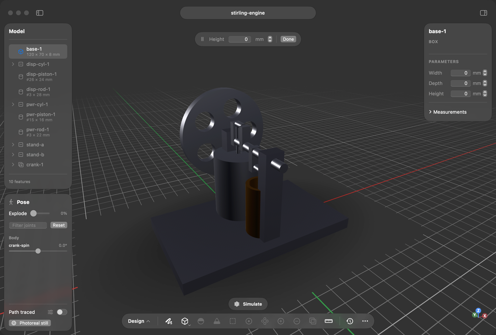

<p align="center">
  
</p>

<h1 align="center">vcad</h1>

<p align="center">
  <b>Free, native CAD for the Mac — with a real kernel and room for your agent.</b><br>
  Close the gap between designed and built, and prove it closed.
</p>

<p align="center">
  <a href="https://vcad.io/desktop/"><b>Download for Mac</b></a>
  &nbsp;·&nbsp;
  <a href="#bring-your-own-agent">Bring your own agent</a>
  &nbsp;·&nbsp;
  <a href="#build-from-source">Build from source</a>
</p>

<p align="center">
  
</p>

vcad is open-source parametric CAD with its own boundary-representation
kernel, written in Rust. It runs entirely on your machine: no account, no
cloud, no subscription. Requires macOS 15 or later.

## Bring your own agent

vcad speaks MCP, so Claude Code, Claude Desktop, Cursor, Codex, or any MCP
client can model, measure, and export real parts.

**Easiest:** install the Mac app. On first launch it finds the agents you have
installed and connects them in one dialog (undo any time in Settings ▸ Agents).

**Without the app**, the same server is on npm and runs locally:

```json
{
  "command": "npx", "args": ["-y", "@vcad/mcp"]
}
```

With Claude Code: `claude mcp add vcad -- npx -y @vcad/mcp`, or install the
plugin (server + the vcad skill, versioned together):
`/plugin marketplace add muni-works/vcad` then `/plugin install vcad@vcad`.

The running Mac app also serves MCP on `127.0.0.1` (one file per instance in `~/.vcad/instances/`),
so an agent can drive the same view you are looking at. Tools and protocol
details: [packages/mcp/README.md](packages/mcp/README.md).

## What's inside

- **A real BRep kernel** — half-edge topology; planes, cylinders, cones,
  spheres, tori, and NURBS; booleans on exact (Shewchuk) predicates; fillets
  and chamfers; shell; sweep and loft. ([`crates/`](crates))
- **Sketches that solve** — a Levenberg–Marquardt constraint solver for
  coincident, tangent, distance, angle, and the rest.
- **Interchange** — STEP AP214 import and export, STL, GLB, DXF.
- **Assemblies and motion** — mates, joints, forward kinematics, and
  articulated physics with a gym-style interface for RL.
- **Drawings** — orthographic, section, and detail views with dimensions and
  GD&T.
- **Making things** — 2.5D CAM with G-code post and stock simulation, sheet
  metal flat patterns, DFM checks, and PCB layout through fab-ready output.
- **Analysis** — structural FEA, tolerance stackups, thermal, and more, each
  fail-closed: a result says what it was checked against.
- **loon** — a small Lisp for parametric parts; a `.loon` file goes anywhere a
  `.vcad` does.

## Build from source

vcad depends on two sibling workspaces, `tang` (math) and `phyz` (physics).
Clone both next to vcad first; the default build fails without them.

```bash
git clone git@github.com:ecto/vcad.git
git clone git@github.com:ecto/tang.git
git clone git@github.com:ecto/phyz.git
cd vcad
```

**Mac app** (Xcode command-line tools):

```bash
apple/VcadApp/build-ffi.sh   # kernel static library (release)
apple/VcadApp/bundle.sh      # assembles apple/VcadApp/dist/vcad.app
open apple/VcadApp/dist/vcad.app
```

**Kernel and CLI** — published to crates.io as `vcad`:

```bash
cargo install vcad
vcad export part.vcad part.step   # STL, GLB, or STEP; .loon works too
```

**Development:**

```bash
cargo test --workspace
cargo clippy --workspace -- -D warnings
npm ci && VCAD_WASM_SKIP=1 npm run build --workspaces --if-present
```

[CLAUDE.md](CLAUDE.md) has the full contributor notes (worktrees, the kernel
WASM artifact rule, IR operations, changelog). Release signing and updates:
[docs/mac-release.md](docs/mac-release.md). If you had documents on the
retired vcad.io web editor, download them at
[vcad.io/export](https://vcad.io/export).

## License

[Apache License 2.0](LICENSE) — see [NOTICE](NOTICE). Contributions are
accepted under the same license.
Copyright © 2026 Municipal Robotics Corporation. Users are responsible for
complying with export laws that apply to them; see
[docs/export-controls.md](docs/export-controls.md).
