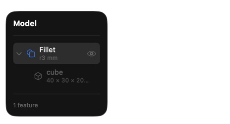
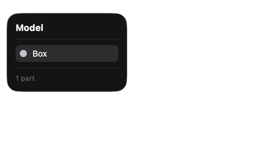
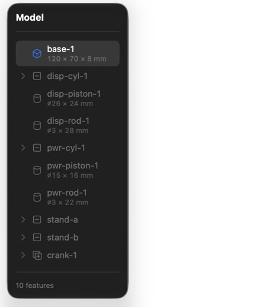
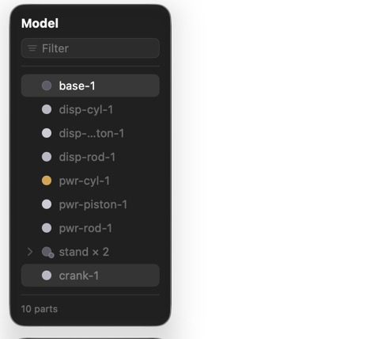
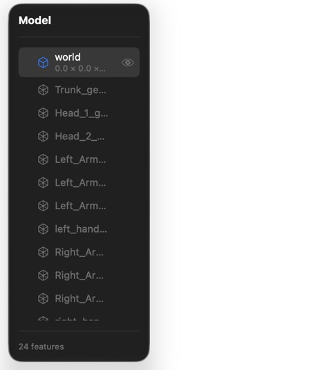
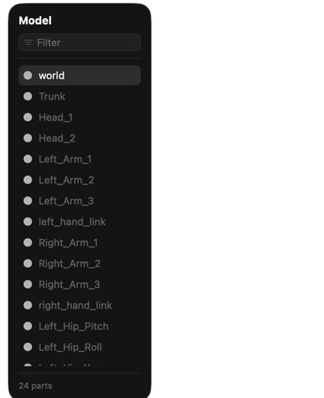
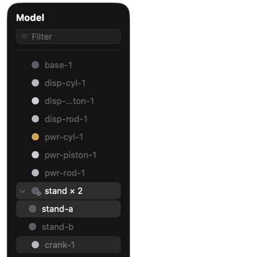

# Model browser (Fusion-style)

The Mac app's left rail lists the document's **parts**, not its DAG.

| | Before | After |
|---|---|---|
| Filleted box |  |  |
| Stirling engine |  |  |
| K1 humanoid |  |  |

Stirling with the `stand × 2` group expanded: 

## Rules

- A root solid is a permanent row, named by `DocumentGraph.partName`: the first
  *descriptive* name walking down the primary-input chain (`left` / `child` /
  `base` / `children[0]`), else the body it started as ("Box"), else "Body".
  Names the app or runtime stamps on operations ("Fillet", "Move", "cube") are
  not descriptive. Duplicates get "Box 2".
- A root that is also a part def's root (K1) takes its instance's name.
- Repeated instances of one part def collapse to "Rotor × 2" and expand into
  their members.
- Sketches sit in a quiet section at the bottom.
- The swatch is the viewport's resolved material. A hidden part is dimmed; its
  eye shows only on hover or when hidden.
- Double-click renames (a part's root node, or the assembly instance).
  ⌥-click isolates. ⌘-click multi-selects. The filter shows once there are
  more than six rows.
- Nothing is computed per hover or select: `featureNodes`/`sketchNodes` are
  built once per rebuild, and rows only read selection/hover state.
