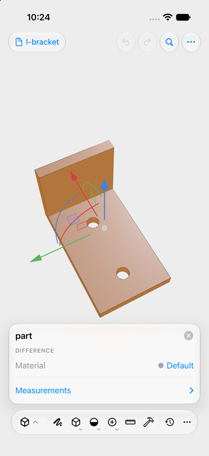
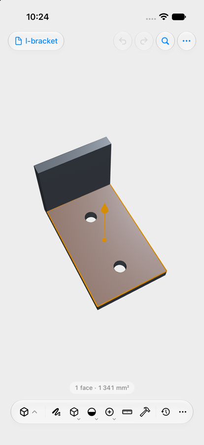
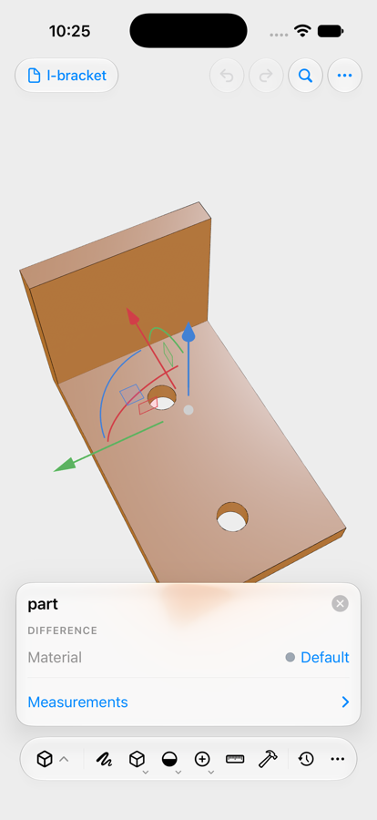
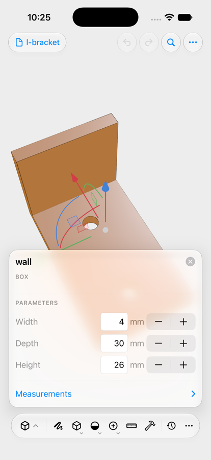
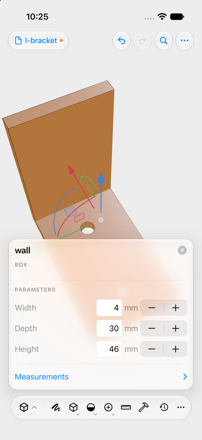
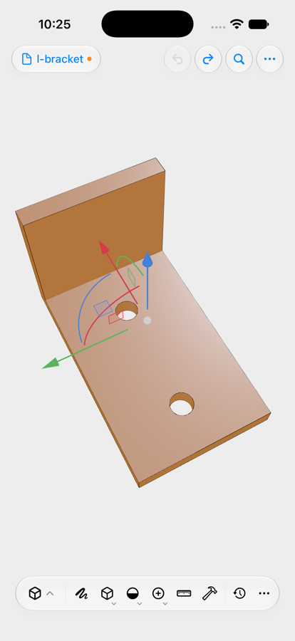
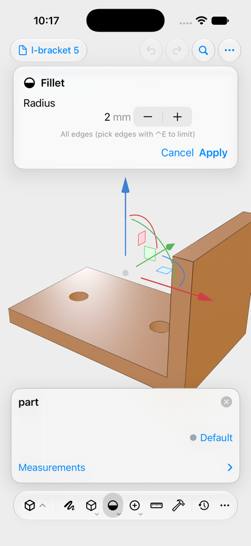
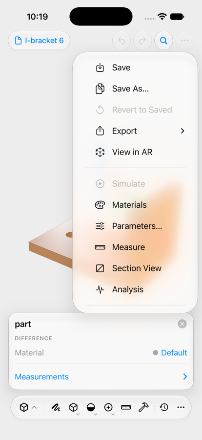
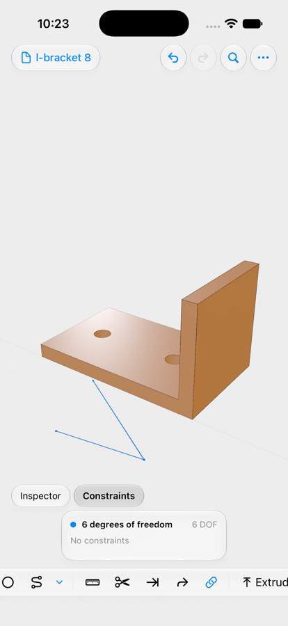

# vcad for iPhone

The full editor on a phone — not a viewer. Same kernel, same document model,
same undo, same panels as the Mac app; a touch viewport and a phone layout on
top.

```bash
./build-ffi.sh                       # kernel → Libs/VcadFFI.xcframework (device + sim, stable Rust)
TARGETS=sim ./build-ffi.sh           # simulator slice only (faster)
./bundle.sh                          # xcodebuild + assemble + install + launch on the iPhone 17 Pro sim
VCAD_OPEN=/abs/path/part.vcad ./bundle.sh   # …and open a document on launch
```

## Layout: the Mac app, squished

The phone runs the Mac's own chrome, not a phone redesign:

- **Bottom: the Mac dock** (`GlassDock`) — workspace picker, Sketch,
  Primitives, Modify, Combine, Measure, Mallet, History, All Tools. Groups
  open as popovers; while sketching it becomes the Mac's sketch bar.
- **Above the dock: the Mac's floating panels** (Object Inspector, model
  navigator, measure, section, analysis, fabricate, joints, pose/simulation,
  sketch constraints) as cards at phone width. One card shows at a time:
  the newest in front, the rest as chips above it. **Selecting something
  opens the inspector**; its × or a tap on empty space closes it.
- **Top: document, undo/redo, Find (the Mac command palette), and ⋯**, the
  Mac's menu bar folded into one menu: Save / Save As / Revert / Export
  (vcad, STL, STEP, GLB) / View in AR · Simulate / Materials / Parameters /
  Measure / Section / Analysis / Describe a Part · Model Navigator /
  Inspector / Select filter / Camera views. Beneath it hang the Mac's
  command panel (Fillet, Shell, …), floating panel, palette and toasts.
- **Viewport touch = the Mac's mouse** (`PhonePick`, a port of the Mac
  overlay's click handler): tap picks a face/edge (Fusion-style, with the
  press-pull arrow and the "1 face · 900 mm²" readout), double tap selects
  the whole body and frames it, long press opens the right-click menu.
  Taps also place armed primitives, finish a Combine, strike with the
  mallet and draw in a sketch. One finger orbits, two pan, pinch zooms.

Shared-code changes for this are iOS-only (`#if os(iOS)`): phone-width
`Theme.Width`, a compact dock slot, `DockSpace.hosted` (no Drawing /
Electronics workspace on iOS), popovers kept as popovers, glass panel
surfaces. The Mac's inspector / simulation panels and the section and
topology-highlight helpers moved verbatim from `ReleasedDesktop.swift`
(Mac-only) to `ReleasedPanels.swift` (shared).

## The loop, in the simulator

`VCAD_PHONE_DEMO=1` walks open → orbit → tap (face) → double tap (body,
inspector opens) → edit a parameter → undo → edit → save through the same
code paths the gestures and buttons call (`EditorModel` orbit,
`PhonePick.tap` / `doubleTap`, the inspector's `editVec`, `undo()`,
`saveDocument()`), logs `[phone-demo]` per step, reads the saved file back
and checks undo survives the save. Screens 09–12 are real touches in the
simulator.

| | | | |
|---|---|---|---|
|  opened |  orbit |  tap picks a face |  double tap: body + inspector |
|  inspector: wall |  height 26→46 |  undo → 26 |  saved (on disk: 36, PASS) |
|  dock ▸ Modify ▸ Fillet |  ⋯ = the menu bar |  navigator + chips |  sketch: bar + taps |

## Ported

- **Kernel** — `vcad-ffi` for `aarch64-apple-ios` / `aarch64-apple-ios-sim`
  (stable Rust, recon/irys-recon included), packaged as an xcframework.
- **Documents** — open `.vcad` / `.loon` / STEP / STL from Files (copied into
  vcad's Files folder and edited there), open-in-place for documents already
  there, Save (atomic `SafeWriter`), Save As (new document in Files), Export a
  Copy… (system exporter, anywhere), bundled samples.
- **Viewport** — parts, pattern instancing, assembly instances + live poses,
  PBR materials, feature edges, selection highlight, gizmo, sketch ink.
  One-finger orbit (with flick coast), two-finger pan, pinch zoom, tap
  face/edge pick, double-tap body select + frame, long-press context menu.
- **Editing** — the Mac dock's Design and Assembly tools (sketch,
  primitives, fillet/chamfer/shell/hole/pattern, combine, measure, mallet,
  history), the command palette, Parameters, Section, the Object Inspector's
  parameter editors, the model navigator, undo/redo, materials, intent bar
  (⋯ ▸ Describe a Part).
- **Analysis / Fab** — DFM, stress, clearance, fields; the Fab workspace
  (sheet metal, print, CAM panels).
- **Simulation** — ⋯ ▸ Simulate: pose studio on jointed assemblies,
  `SimulationWindow` otherwise; playback bar.
- **AR** — View in AR: the part as USDZ (`UsdzExport.swift`) in AR Quick Look.

## Compiled but not exposed on iPhone

These build (sharing is cheaper than stubbing) but have no phone UI and are
never started:

- Local agent / MCP server (`AgentBridge` etc.) — never started; agent
  install/connect probes fail closed (no `Process` on iOS).
- CNC / machine control, Manufacture workspace. The Drawing and
  Electronics workspaces are hidden on iOS (`DockSpace.hosted`) — their
  views are Mac-only.
- Path tracer engine (`PathTracer.swift`; its NSView viewport is Mac-only).

## Left out / stubbed

- **Excluded files** (`Package.swift`): Mac `@main`, Sparkle updater,
  `ReleasedDesktop` (Mac window + NSView viewport — replaced by the phone
  viewport), `WelcomeWindow`, `WindowDragRegion`, `FieldsSnapshots`, dev
  smoke harnesses.
- **Compressed field overlays** — `libtang_compress_ffi` isn't built for iOS;
  loading a `.tc` field reports that instead of decoding.
- **Live loon reload** — no FSEvents on iOS; loon documents open but don't
  watch the file.
- **Desktop-only panels** — CNC file pickers, Gerber export folder, video
  export, photo import, crash-report prompt: their modal panels report
  Cancel on iOS.
- **Render gate** — the Mac pauses RealityKit when idle; the phone viewport
  renders continuously (battery follow-up).

## Known issues (found in the simulator run)

- **Body selection highlight** (the orange emissive lift) doesn't show;
  face/edge picks do highlight, and the gizmo marks a selected body.
- **No gizmo drag**: one-finger drags orbit; the transform gizmo's handles
  aren't grabbable yet (the Mac drives them from its mouse overlay).
- **No Compass** (views live in ⋯ ▸ Camera) and keyboard hints in a few
  panels (e.g. Fillet's "pick edges with ⌃E") still read like the Mac.
- **No ink edges** on runtime-evaluated documents (ribbon edges only show
  for documents that carry `scene.edges`; the Metal toolchain for the
  screen-space edge shader wasn't available to bundle `vcad.metallib`).
- **Touch-tested in the simulator** (tap, double tap, dock, menus, cards,
  sketch); pinch and two-finger pan only through their model calls — the
  simulator tool has no multi-touch.

## Open decisions (not made here)

- **Distribution.** An iPhone app ships through TestFlight / the App Store;
  the Mac app ships outside the store (DMG + Sparkle). Which channel, and
  under which account, is undecided.
- **Signing.** Device builds need an iOS distribution certificate and a
  provisioning profile for `io.vcad.phone`. `bundle.sh` only ad-hoc signs
  for the simulator.

## Known state of the visionOS target

`apple/VcadVision` was already red on `main` before this work (its 16-file
shared subset no longer covers what `Editor.swift` references, e.g.
`EditorModel.documentBytes`, `CNCWorkspace`) and isn't built in CI. The
iPhone target takes the whole-tree approach instead; moving Vision onto it is
a follow-up.
