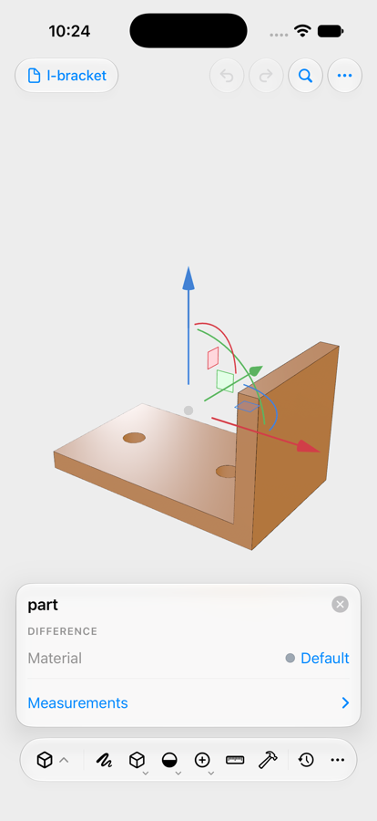
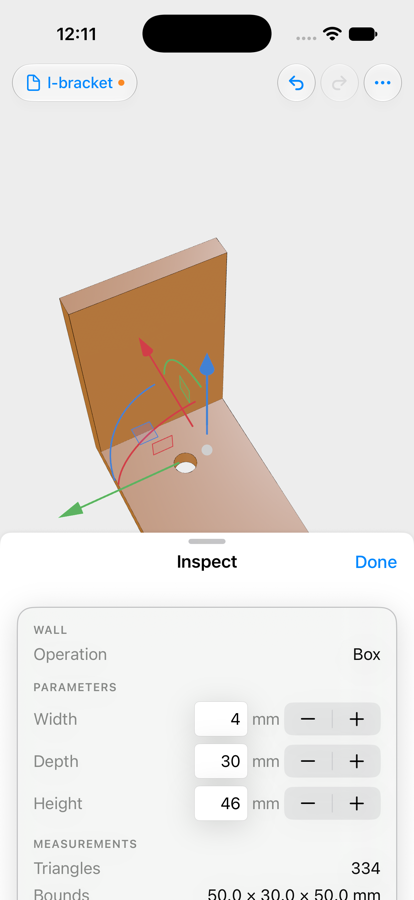
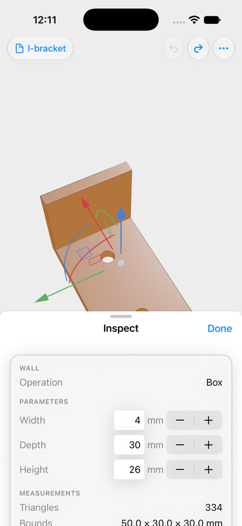
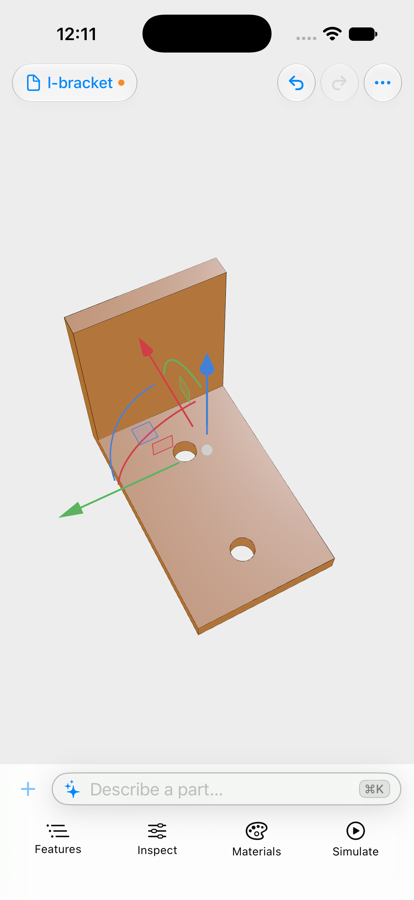

# vcad for iPhone

The full editor on a phone — not a viewer. Same kernel, same document model,
same undo, same panels as the Mac app; a touch viewport and a phone layout on
top.

```bash
./build-ffi.sh                       # kernel → Libs/VcadFFI.xcframework (device + sim, stable Rust)
TARGETS=sim ./build-ffi.sh           # simulator slice only (faster)
./bundle.sh                          # xcodebuild + assemble + install + launch on the iPhone 17 Pro sim
VCAD_OPEN=/abs/path/part.vcad ./bundle.sh   # …and open a document on launch
```

## The loop, in the simulator

`VCAD_PHONE_DEMO=1` walks open → orbit → tap-select → edit a parameter →
undo → edit → save through the same code paths the gestures and buttons call
(`EditorModel` orbit, the viewport's ARView hit test, the inspector's
`editVec`, `undo()`, `saveDocument()`), logs `[phone-demo]` per step and
reads the saved file back, then checks undo survives the save. It does **not** synthesize touches.

| | | | |
|---|---|---|---|
|  opened |  orbit |  tap-select |  Inspect |
|  height 26→46 |  undo → 26 |  height → 36 |  saved (on disk: 36, PASS) |

## How it's built

`Sources/VcadPhone/App` is a symlink to `../VcadApp/Sources/VcadApp` — the
**whole** Mac source tree compiles for iOS, minus a short exclude list in
`Package.swift`. The Mac stays the single source of truth; the phone adds:

| File | What it is |
| --- | --- |
| `PlatformShims.swift` | AppKit spellings over UIKit (`NSColor`, `NSImage`, `NSRect`, `NSCursor` no-ops, `NSEvent.modifierFlags`, `NSWorkspace`, `NSPasteboard`, `NSBitmapImageRep`, modal panels that report Cancel, a `Process` that can't launch, …) so shared files stay word-for-word |
| `PhoneViewportController.swift` | the phone's `ReleaseWindowController` — same API the shared code calls on the Mac's viewport controller (ARView, centering entity, in-place mesh swap, selection repaint, framing, picking/projection) |
| `PhoneViewport.swift` | non-AR RealityKit `ARView` + touch gestures, built from the shared scene builders |
| `PhoneRootView.swift` | phone layout: viewport, top bar (document, undo/redo, save), intent bar, Features / Inspect / Materials / Simulate sheets, long-press context actions |
| `PhoneDocuments.swift`, `PhoneDocumentFlow.swift` | Files-app open/save, Export a Copy, AR Quick Look; phone versions of the Mac's `openPanel` / `saveAsPanel` / `exportUSDZPanel` |

Shared files guard only genuinely Mac-only behaviour with `#if os(macOS)`
(mouse/keyboard monitors, NSWindow plumbing, AppKit drawing). Where the
existing visionOS-era guards excluded things the phone can use (joint drag,
playable machines, Save As), they became `#if os(macOS) || os(iOS)`.

## Ported

- **Kernel** — `vcad-ffi` for `aarch64-apple-ios` / `aarch64-apple-ios-sim`
  (stable Rust, recon/irys-recon included), packaged as an xcframework.
- **Documents** — open `.vcad` / `.loon` / STEP / STL from Files (copied into
  vcad's Files folder and edited there), open-in-place for documents already
  there, Save (atomic `SafeWriter`), Save As (new document in Files), Export a
  Copy… (system exporter, anywhere), bundled samples.
- **Viewport** — parts, pattern instancing, assembly instances + live poses,
  PBR materials, feature edges, selection highlight, gizmo, sketch ink.
  One-finger orbit (with flick coast), two-finger pan, pinch zoom, tap
  select, double-tap frame, long-press context menu (edit, frame, isolate,
  hide, add to selection, delete).
- **Editing** — feature tree, add primitives, feature parameter editors,
  document parameters, rename/delete, undo/redo (the document runtime's
  history), materials (swatch grid), intent bar (natural-language edits).
- **Simulation** — `SimInspector` (physics episodes), playback bar.
- **AR** — View in AR: the part as USDZ (`UsdzExport.swift`) in AR Quick Look.

## Compiled but not exposed on iPhone

These build (sharing is cheaper than stubbing) but have no phone UI and are
never started:

- Local agent / MCP server (`AgentBridge` etc.) — never started; agent
  install/connect probes fail closed (no `Process` on iOS).
- CNC / machine control, Manufacture workspace, electronics workspace,
  drawing exports.
- Path tracer engine (`PathTracer.swift`; its NSView viewport is Mac-only).

## Left out / stubbed

- **Excluded files** (`Package.swift`): Mac `@main`, Sparkle updater,
  `ReleasedDesktop` (Mac window + NSView viewport — replaced by the phone
  viewport), `WelcomeWindow`, `WindowDragRegion`, `FieldsSnapshots`, dev
  smoke harnesses.
- **Compressed field overlays** — `libtang_compress_ffi` isn't built for iOS;
  loading a `.tc` field reports that instead of decoding.
- **Live loon reload** — no FSEvents on iOS; loon documents open but don't
  watch the file.
- **Desktop-only panels** — CNC file pickers, Gerber export folder, video
  export, photo import, crash-report prompt: their modal panels report
  Cancel on iOS.
- **Render gate** — the Mac pauses RealityKit when idle; the phone viewport
  renders continuously (battery follow-up).

## Known issues (found in the simulator run)

- **Selection highlight isn't visible** in the tap-select frame: the pick
  resolves and selects the part, but the orange emissive lift doesn't show.
- **No ink edges** on runtime-evaluated documents (ribbon edges only show
  for documents that carry `scene.edges`; the Metal toolchain for the
  screen-space edge shader wasn't available to bundle `vcad.metallib`).
- **Gesture recognizers not touch-tested.** Simulator-panel access wasn't
  granted during this run, so orbit/pan/pinch/tap/long-press were exercised
  through their model calls, not real touches.

## Open decisions (not made here)

- **Distribution.** An iPhone app ships through TestFlight / the App Store;
  the Mac app ships outside the store (DMG + Sparkle). Which channel, and
  under which account, is undecided.
- **Signing.** Device builds need an iOS distribution certificate and a
  provisioning profile for `io.vcad.phone`. `bundle.sh` only ad-hoc signs
  for the simulator.

## Known state of the visionOS target

`apple/VcadVision` was already red on `main` before this work (its 16-file
shared subset no longer covers what `Editor.swift` references, e.g.
`EditorModel.documentBytes`, `CNCWorkspace`) and isn't built in CI. The
iPhone target takes the whole-tree approach instead; moving Vision onto it is
a follow-up.
