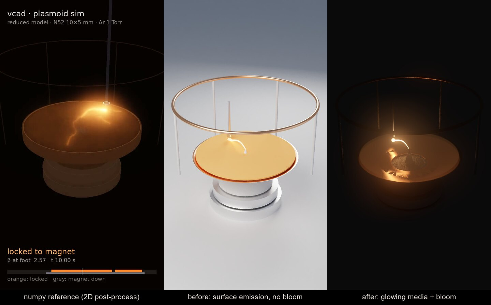

# Glow in the photoreal renderer

Demo and evidence for glowing media and HDR bloom (`vcad-kernel-raytrace::medium`,
`vcad-render::glow`). Feature docs: `packages/docs/content/architecture/kernel-features.mdx`
§ "Glowing Media and Bloom".



| file | what |
| --- | --- |
| `plasmoid-glow.loon` | the racing-plasmoid dish (geometry from `docs/plasmoid-sim/plasmoid-dish.loon`, PR #1198) with filament, foot and glow sheet as `material-glow` media |
| `after.jpg` | media + `--bloom 0.25 --bloom-radius 0.06 --tonemap exp --lighting dark`, 1024 spp |
| `after-no-bloom.jpg` | same media, ACES, no bloom, 512 spp — the physically based part alone |
| `before.jpg` | the same document with the plasma as *surface* emitters (`emissive`), studio rig, no bloom — the best vcad could do before |
| `comparison.jpg` | numpy reference (`docs/plasmoid-sim/render.py`, poster frame) · before · after |

Reproduce:

```bash
cargo build --release -p vcad-render -p vcad-loon --example loon2vcad
target/release/examples/loon2vcad docs/glow/plasmoid-glow.loon > plasmoid-glow.vcad
target/release/vcad-render plasmoid-glow.vcad --photoreal --lighting dark --backdrop none \
  --bloom 0.25 --bloom-radius 0.06 --tonemap exp --spp 1024 --size 720x1280 \
  --fill 0.85 --view orbit:-90,28 --jpeg after.jpg
```

## Physically based vs. post-process

**Physically based (path-traced):** the medium's emission and absorption
(emission–absorption radiative transfer, `L = (ε/κ)(1 − e^{−κL})`), its depth and
occlusion (the spike hides the filament), the light it casts on the dish and the
copper bowl's reflection of it — all along camera *and* bounce rays.
`tests/emissive_medium.rs` pins slab / absorbing slab / oblique chord / wall /
soft edge to the analytic answer within 0.1–0.7 %.

**Post-process (a look):** the halo. `--bloom` is an energy-conserving glare PSF
(total radiance preserved to rounding — tested), standing in for lens and sensor
scatter; `--tonemap exp` is a display curve. The reference image is *all*
post-process: its filament, glow and halo are drawn in 2-D.

**Stylised in both:** the filament's shape. The reduced plasmoid model has no
filament geometry, so `plasmoid-glow.loon` draws the same arch `render.py` does.

## Known limits

- Bounce light from a medium is BSDF-sampled only (kosm does not importance-sample
  a splat field), so the dish near the filament is noisier than under an area light;
  the denoiser smooths it into soft blotches at low spp.
- No scattering (right for an optically thin plasma, wrong for fog).
- CPU integrator only: `--gpu` refuses media; `vcad render --photoreal` and the app
  route to the CPU. `--animate` refuses media. A transparent PNG refuses media and bloom.
