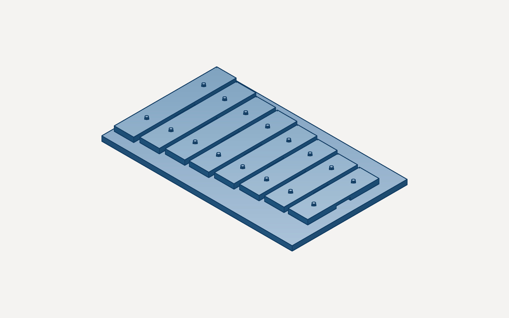
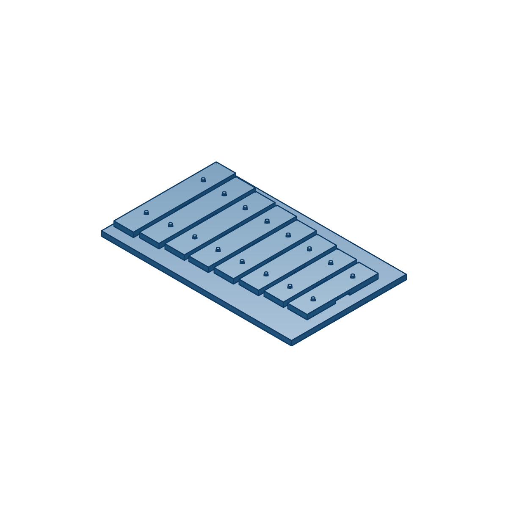
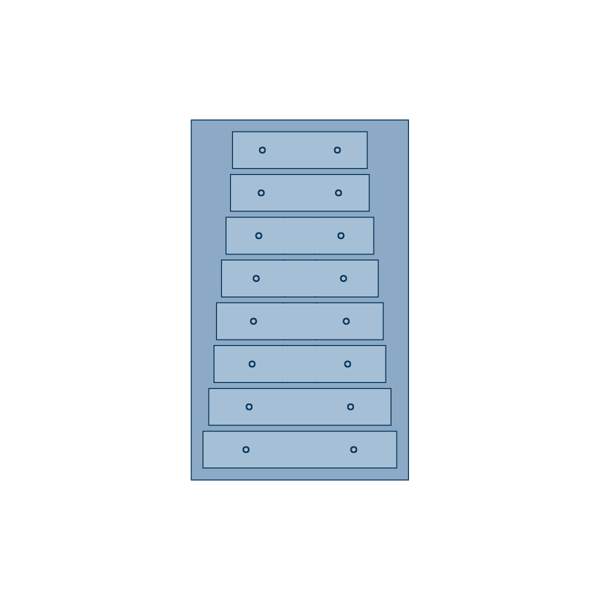
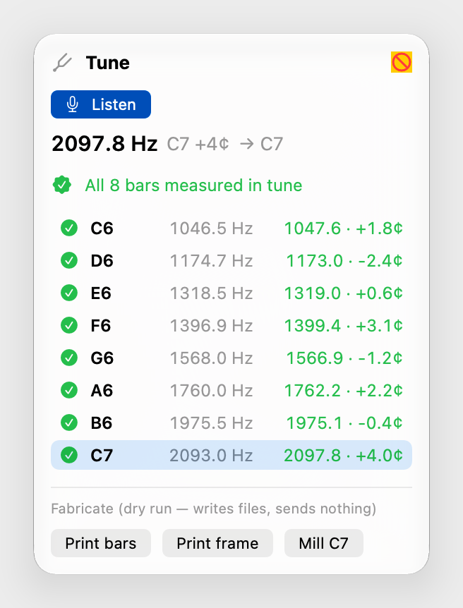
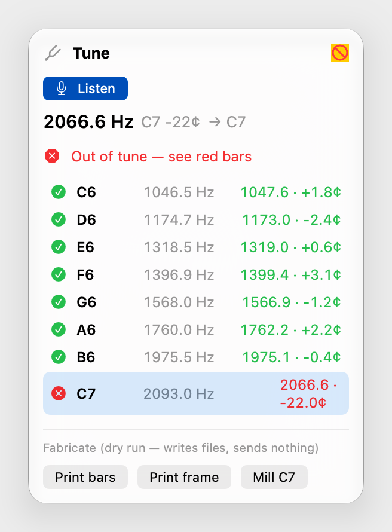

# vcad 1.0 hero demo: a glockenspiel whose pitch comes from the kernel

> **"Make me a glockenspiel in C major I can print or mill."**

The agent asks for one tool call. vcad designs eight bars whose pitch comes from physics: a free-free beam FEM predicts each bar's modes, and Newton tunes its length and undercut until it rings within a hundredth of a cent of the note. It lays the bars on a frame with pegs at their nodal points. Every bar carries a receipt claim, **"C6 · 1046.5 Hz predicted"**. You print or mill the set, strike a real bar, and vcad.app hears it through the microphone. The receipt flips from *predicted* to *measured*, showing the cent error.



## The run

Everything below is reproducible from one script, which drives the native Rust MCP server (`vcad-mcp`) over stdio the way an agent does:

```bash
cargo build --release -p vcad-mcp -p vcad-ffi --example instrument_fab
```

```bash
node examples/glockenspiel/hero/run.mjs target aluminium_6061
```

Actual output (mew, release build):

```
> Make me a glockenspiel in C major I can print or mill. (aluminium_6061)
design_instrument → doc_2_hXxH0RD3mUllkVTx, receipt provisional
note   target Hz  predicted Hz   cents   length  undercut  f2/f1
C6      1046.50       1046.50   0.003   131.3     2.74  4.000
D6      1174.66       1174.66   0.004   123.7     2.75  4.000
E6      1318.51       1318.51   0.005   116.5     2.76  4.000
F6      1396.91       1396.92   0.005   113.0     2.77  4.000
G6      1567.98       1567.99   0.006   106.4     2.78  4.000
A6      1760.00       1760.01   0.008   100.1     2.79  4.000
B6      1975.53       1975.54   0.010    94.2     2.81  4.000
C7      2093.00       2093.00  -0.000    91.3     2.82  4.000

fab dry runs (files only):
print bars  → out/bars-plate.gcode   (191409 lines, fits P1S bed: true, 103 min est.)
print frame → out/frame-plate.gcode  (397374 lines, fits P1S bed: true, 130 min est.)
mill  C6   → bar_c6-setup1.nc (2365 lines), bar_c6-setup2.nc (205 lines)
…
mill  C7   → bar_c7-setup1.nc (2365 lines), bar_c7-setup2.nc (184 lines)
```

`design_instrument` took 3.4 s, including all eight tunings and the loon→IR evaluation of the nine-part assembly. Artifacts from that run are committed next to this doc: [`glockenspiel.vcad`](hero-demo/glockenspiel.vcad), [`receipt.json`](hero-demo/receipt.json) and the call-by-call [`transcript.json`](hero-demo/transcript.json).

| | |
|---|---|
|  |  |

## 1. Kernel and tools

**Solver** (`crates/vcad-kernel-acoustics/src/instrument.rs`):

- A Hermite-beam FEM on a non-uniform mesh with breakpoints at the undercut walls and hole edges, with section properties that vary in both thickness and width.
- Rotary inertia in the mass matrix, and a first-order Timoshenko shear correction per mode, read from the FEM's own `EI·w‴`. On these 6 mm bars that correction is ~1% (≈17 cents), so it is always on.
- Eigenpairs from shifted subspace iteration with a banded Cholesky.

**Tuning:** Newton on `[ln(f₁/f_t), ln((f₂/f₁)/4)]` over `(ln L, d/t)`, with a central-difference Jacobian through the FEM. The peg holes follow the fundamental's nodes between iterates. It converges in 4–5 iterations.

**Undercut choice:** a central 0.2·L pocket, because mode 2 has a node at the centre (zero curvature there). That pocket drops f₁ while barely touching f₂ and reaches 4:1 at ~45% depth. A 0.5·L pocket can't get past 3.3:1 (see `examples/undercut_scan.rs`).

**Cross-checks** (unit tests):

- With the undercut, holes and corrections off, the FEM matches the closed-form free-free roots to < 0.01 cent and the 0.2242·L nodes.
- It agrees with the existing hole-aware `strike` FEM to < 0.5 cent.
- The shear plus rotary correction matches the analytic first-order Timoshenko factor within 25% of the correction.

**What isn't modelled:** vcad has no 3-D modal FEA (`vcad-kernel-fea` is static), so torsional and in-plane modes are not computed. The tuner flags bars wider than 30% of their length, and stubby bars.

**MCP tools** (native Rust, `crates/vcad-mcp/src/tools/instrument.rs`):

| tool | does |
|---|---|
| `design_bar` | one bar for a note or Hz, in aluminium_6061 / brass / pla, with optional ratio, span, hole and tolerance. Returns geometry, nodes, modes, Newton history, and a `predicted` claim |
| `design_instrument` | a major-scale set plus frame as a session document. Writes `Document.instrument` (one claim per bar), resonator lengths, print plates and per-bar CAM jobs |
| `record_strike` | a measured Hz is matched to a bar (nearest within 60 cents, or by note) and committed as one undo step. That bar's claim becomes `measured` |
| `instrument_receipt` | per-bar state plus the unified receipt |

**Receipts:** while any bar is only predicted, the receipt is **Provisional** (`ClaimBasis::Predicted` never passes). Once every bar is measured inside ±5 cents it rolls up **Pass**. One bar outside the tolerance makes it **Fail**.

## 2. Measurement: the Tune panel

**Fabricate › Tune Instrument (Microphone)** (⌥⌘T) opens the panel in the right rail (`apple/VcadApp/Sources/VcadApp/TunePanel.swift`).

**Listening:** **Listen** asks for microphone access the system way (`AVCaptureDevice.requestAccess`; `NSMicrophoneUsageDescription` in Info.plist; `com.apple.security.device.audio-input` in the hardened-runtime entitlements). It then taps `AVAudioEngine`'s input node.

**Detecting a strike** (`PitchDetector.swift`):

- `StrikeDetector` treats an onset as a block-RMS jump over both the noise floor and the previous block, so a ring-down can't re-trigger it.
- Analysis starts 20 ms after the onset, to skip the mallet click, and takes 8192 samples (Hann window, zero-padded ×2, vDSP FFT).
- It picks the *lowest* spectral peak within 20 dB of the strongest, because a tuned bar's two-octave overtone can out-ring the fundamental, then refines it with parabolic interpolation on the log spectrum. On a pure tone it lands within 0.1 cent.

**Recording:** the detected pitch is matched to the nearest bar and recorded through the kernel (`vcad_instrument_call` `record`, the same Rust as `record_strike`), as one named undo step, "Tune C6". The row turns green or red with the cent error.

| before (all predicted) | after striking all eight | one bar filed 22 cents flat |
|---|---|---|
|  |  |  |

The screenshots are rendered by `TuneFlowTests`:

```bash
VCAD_TUNE_SNAPSHOT=docs/launch/hero-demo swift test --filter TuneFlowTests
```

That test opens the committed `glockenspiel.vcad`, synthesizes strike audio for every bar (fundamental plus a louder 4× overtone plus noise, each a few cents off), and runs it through the live `StrikeDetector` → `TuneStore.heard` → kernel path. The 🚫 in the panel's corner is SwiftUI `ImageRenderer` standing in for the AppKit-backed close button. **These are rendered views, not a screen recording, and no real bar has been struck yet.** The first physical strike is the step left for Cam (see "Not done").

## 3. Fabrication (dry runs only)

Nothing is ever sent to a printer or a mill: both paths write files.

**Print:** the existing print flow (`vcad_print_call` slice). The **Print bars** and **Print frame** buttons slice one plate each for a Bambu P1S and write G-code. Both plates fit the 256 mm bed: the frame is 155 × 244 mm, which is why bar pitch is 29 mm. Bars print undercut-down, so the 0.2·L pocket is a short bridge. For a printed (PLA) instrument, use `material: "pla"`. It rings briefly, which is fine for a toy, and the default 6 mm PLA bars are stubby above C6, so start at C5.

**Mill:** 6061 plate of bar thickness, Grbl post, two setups per bar (`vcad_cam_job`):

1. Ø3.175 1F: circle-pocket the peg holes, then profile the outline with two tabs.
2. Bar flipped in soft jaws, Ø6 2F: pocket the undercut across the full width.

Both go through the kernel's stock-sim verification, and **Mill <bar>** writes the `.nc` files.

## 4. Tests

| what | where |
|---|---|
| solver vs analytic free-free frequencies, nodes, Timoshenko, `strike` FEM | `vcad-kernel-acoustics` `instrument::tests` (12) |
| tuning convergence (C6/G6/C7 in Al with ratio; A5 in all three materials) | `tuning_converges_to_target_and_ratio`, `plain_tuning_for_every_material` |
| receipt transitions predicted → measured pass / fail | `instrument::tests::receipt_transitions_predicted_to_measured`, `instrument_doc::tests` (3), FFI `record_flips_receipt`, MCP `instrument_round_trip_predicted_to_measured` |
| fab dry runs write sliceable / verified G-code | FFI `mill_dry_run_writes_verified_gcode`, `print_dry_run_slices_both_plates` |
| metadata survives the app's CRDT engine | `vcad-app` `tuned_instrument_metadata_survives_the_crdt_round_trip` |
| pitch detector on synthetic tones / struck bars / noise; strike segmentation | `TuneTests` (7) |
| end-to-end strike → receipt in the app | `TuneFlowTests` |

## Not done / next

- **A real strike.** The loop has only been closed on synthetic audio. The first physical bar (milled or printed) still needs to be struck at the Mac, and the predicted-versus-measured error recorded here. The glockenspiel precedent (laser-cut C6 bars, −5 cents) suggests what to expect: a few cents, dominated by material E and thickness tolerance.
- **No 3-D modal cross-check** until `vcad-kernel-fea` grows an eigen solve.
- **Resonators** are reported as closed-tube lengths (`resonator_mm`, 74 → 33 mm at a 25 mm bore), not modelled as geometry.
- **Tuning uses finite differences,** not `vcad-kernel-diff`. That crate differentiates frozen tessellations for mass properties, not beam eigenvalues. An exact eigen-sensitivity `dλ = φᵀ(dK − λ dM)φ` would be the natural upgrade.

---

## Earlier storyboard (#1062): "an agent designs a part"

Kept verbatim below; the glockenspiel above is the vcad 1.0 hero.

### Hero demo — "an agent designs a part" (~60 s)

One continuous screen capture of the native Mac app with Claude connected over
the app's local MCP bridge (`vcad-app`, Help ▸ Connect Claude…). No cuts inside
a beat; cuts between beats are fine. The long (~3 min, hold-up-the-part) version
in the launch plan builds on the same beats once M2c and CNC are filmable.

Status key: **NOW** = filmable on main today (2026-11-07) · **GAP** = waits on
another lane · **WORKAROUND** = filmable with the noted substitute.

## Storyboard

| t | Beat | On screen | Tools | Status |
|---|---|---|---|---|
| 0–4 s | Cold open | Dock click → vcad up in ~0.7 s, empty viewport. Lower-third: "free · open · local". | — | **NOW** (speed-pass: shell at 0.63–0.79 s) |
| 4–8 s | Connect | Claude Desktop/Code beside the app; prompt typed: *"Design a wall bracket for a 2 kg shelf load, 4 mm aluminum, two M5 screws."* | Help ▸ Connect Claude… (already done off-camera) | **NOW** |
| 8–22 s | Agent models | Bracket appears and refines live in the viewport — base, flange, holes, fillet. Feature tree fills in. Named undo steps appear. | `create_cad_loon` or engine `create`/booleans, `set_parameters`, `set_camera`, `frame_part` | **NOW** (M2a write tools, #1045) |
| 22–30 s | DFM | Agent runs DFM; viewport flags a thin wall in orange; agent applies the fix, wall thickens. | `dfm_check`, `dfm_apply_fix`, `annotate` | **NOW** (M2b, #1051) |
| 30–40 s | FEA | Agent fixes the screw faces, loads the shelf face; von Mises field on the part, max stress + safety factor called out. | `inspect_faces`, `analyze_structure`, `annotate` | **NOW** — but see FEA note |
| 40–52 s | PCB in enclosure | Agent opens an enclosure with a board in it, checks fit, board drops in, clearance passes green. | `open_document`, `check_interference` (+ M2c board tools) | **GAP → M2c**. **WORKAROUND:** open the bundled *PCB axial-flux motor* sample and run `check_interference` between board and rotors (opens in 0.06 s from its baked bundle). |
| 52–58 s | Export | STEP + STL written; Finder window with the files; optionally the path-traced beauty shot. | app File ▸ Export (agent has no export tool on the app bridge) | **WORKAROUND:** export by menu on camera, or use `npx @vcad/mcp` `export_cad` on the saved file. **GAP → M4a** for "send to CNC/print". `photoreal` needs `libirys_ffi.dylib` bundled (not in this build). |
| 58–60 s | End card | "vcad 1.0 — free for Mac. vcad.io" + "Kernel paper: differentiable BRep" | — | **NOW** (paper link once the arXiv id exists) |

## Capture plan

- **Machine:** the dev Mac, display at 1440p scaled, ProMotion on. Hide the
  dock and menu-bar clutter; Do Not Disturb on. Light appearance (renders read
  better on the site).
- **Build:** `BAKE_SAMPLES=1 CONFIG=release apple/VcadApp/bundle.sh` so every
  sample opens warm; clear `~/.cache/vcad` *after* a rehearsal so the agent's
  bracket solves live but nothing else stalls.
- **Recorder:** macOS Screenshot ▸ Record Selected Portion (or `screencapture -v
  -R x,y,w,h out.mov`) at 60 fps; record the app and the Claude window side by
  side (app ⅔, Claude ⅓). One take per beat; keep the raw .movs.
- **Agent:** Claude Desktop with `vcad-app` configured by Connect Claude. Keep a
  rehearsed prompt file per beat so takes are repeatable; the agent's tool calls
  stay visible in the transcript pane (that's the point).
- **Camera:** let the agent drive (`set_camera`, `frame_part`) — no manual
  orbiting during agent beats; manual orbit only in the cold open.
- **Speed:** real time for modeling and DFM; FEA solve may be sped up 2× with an
  on-screen "2×" tag — never hidden.
- **Audio:** none recorded; music + captions in post.

## Gaps by lane

| Gap | Lane | Needed for |
|---|---|---|
| Board placement / fit tools on the app bridge, board renders in enclosure | **M2c electronics** | Beat 40–52 s as written |
| Agent-callable export (`export_cad` on the app bridge) | M2a follow-up | Beat 52–58 s without a menu click |
| Send to CNC / print, flat pattern | **M4a fab** | Long version (part in hand) |
| Insert the bracket into an assembly with the shelf | **M4b assembly** | Optional long-version beat |
| Path tracer bundled (`libirys_ffi.dylib`) | release build | Beauty-shot end frame |
| FEA convergence on thin parts | kernel | Credible stress numbers on camera |

**FEA note.** The M2b lane found the lattice FEA doesn't converge on a plain
100×10×10 cantilever at resolution ≤ 48 (stress Δ ~22–25 %, displacement
non-monotonic). Film the colour field and the safety-factor call-out, but don't
put a precise MPa number on screen until that's fixed — or pick a bracket chunky
enough that two resolutions agree within a few percent, and check before the
take.

## Allowed claims on screen

Free, open, local; no account, no cloud. Speed numbers only from
`docs/launch/speed-pass.md`. Nothing about tang beyond the approved H200
attention claim (416 TFLOP/s, beating PyTorch SDPA from 2k tokens) — and it
doesn't belong in this video.
