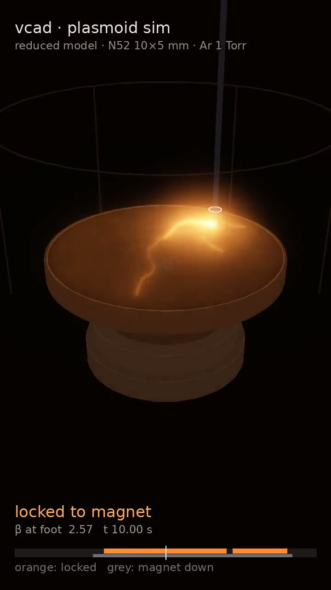
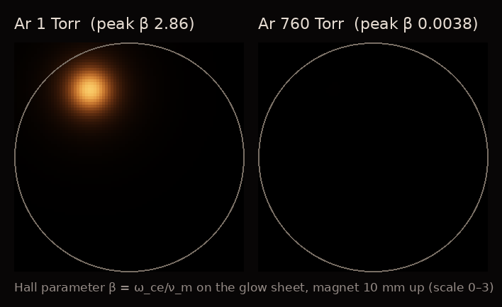
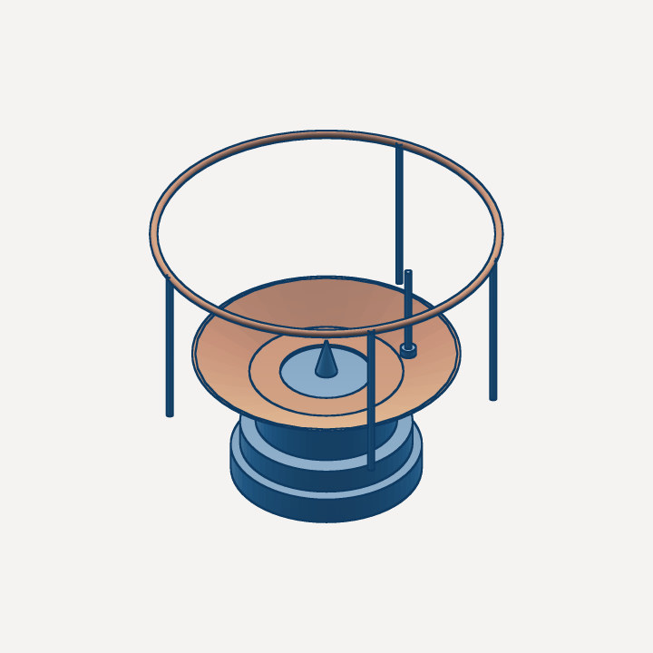
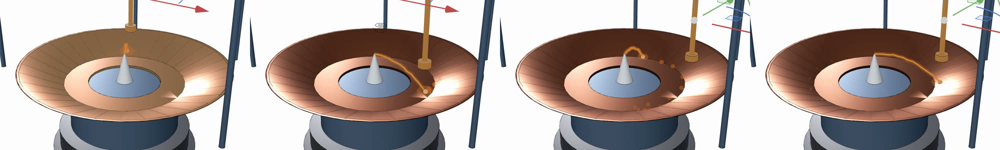
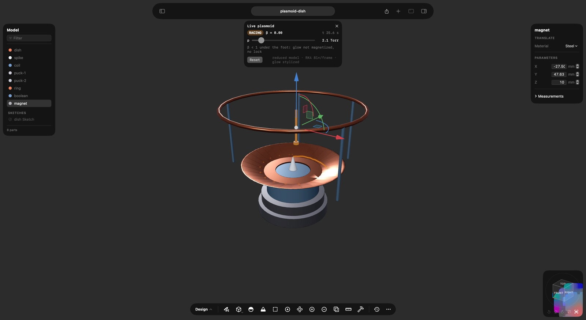

# plasmoid sim: a racing plasmoid locks to a magnet

[](plasmoid-sim/plasmoid.mp4)

The source is a viral clip. A glowing orange-white disc sits on a dish electrode on top of a stacked HV driver, with a pickup ring above. A filament races around the dish. Bring a small neodymium magnet close and the filament's foot pins under the magnet and follows it "like it's on rails".

This doc covers:

- what is probably going on physically;
- the simplest model that reproduces it;
- what vcad already had for it and what was missing;
- a first animated version;
- the work needed to make it a first-class vcad capability.

**Files**

| what | where |
|---|---|
| model + tests | [`crates/vcad-kernel-particle/src/plasmoid.rs`](../crates/vcad-kernel-particle/src/plasmoid.rs) |
| the clip, as a document | [`plasmoid-sim/plasmoid-clip.loon`](plasmoid-sim/plasmoid-clip.loon) (+ [`.vcad`](plasmoid-sim/plasmoid-clip.vcad)): device, sim parameters, plasma media, magnet choreography as the `timeline` |
| timeline → sim → frames | [`crates/vcad-render/src/plasmoid.rs`](../crates/vcad-render/src/plasmoid.rs) (`vcad-render --sim plasmoid`), test [`tests/plasmoid_timeline.rs`](../crates/vcad-render/tests/plasmoid_timeline.rs) |
| model numbers + β map | [`examples/plasmoid_magnet.rs`](../crates/vcad-kernel-particle/examples/plasmoid_magnet.rs) |
| device geometry | [`plasmoid-sim/plasmoid-device.loon`](plasmoid-sim/plasmoid-device.loon) (a loon module), used by [`plasmoid-dish.loon`](plasmoid-sim/plasmoid-dish.loon) (+ [`.vcad`](plasmoid-sim/plasmoid-dish.vcad) for the app) and the clip |
| live drag demo (vcad.app) | [`PlasmoidSim.swift`](../apple/VcadApp/Sources/VcadApp/PlasmoidSim.swift), FFI [`crates/vcad-ffi/src/plasmoid.rs`](../crates/vcad-ffi/src/plasmoid.rs), §3b |
| figures | [`figures.py`](plasmoid-sim/figures.py) (numpy + PIL) |

Reproduce on a build box (the clip is entirely vcad: loon → IR → path tracer; ffmpeg only muxes the frames and burns in the HUD):

```bash
cargo build --release -p vcad-render@0.11.0 -p vcad-loon --example loon2vcad
cd docs/plasmoid-sim
../../target/release/examples/loon2vcad plasmoid-clip.loon > plasmoid-clip.vcad
../../target/release/examples/loon2vcad plasmoid-dish.loon > plasmoid-dish.vcad
# 600 frames; --resume picks up an interrupted run, the sim always runs whole
../../target/release/vcad-render plasmoid-clip.vcad --photoreal --animate --sim plasmoid \
  --lighting dark --backdrop none --bloom 0.25 --bloom-radius 0.06 --tonemap exp \
  --spp 32 --max-depth 4 --size 720x1280 --fill 0.85 --view orbit:-90,28 -o /tmp/clip --mp4 plasmoid.mp4
cargo run --release -p vcad-kernel-particle --example plasmoid_magnet -- /tmp/clip   # beta_map.csv
python3 figures.py /tmp/clip .        # reads the trajectory.csv the render wrote
../../target/release/vcad-render plasmoid-dish.vcad --jpeg device.jpg --size 720
```

## 1. Physics triage

**What the device probably is.** This is a hypothesis built from one still frame. It looks like a solid-state Tesla coil or RF resonator, with its top load replaced by a shallow dish and a central spike. The diffuse disc glow and the glassy spike suggest a low-pressure envelope (an RF glow), not an open-air streamer. Dimensions in the loon model are scaled by eye from the hand.

**Why "Lorentz force on the current channel" is the wrong story.** The drive is RF, so the filament current reverses every half-cycle. In the static field of a magnet, `I·L×B` therefore averages to zero over a cycle. A naive "J×B drags the arc" model would only work for DC arcs, such as rail-arc and magnetically rotated arc devices. It cannot explain an RF filament that locks steadily.

**What does survive time-averaging:**

1. **Magnetized electron transport.** The electron Hall parameter is `β = ω_ce / ν_m`. Where β ≳ 1, cross-field diffusion drops as `1/(1+β²)`. Electrons stay longer, so the same RF power ionizes more there. The discharge prefers regions of strong |B|, which is the magnetron and magnetized-RF-plasma effect.
   - Under a 10 × 5 mm N52 disc held 10 mm above the dish (8 mm above the glow sheet), |B| = 61 mT.
   - In argon at 1 Torr (ν_m ≈ 3.7×10⁹ s⁻¹), that gives **β ≈ 2.9**: strongly magnetized.
   - At 1 atm (ν_m ≈ 2.8×10¹² s⁻¹), it gives **β ≈ 0.004**: no effect.

   

2. **The rectified sheath field.** An RF sheath has a time-averaged DC field pointing into the electrode. Crossed with the magnet's horizontal field, it gives an E×B drift that does not average out. It swirls the locked foot around the magnet's axis, and its handedness flips with magnet polarity.

**The boring alternative, stated honestly.** NdFeB magnets are nickel-plated conductors. Any metal object brought near an RF HV electrode attracts the discharge through field enhancement and capacitive coupling. The clip alone cannot tell "magnetized plasma" apart from "a metal thing on a stick". Two experiments would separate them:

- repeat the demo with a same-size non-magnetic metal slug (aluminum or brass);
- repeat it with the magnet in a thick plastic sleeve.

If the effect is magnetic, it needs low pressure and shows up with a ceramic or sleeved magnet. If it is electrostatic, the aluminum slug does the same thing.

**Candidate models:**

| model | verdict |
|---|---|
| reduced foot/quasi-particle in the magnet field, drive + magnetized-transport pull + E×B sense | **chosen.** Smallest model that circulates, locks, follows and releases, with an analytic lock threshold |
| 2D drift-diffusion fluid on the dish (anisotropic magnetized mobility, RF-heated ionization source) | next step. Would *derive* the pull instead of fitting it (gap #4) |
| particle-in-cell (PIC) / Monte Carlo collisions (MCC) | overkill for the visual. Needed only for quantitative sheath and ionization numbers |

## 2. Model (`vcad_kernel_particle::plasmoid`)

### Real physics (derived, tested against closed forms)

- **`DiscMagnet`: an axially magnetized cylinder.**
  - It is *exactly* a solenoidal bound-current sheet, `K = (B_r/μ0) φ̂`. It is built as a stack of coaxial loops using the crate's existing exact elliptic-integral loop field (`field::b_ring`).
  - Tests:
    - on-axis field matches the closed-form solid-cylinder result to < 0.2 %;
    - far field matches a point dipole `m = B_r V / μ0` to < 1 %.
- **`MagnetPose`: places the magnet anywhere in 3D**, with any orientation. This was missing: the existing `FieldMap` is coaxial-only.
- **`collision_frequency` / `hall_parameter`:** `ν = n σ v̄` and `β = e|B| / (m_e ν)`. The pressure-dependence test asserts β > 1 at 1 Torr and β < 0.05 at 1 atm.

### Phenomenological (fit parameters, not derived)

The filament's foot on the dish is an overdamped quasi-particle:

```text
dx/dt = v_race φ̂ + k (r0 − r) r̂             racing ionization wave + preferred radius
      + μ ∇Φ,   Φ = ln(1 + β²)               pull toward lower electron loss
      + v_spin · β²/(1+β²) · unit(−ẑ × B)    rectified-sheath E×B sense
```

| parameter | value | status |
|---|---|---|
| `v_race` | 0.6 m/s (≈ 1.7 rev/s at r0 = 55 mm) | fit, read off the clip by eye |
| `r0`, `k` | 55 mm, 3 s⁻¹ | fit |
| `μ` | 1.8 × μ* = 5.3×10⁻³ m²/s | fit; only the ratio μ/μ* matters |
| `v_spin` | 0.05 m/s | fit; *direction* is physics, magnitude is not (the true electron E×B speed is ~10⁶ m/s, but the luminous structure moves at ionization-front speed) |
| `Φ = ln(1+β²)` | n/a | the functional form follows `D⊥ ∝ 1/(1+β²)`; the coupling into foot motion is assumed |

### Emergent results (not hard-coded, checked by tests)

- **Lock threshold.** A fixed point exists iff `μ · max|∇Φ| > v_race`, so the threshold is `μ* = v_race / max|∇Φ|` (`PlasmaParams::depinning_mobility`). Swept numerically, the transition falls between 0.95 μ* and 1.0 μ*. The test asserts a lock at 1.3 μ* and a slip at 0.7 μ*.
- **Release speed.** The locked foot follows the magnet until the magnet's speed exceeds the pin's spare speed, `μ·max|∇Φ| − v_race` when dragged against the race. At μ = 2μ* this predicts ≈ 0.6 m/s (≈ 11 rad/s on the orbit). The measured transition is between 10 and 15 rad/s. The test asserts it follows at 5 rad/s and breaks away at 20 rad/s.
- **Lock offset.** The locked foot sits slightly downstream of the footprint, in the race direction.
- **Predictions a bench could falsify:**
  - The effect vanishes as pressure rises past β ≈ 1. β scales as 1/p, so that is ≈ 3 Torr for this magnet at this gap.
  - Flipping the magnet doesn't change capture (Φ depends on |B|) but reverses the swirl around the footprint.
  - Lowering the magnet slowly gives capture at a specific gap where μ·max|∇Φ| crosses v_race.

## 3. The demo run

The 20 s choreography is the `timeline` of [`plasmoid-clip.loon`](plasmoid-sim/plasmoid-clip.loon): three parameter tracks (`magnet_r`, `magnet_angle`, `magnet_gap`), smoothstep-eased, interpolated in (r, angle, gap) so the flick sweeps an arc. `vcad-render --sim plasmoid` binds the document's parameters to the model, runs `simulate()` once over the clip (RK4 at 2.4 kHz = 30 fps × 80 substeps, the pose sampled at every substep, never held per frame, output at 120 Hz) and prints the beats; `plasmoid_magnet` prints the model's numbers at the hold pose:

```text
magnet: N52 10x5 mm, m = 0.447 A·m², gap 10 mm
|B| at glow under magnet: 61.0 mT
ν_m (Ar, 1 Torr): 3.73e9 /s → β = 2.88
ν_m (Ar, 760 Torr): 2.84e12 /s → β = 0.0038
depinning mobility μ* = 2.929e-3 m²/s; using 1.8× = 5.272e-3
max pin speed μ·max|∇Φ| = 1.08 m/s vs race 0.60 m/s
locked   5.93 s →  14.04 s
locked  14.47 s →  18.08 s
```

These are the times the choreography produced when it was a `KEYS` table in the example. `tests/plasmoid_timeline.rs` keeps that table as a golden fixture: the timeline-driven run matches it to 1.4×10⁻¹⁶ m over the whole 20 s, with identical lock/release times.

### Behaviour vs. the source clip


| source clip | sim |
|---|---|
| filament races around the dish | 0–5.9 s: circulates at 1.7 rev/s; no magnet field at the glow |
| magnet brought close → plasmoid locks | 5.9 s: the magnet reaches its 10 mm gap and the next pass captures the foot (β ≈ 2.6 at the foot) |
| plasmoid follows the magnet "on rails" | 6–14 s: dragged clockwise *against* the race, then inward to r = 30 mm; stays locked throughout |
| *(not in clip)* | 14.0 s: a flick at ~0.6 m/s mean (0.9 m/s peak) against the race beats the pin, whose spare speed is 1.08 − 0.60 ≈ 0.5 m/s, and the foot is left behind; 14.5 s: recaptured on the next lap |
| *(not in clip)* | 18.1 s: the magnet lifts away, the foot releases and resumes racing |

### What is simulated vs drawn

**From the document + sim, every frame:**

- the magnet pose (timeline) — the `magnet` root is re-placed;
- the foot position (the model, stepped from that pose) — the `foot` medium is re-placed, integrated over 16 positions across the 1/30 s exposure (motion blur from the sim, not a smear);
- the lock state and β (the HUD);
- the device (the loon geometry, path-traced).

**Physically based rendering (vcad-render's path tracer, #1224):** the plasma is three glowing media — `filament`, `foot`, and the faint `sheet` over the dish — whose emission is integrated along camera *and* bounce rays, so the plasma lights the copper bowl and the spike occludes it.

**Drawn, not simulated:** the filament's *shape* — an arch from the spike tip to the foot, thickening toward it — is the stylisation the clip document's `filament` root draws; `--sim plasmoid` redraws the same arch to wherever the foot is. The reduced model has no filament geometry. The halo is `--bloom`, an energy-conserving glare filter (a look, not physics). Dropped from the old numpy render (`render.py`, removed): the flicker, the jittered filament, the secondary streamers and the 2-D persistence trail — all hand-drawn.

### The loon model

[`plasmoid-sim/plasmoid-dish.loon`](plasmoid-sim/plasmoid-dish.loon) shares the sim's frame: Z-up, mm, the dish surface at z = 0. It contains:

- the dish;
- the central spike;
- the coil former;
- two driver pucks;
- the antenna ring on posts;
- the magnet at its hold pose, on a holder (disc + holder are one root named `magnet`, so the app drags them together).

The geometry lives in the module [`plasmoid-device.loon`](plasmoid-sim/plasmoid-device.loon), so the live-demo document and the clip document draw the same device. The clip document adds the sim's inputs as `defparam`s (`dish_r`, `glow_height`, `orbit_r`, `magnet_radius`/`_thickness`, `magnet_r`/`_angle`/`_gap`, `pressure_torr`, `mobility_margin`), the plasma media, and the choreography as `[timeline 20 30 [param-track "magnet_r" "ease-in-out" #[t v …]] …]` — a loon form added for this, which lands in the document's `timeline` like any other.



## 3b. Live in vcad.app: drag the magnet

[](plasmoid-sim/live-drag.mp4)

*Frames written by vcad.app itself while the magnet is driven through the real move gizmo. Left to right: locked under the held magnet; following a slow drag; a flick leaves the foot behind (the tail is the foot racing off); recaptured on the next pass. The foot sits in the bowl, ~20 mm below the magnet, so from this camera it reads as "in front of" the wand.*

Open [`plasmoid-sim/plasmoid-dish.vcad`](plasmoid-sim/plasmoid-dish.vcad) (the loon model through `loon2vcad`), choose **Analyze ▸ Live Plasmoid**, select the magnet and drag it (the move gizmo's XY plane, or ⌥-drag). The foot locks under the magnet when it is close and slow, breaks away on a fast flick, and is recaptured on the racer's next pass. The HUD shows β under the foot, LOCKED / RACING, and a pressure slider: drag it from 1 Torr toward 1 atm and the lock vanishes (β ≈ 0.004).

**What runs live (kernel physics):**

- `PlasmoidStepper` (`plasmoid.rs`) runs on a `FieldScene`, so several magnets (or blocks, coils) superpose. It uses the same RK4 step as `simulate` / `simulate_scene` (one shared function), fed frame by frame. Each source's pose is interpolated across the frame (`lerp_scene`), and `locked_source` reports which source holds the foot. Each display frame passes the magnet pose at the frame's end. The kernel interpolates it from the previous frame's pose across fixed substeps of ≈ 1/2400 s (40 per 60 Hz frame), so a flick reaches the integrator as a smooth path rather than a teleport. A test checks it against `simulate` on a scripted path to 1e-7 m.
- The mobility is calibrated once at 1 Torr (1.8 μ* at the 10 mm hold gap). The pressure slider changes only ν, and hence β, so raising the pressure kills the lock instead of being renormalized away.
- "Locked" is `plasmoid::is_locked`: the foot within 8 mm of the footprint, the magnet below 50 mm, and β ≥ 1 at the foot. (The demo example still uses its own distance + height test, so its LOCK/release times above are unchanged.)
- Each frame is one FFI call (`vcad_plasmoid_advance`) on the store's own serial queue, never the main thread. Frames are dropped while a step is in flight, so a slow step cannot pile up a backlog. Each frame integrates the wall-clock time since the last one, capped at 50 ms: a stall slows sim time rather than teleporting the magnet. The first version stepped on the main thread and death-spiralled (slower frame → more substeps → slower frame), starving the UI. 40 RK4 substeps measured 2.5 ms per frame (release kernel, `PlasmoidSimTests`, on a loaded M-series Mac).



Dragging is cheap enough to feel live. In the scripted capture, one drag event (the document's in-place re-eval + scene refresh) took a median of 3.3 ms (45 ms max). The live loop ran at ~30 Hz (≈ 80 substeps/frame) on a loaded Mac.

**Several magnets.** Every part whose name starts with `magnet` (`magnet`, `magnet-2`, …) is bound and superposed. The HUD says which one holds the foot (LOCKED · 1), and dragging any of them works. Flick the holding magnet away and the racer is handed to the next one it meets (tested in Rust and Swift).


**Read from the document (gap #6, partly):** the parts named `dish`, `spike` and `magnet…`. Their bounding boxes give the dish centre and rim plane, the dish radius (bbox half-width, 87 mm, so it includes the 2 mm wall), the spike tip the filament roots on, and the magnet disc (the bottom 5 mm of the `magnet` part). Mid-drag the app reads the gizmo's live offset rather than waiting for the in-place re-eval. The foot is drawn on the bowl surface: the dish mesh is ray-cast under the foot. The model itself still treats the dish as the flat rim plane: at the 60 mm orbit the real bowl is ~10 mm below the rim, so the true magnet–glow gap is ~20 mm, not the 10 mm the model sees.

**Still assumed / stubbed:**

- Every magnet's grade and size (N52 10 × 5 mm) and its polarity (north down). A rotated magnet part is not reflected. The kernel and FFI take any axis per magnet, but the app doesn't read part rotations yet.
- The filament arc, its flicker, the halo and the comet tail are stylization: unlit emissive spheres and cylinders, with no bloom or volumetric glow (gap #3).
- No `simulate_plasmoid` MCP tool yet, so agents cannot choreograph it.
- Opening this document, the `magnet` part sometimes isn't drawn until the next scene refresh (a pre-existing load race, not plasmoid-specific). Starting the live plasmoid forces one refresh and selects the magnet.

**Reproduce the capture** (frames written by the app itself; no screen-recording rights needed):

```bash
VCAD_PLASMOID_SNAPSHOT_DIR=/tmp/plasmoid-live apple/VcadApp/dist/vcad.app/Contents/MacOS/vcad --vcad-open docs/plasmoid-sim/plasmoid-dish.vcad
```

It drives the magnet through the real move gizmo (`beginGizmoDrag` / `gizmoDragTo` with scripted rays): hold → lock, slow drag → follows, flick → breaks away, hold → recaptured, then 1 atm → gone. Each frame advances exactly 1/30 s of sim time. `VCAD_PLASMOID=1` just turns the live sim on at launch.

## 4. Audit: what vcad had

| piece | status |
|---|---|
| exact loop field (`particle::field::b_ring`, elliptic integrals) | **reused.** It is the magnet's bound-current sheet |
| Boris pusher / `Tracer` / `FieldMap` | not used. Coaxial-only geometry (rings + axisym Poisson), and individual electron orbits are the wrong level for a luminous structure that moves at ionization-front speed |
| axisym Poisson | not used. The dish E field enters only as the sign of the rectified sheath field |
| `vcad-kernel-em` magnets | 2D planar `MagnetBlock` only (bound-current sheets in a cross-section); axisym has no magnets. No 3D posed magnet source |
| MCP `simulate_charged_particles` / `optimize_electrodes` | fusor-specific `DeviceSpec` (rings, grids); no field-source or plasma-foot tool |
| document `timeline` + MCP `animate` / `render_sequence` / `export_video` | **exists.** Keyframed parameters, joints and visibility, rendered to GLB/GIF/MP4 with a proof HUD. Now carries the magnet path; the sim hook is in `vcad-render --photoreal --animate --sim plasmoid`. The MCP `render_sequence` / `export_video` tools render through the kernel's SVG renderer (no path tracer, no media), so they do not run the hook |
| native app animation / physics | rigid-body / joint playback (phyz). No field-sim tick |
| `vcad-render` materials | **partly exists.** Constant emissive colour + strength on materials (`look` `emission`, honoured by the `--photoreal` path tracer); `emissive_map` is refused by the tracer. No volumetric/participating-media emission, no bloom, no point/line light primitives |

## 5. Gap list (ranked)

1. **Posed 3D field sources in the kernel.** *Addressed* by `vcad_kernel_particle::field3d` (+ the `magnetic_field` MCP tool): a full-rotation `Pose`, exact loop / solenoid / disc-rod-ring / block sources, a superposing `FieldScene` with ∇|B|. `DiscMagnet` moved there unchanged (bit-identical field) and `MagnetPose` is now a wrapper over `Pose`. The model's physics runs on a `FieldScene`: `PlasmaParams::{potential_in, grad_potential_in, depinning_mobility_in, velocity_in}` and `simulate_scene` (time-varying scene) take any posed coils and magnets; the disc + `MagnetPose` API is a thin wrapper and stays bit-identical. Still open from this item: time-varying poses (re-pose per step for now) and a sampled cache for speed. Original note: Generalize `FieldMap` from "coaxial rings + axisym grid" to a `FieldSource` set:
   - ring coils, disc, ring and block magnets, each with a `MagnetPose`;
   - time-varying poses;
   - superposition, plus a sampled cache for speed.

   `plasmoid::DiscMagnet` is the seed. Block magnets need the 3D bound-current-sheet (rectangular loop) field, which is a closed form. Blocks: every interactive demo, plus a proper magnet library for the EM crate's 3D future.
2. **Interactive magnet in vcad.app.** *Addressed* (§3b): Analyze ▸ Live Plasmoid steps `PlasmoidStepper` once per display frame (RK4 at 2.4 kHz, magnet pose interpolated across the frame) from the dragged `magnet` part's live pose, and draws the foot, the filament and the halo with a β / lock / pressure HUD. Still open:
   - an MCP tool (`simulate_plasmoid`, `pose_at` as keyframes) so agents can choreograph it;
   - magnet orientation and polarity from the part (north-down is assumed);
   - real glow (gap #3).
3. **Volumetric glow + bloom.** *Addressed in the photoreal path tracer* by #1224 (`material-glow` media, `--bloom`), and used per frame by the clip (§3). Still open: the app viewport's live demo still draws its glow with unlit primitives. Original note: Emissive *surfaces* already exist in the photoreal path tracer. Plasma, glow discharge, arcs and hot gas also need:
   - emissive volumes or emissive line/point primitives (a filament is not a BRep face), in `vcad-render` and the app viewport;
   - additive point/line splats with bloom.

   The Python renderer that was here was the spec: screen-blend, multi-scale gaussian bloom, orange-to-white `1−exp(−I·k)` tone map. Until then every plasma video is hand-composited.
4. **Derive the pull: a 2D drift-diffusion fluid on the dish.** Electron continuity with an anisotropic magnetized mobility tensor `μ_e/(1+β²)` across B, an RF-heated ionization source, and Bohm loss to the walls.
   - The foot becomes the density peak, and μ stops being a fit parameter.
   - The `vcad-kernel-thermal` / `em` finite-volume core can host it.
5. **Bench calibration + receipts.** Phone-camera tracking of a real dish:
   - race speed;
   - capture gap;
   - release speed vs magnet speed;
   - pressure sweep;
   - aluminum-slug control (§1).

   These bind to a `vcad.plasmoid-claims/1` family (predicted → Provisional, never Pass), in the style of the other solver crates.
6. **BRep → sim binding.** *Addressed for the clip:* `--sim plasmoid` reads the dish radius, glow height, orbit, magnet size and pose, pressure and mobility margin from the clip document's parameters (which also drive its geometry), the spike tip from the `spike` root, the foot size from the `foot` root and the plasma's emission from the media's materials. The app demo (§3b) reads the named parts' bounds. Still open: the model's dish is a flat plane, not the bowl; `plasmoid_magnet`'s β map uses the model defaults; the live demo reads bounds, not parameters (its dish radius is the 87 mm bbox half-width, the clip's is the 85 mm rim). Original note: Read the dish radius, the spike position and the magnet pose from the loon document, not duplicated constants. This shares the open-fusor gap ("CAD/sim disconnected").
7. **Drive the sim from the document timeline.** *Addressed:* the path is the clip document's timeline, and `vcad-render --sim plasmoid` samples it at every RK4 substep (§3); the `KEYS` table survives only as the test's golden fixture. Open: the MCP `render_sequence` / `export_video` tools don't path-trace, so they can't run the hook; a `simulate_plasmoid` MCP tool. Original note: The IR already has a keyframed `timeline` (parameters, joints, visibility) and `export_video`. Put the magnet's pose on a timeline track and let the plasmoid sim sample it, so the path lives in the document instead of in the example's `KEYS` table.
