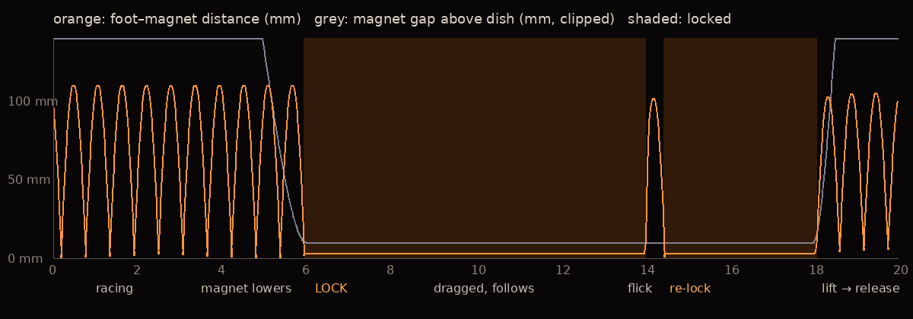

# plasmoid sim: a racing plasmoid locks to a magnet


The source is a viral clip. A glowing orange-white disc sits on a dish electrode on top of a stacked HV driver, with a pickup ring above. A filament races around the dish. Bring a small neodymium magnet close and the filament's foot pins under the magnet and follows it "like it's on rails".

This doc covers:

- what is probably going on physically;
- the simplest model that reproduces it;
- what vcad already had for it and what was missing;
- a first animated version;
- the work needed to make it a first-class vcad capability.

**Files**

| what | where |
|---|---|
| model + tests | [`crates/vcad-kernel-particle/src/plasmoid.rs`](../crates/vcad-kernel-particle/src/plasmoid.rs) |
| demo run | [`examples/plasmoid_magnet.rs`](../crates/vcad-kernel-particle/examples/plasmoid_magnet.rs) |
| device geometry | [`plasmoid-sim/plasmoid-dish.loon`](plasmoid-sim/plasmoid-dish.loon) |
| renderer / figures | [`render.py`](plasmoid-sim/render.py), [`figures.py`](plasmoid-sim/figures.py) (numpy + PIL + scipy) |

Reproduce on a build box:

```bash
cargo run --release -p vcad-kernel-particle --example plasmoid_magnet -- out
python3 docs/plasmoid-sim/render.py out frames --jobs 8
ffmpeg -framerate 30 -i frames/f%04d.png -c:v libx264 -pix_fmt yuv420p -crf 27 plasmoid.mp4
python3 docs/plasmoid-sim/figures.py out docs/plasmoid-sim
cargo run --release -p vcad-loon --example loon2vcad -- docs/plasmoid-sim/plasmoid-dish.loon > dish.vcad
cargo run --release -p vcad-render -- dish.vcad --jpeg docs/plasmoid-sim/device.jpg --size 720
```

## 1. Physics triage

**What the device probably is.** This is a hypothesis built from one still frame. It looks like a solid-state Tesla coil or RF resonator, with its top load replaced by a shallow dish and a central spike. The diffuse disc glow and the glassy spike suggest a low-pressure envelope (an RF glow), not an open-air streamer. Dimensions in the loon model are scaled by eye from the hand.

**Why "Lorentz force on the current channel" is the wrong story.** The drive is RF, so the filament current reverses every half-cycle. In the static field of a magnet, `I·L×B` therefore averages to zero over a cycle. A naive "J×B drags the arc" model would only work for DC arcs, such as rail-arc and magnetically rotated arc devices. It cannot explain an RF filament that locks steadily.

**What does survive time-averaging:**

1. **Magnetized electron transport.** The electron Hall parameter is `β = ω_ce / ν_m`. Where β ≳ 1, cross-field diffusion drops as `1/(1+β²)`. Electrons stay longer, so the same RF power ionizes more there. The discharge prefers regions of strong |B|, which is the magnetron and magnetized-RF-plasma effect.
   - Under a 10 × 5 mm N52 disc held 10 mm above the glow, |B| = 61 mT.
   - In argon at 1 Torr (ν_m ≈ 3.7×10⁹ s⁻¹), that gives **β ≈ 2.9**: strongly magnetized.
   - At 1 atm (ν_m ≈ 2.8×10¹² s⁻¹), it gives **β ≈ 0.004**: no effect.

   

2. **The rectified sheath field.** An RF sheath has a time-averaged DC field pointing into the electrode. Crossed with the magnet's horizontal field, it gives an E×B drift that does not average out. It swirls the locked foot around the magnet's axis, and its handedness flips with magnet polarity.

**The boring alternative, stated honestly.** NdFeB magnets are nickel-plated conductors. Any metal object brought near an RF HV electrode attracts the discharge through field enhancement and capacitive coupling. The clip alone cannot tell "magnetized plasma" apart from "a metal thing on a stick". Two experiments would separate them:

- repeat the demo with a same-size non-magnetic metal slug (aluminum or brass);
- repeat it with the magnet in a thick plastic sleeve.

If the effect is magnetic, it needs low pressure and shows up with a ceramic or sleeved magnet. If it is electrostatic, the aluminum slug does the same thing.

**Candidate models:**

| model | verdict |
|---|---|
| reduced foot/quasi-particle in the magnet field, drive + magnetized-transport pull + E×B sense | **chosen.** Smallest model that circulates, locks, follows and releases, with an analytic lock threshold |
| 2D drift-diffusion fluid on the dish (anisotropic magnetized mobility, RF-heated ionization source) | next step. Would *derive* the pull instead of fitting it (gap #4) |
| particle-in-cell (PIC) / Monte Carlo collisions (MCC) | overkill for the visual. Needed only for quantitative sheath and ionization numbers |

## 2. Model (`vcad_kernel_particle::plasmoid`)

### Real physics (derived, tested against closed forms)

- **`DiscMagnet`: an axially magnetized cylinder.**
  - It is *exactly* a solenoidal bound-current sheet, `K = (B_r/μ0) φ̂`. It is built as a stack of coaxial loops using the crate's existing exact elliptic-integral loop field (`field::b_ring`).
  - Tests:
    - on-axis field matches the closed-form solid-cylinder result to < 0.2 %;
    - far field matches a point dipole `m = B_r V / μ0` to < 1 %.
- **`MagnetPose`: places the magnet anywhere in 3D**, with any orientation. This was missing: the existing `FieldMap` is coaxial-only.
- **`collision_frequency` / `hall_parameter`:** `ν = n σ v̄` and `β = e|B| / (m_e ν)`. The pressure-dependence test asserts β > 1 at 1 Torr and β < 0.05 at 1 atm.

### Phenomenological (fit parameters, not derived)

The filament's foot on the dish is an overdamped quasi-particle:

```text
dx/dt = v_race φ̂ + k (r0 − r) r̂             racing ionization wave + preferred radius
      + μ ∇Φ,   Φ = ln(1 + β²)               pull toward lower electron loss
      + v_spin · β²/(1+β²) · unit(−ẑ × B)    rectified-sheath E×B sense
```

| parameter | value | status |
|---|---|---|
| `v_race` | 0.6 m/s (≈ 1.7 rev/s at r0 = 55 mm) | fit, read off the clip by eye |
| `r0`, `k` | 55 mm, 3 s⁻¹ | fit |
| `μ` | 1.8 × μ* = 5.3×10⁻³ m²/s | fit; only the ratio μ/μ* matters |
| `v_spin` | 0.05 m/s | fit; *direction* is physics, magnitude is not (the true electron E×B speed is ~10⁶ m/s, but the luminous structure moves at ionization-front speed) |
| `Φ = ln(1+β²)` | n/a | the functional form follows `D⊥ ∝ 1/(1+β²)`; the coupling into foot motion is assumed |

### Emergent results (not hard-coded, checked by tests)

- **Lock threshold.** A fixed point exists iff `μ · max|∇Φ| > v_race`, so the threshold is `μ* = v_race / max|∇Φ|` (`PlasmaParams::depinning_mobility`). Swept numerically, the transition falls between 0.95 μ* and 1.0 μ*. The test asserts a lock at 1.3 μ* and a slip at 0.7 μ*.
- **Release speed.** The locked foot follows the magnet until the magnet's speed exceeds the pin's spare speed, `μ·max|∇Φ| − v_race` when dragged against the race. At μ = 2μ* this predicts ≈ 0.6 m/s (≈ 11 rad/s on the orbit). The measured transition is between 10 and 15 rad/s. The test asserts it follows at 5 rad/s and breaks away at 20 rad/s.
- **Lock offset.** The locked foot sits slightly downstream of the footprint, in the race direction.
- **Predictions a bench could falsify:**
  - The effect vanishes as pressure rises past roughly β ≈ 1 (tens of Torr for this magnet).
  - Flipping the magnet doesn't change capture (Φ depends on |B|) but reverses the swirl around the footprint.
  - Lowering the magnet slowly gives capture at a specific gap where μ·max|∇Φ| crosses v_race.

## 3. The demo run

`plasmoid_magnet` runs a 20 s choreography. RK4 at 2.4 kHz, output at 120 Hz.

```text
magnet: N52 10x5 mm, m = 0.447 A·m², gap 10 mm
|B| at glow under magnet: 61.0 mT
ν_m (Ar, 1 Torr): 3.73e9 /s → β = 2.88
ν_m (Ar, 760 Torr): 2.84e12 /s → β = 0.0038
depinning mobility μ* = 2.929e-3 m²/s; using 1.8× = 5.272e-3
max pin speed μ·max|∇Φ| = 1.08 m/s vs race 0.60 m/s
t =   5.93 s: LOCK
t =  14.04 s: release
t =  14.47 s: LOCK
t =  18.08 s: release
```

### Behaviour vs. the source clip



| source clip | sim |
|---|---|
| filament races around the dish | 0–5.9 s: circulates at 1.7 rev/s; no magnet field at the glow |
| magnet brought close → plasmoid locks | 5.9 s: the magnet reaches its 10 mm gap and the next pass captures the foot (β ≈ 2.6 at the foot) |
| plasmoid follows the magnet "on rails" | 6–14 s: dragged clockwise *against* the race, then inward to r = 30 mm; stays locked throughout |
| *(not in clip)* | 14.0 s: a ~1.1 m/s flick beats the pin and the foot is left behind; 14.5 s: recaptured on the next lap |
| *(not in clip)* | 18.1 s: the magnet lifts away, the foot releases and resumes racing |

### What is simulated vs drawn

**From the sim:**

- the foot position;
- the magnet pose;
- the lock state;
- β.

**Render-side stylization in `render.py`:**

- the filament's shape (a jittered arc from the spike tip to the foot);
- the flicker;
- the faint secondary streamers;
- the diffuse disc glow.

The reduced model has no filament geometry. The device is drawn with simple projected primitives that mirror `plasmoid-dish.loon`. vcad has no emissive or bloom path yet (gap #3).

### The loon model

[`plasmoid-sim/plasmoid-dish.loon`](plasmoid-sim/plasmoid-dish.loon) shares the sim's frame: Z-up, mm, the dish surface at z = 0. It contains:

- the dish;
- the central spike;
- the coil former;
- two driver pucks;
- the antenna ring on posts;
- the magnet at its hold pose, on a holder.

Loon has no time, so the magnet's path lives in the example's `KEYS` table, and the dish radius and orbit radius are duplicated as constants (gap #6).


## 4. Audit: what vcad had

| piece | status |
|---|---|
| exact loop field (`particle::field::b_ring`, elliptic integrals) | **reused.** It is the magnet's bound-current sheet |
| Boris pusher / `Tracer` / `FieldMap` | not used. Coaxial-only geometry (rings + axisym Poisson), and individual electron orbits are the wrong level for a luminous structure that moves at ionization-front speed |
| axisym Poisson | not used. The dish E field enters only as the sign of the rectified sheath field |
| `vcad-kernel-em` magnets | 2D planar `MagnetBlock` only (bound-current sheets in a cross-section). No 3D posed magnet source |
| MCP `simulate_charged_particles` / `optimize_electrodes` | fusor-specific `DeviceSpec` (rings, grids); no field-source or plasma-foot tool |
| native app animation / physics | rigid-body / joint playback (phyz). No field-sim tick, no emissive materials, no bloom |
| `vcad-render` | BRep → raster with opaque materials. No emissive or volumetric output |

## 5. Gap list (ranked)

1. **Posed 3D field sources in the kernel.** Generalize `FieldMap` from "coaxial rings + axisym grid" to a `FieldSource` set:
   - ring coils, disc, ring and block magnets, each with a `MagnetPose`;
   - time-varying poses;
   - superposition, plus a sampled cache for speed.

   `plasmoid::DiscMagnet` is the seed. Block magnets need the 3D bound-current-sheet (rectangular loop) field, which is a closed form. Blocks: every interactive demo, plus a proper magnet library for the EM crate's 3D future.
2. **Interactive magnet in vcad.app.** The magnet is a part; dragging it updates its pose; a sim tick (≈ 1 kHz RK4, cheap: two 48-loop field sums per step) moves the foot; the viewport draws it.
   - Needs a "live sim" hook in the native app's animation loop, plus an MCP tool (`simulate_plasmoid`, `pose_at` as keyframes) so agents can choreograph it.
   - This is the "drag the magnet and watch it follow" feature.
3. **Emissive / volumetric rendering.** Plasma, glow discharge, hot parts and LEDs all need:
   - emissive materials in `vcad-render` and the app viewport;
   - additive point/line splats with bloom.

   The Python renderer here is the spec: screen-blend, multi-scale gaussian bloom, orange-to-white `1−exp(−I·k)` tone map. Until then every plasma video is hand-composited.
4. **Derive the pull: a 2D drift-diffusion fluid on the dish.** Electron continuity with an anisotropic magnetized mobility tensor `μ_e/(1+β²)` across B, an RF-heated ionization source, and Bohm loss to the walls.
   - The foot becomes the density peak, and μ stops being a fit parameter.
   - The `vcad-kernel-thermal` / `em` finite-volume core can host it.
5. **Bench calibration + receipts.** Phone-camera tracking of a real dish:
   - race speed;
   - capture gap;
   - release speed vs magnet speed;
   - pressure sweep;
   - aluminum-slug control (§1).

   These bind to a `vcad.plasmoid-claims/1` family (predicted → Provisional, never Pass), in the style of the other solver crates.
6. **BRep → sim binding.** Read the dish radius, the spike position and the magnet pose from the loon document, not duplicated constants. This shares the open-fusor gap ("CAD/sim disconnected").
7. **Time in loon** (or a keyframe track on parts), so the magnet's path lives in the document instead of in example code.
