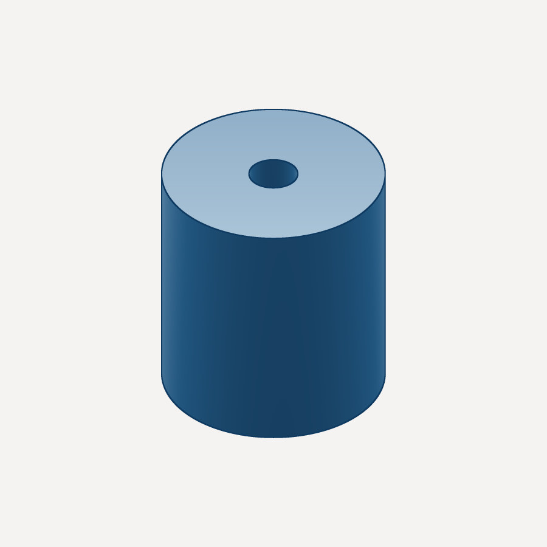
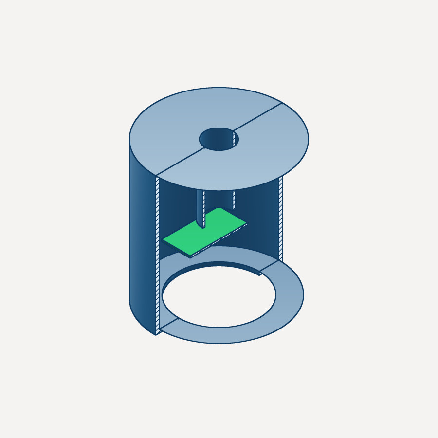
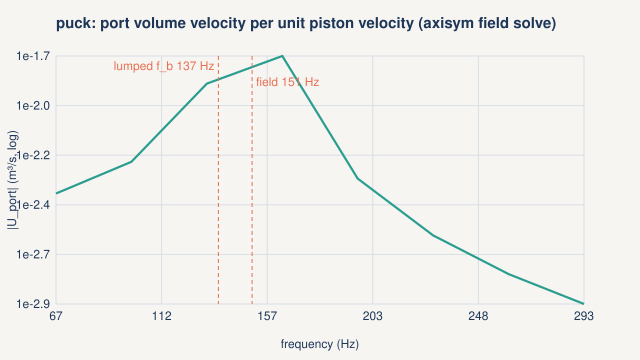
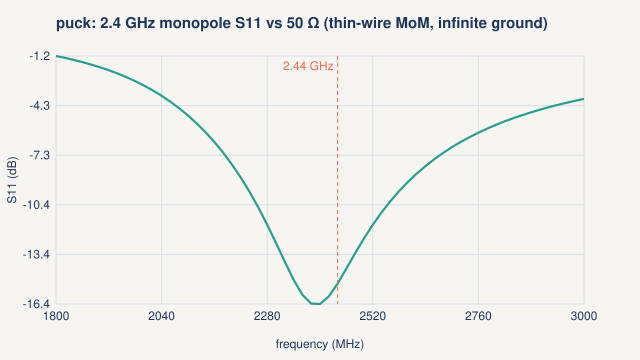

# video 6 — every physics in one object

production plan + proof of concept. status: **planning**. nothing ordered,
built, emailed or published.

> **update 2026-11-16: v2 rerun on main after the gap PRs. see §8.** every
> solver that applies now reads the document through a vcad extractor:
> thermal, acoustics, antenna, EM, tolerance, and a document-level optimizer.
> that's **9 document-fed solvers run on the puck, up from 3**. two findings
> correct v1 below:
> - the first shell mode is **448 Hz on the Fine mesh**, not ~226 Hz. that was
>   a Preview-lattice artifact, so it doesn't sit in the passband.
> - the acoustics extractor **refuses the puck as modeled**: the motor is
>   carved out of the air (new gap G11).
>
> v1's text below is kept as written.

the pitch: one small device. run every vcad solver on it, on camera. optimize
it, build it, measure every prediction, and end on a scorecard that shows the
misses too.

**tl;dr**

- **device: "puck", a cylindrical bass-reflex BLE speaker** (Ø110 × 120 mm,
  3" driver firing down, internal port, 2.4 GHz board). we picked a cylinder
  because two of the solvers we need, acoustics cavity and EM, are
  axisymmetric. a round box with a round driver motor is geometry those
  solvers model natively, so neither one is approximating it.
- **coverage, counted three ways (don't round these up):**
  - **solvers on the brief's list (12):** FEA (+M4 adjoint), thermal, EM,
    antenna, acoustics, tolerance, photonics, diff, PCB/DRC/fab_prep, CAM +
    stocksim, DFM, receipt. **11 apply** to the puck; photonics doesn't, and
    we say so on camera.
  - **can read a `.vcad` document today: 4/12**: FEA, diff, DFM, PCB/DRC.
    CAM and receipt are partial. the other 5 that apply (thermal, EM, antenna,
    acoustics, tolerance) need a hand-transcribed spec.
  - **actually ran document-fed on the puck in the PoC: 3**: diff, DFM, modal
    FEA. static FEA didn't run: the 3 mm shell would fail closed and the lug
    isn't modelled yet. PCB didn't either, because the draft has no
    `PcbBoard` node. acoustics, thermal and antenna also ran, but on specs
    the driver transcribed from the doc's parameters.

  closing the hand-transcribed group is the main engineering work before this
  video is honest. the scorecard in §3 splits FEA into static + modal and adds
  print/slicer as rows, which gives 13 rows. receipt isn't a row because it's
  the frame the rows live in.
- **top 3 blockers:**
  1. thermal, acoustics, EM and antenna can't read geometry from a document.
  2. receipts can't combine claims from several solvers or bind measurements
     to them. `buildReceiptSchema` (`ecad.ts:14346`) takes only `document_id`,
     enclosure ids and a clearance, with no claim-attach input.
  3. there is no document-level multi-physics optimizer. only mass properties
     go through the gradient seam; everything else is finite difference.
- **proof of concept** (`every-physics/poc`, run on mew): one loon file feeding
  6 solvers: diff seam, DFM, modal FEA, acoustics, thermal, antenna. the
  document's gradients match closed form to 4 digits. the draft is already
  wrong in four useful ways: f_b 137 Hz is too high, the first shell mode
  (~226 Hz, coarse mesh) is in the passband, the amp model reads 64–81 °C
  depending on an h we haven't measured, and the board sits under the port
  mouth. the first two are exactly what the optimization scene has to fix.

---

## 1. feasibility audit: what really runs today

read from code at `4ac21aab8`. **doc** = can a `.vcad` document feed it with no
hand-made input. **MCP** = agent-reachable in `packages/mcp` (TS) or
`crates/vcad-mcp`. **app** = surfaced in vcad.app.

| solver | doc → solver | MCP | app | notes |
|---|---|---|---|---|
| structural FEA, static (`vcad-kernel-fea`) | **works**: `vcad_fea_solve(doc,…)` `crates/vcad-ffi/src/fea.rs:657`; TS `resolvePartMesh` `packages/mcp/src/tools/topopt.ts:170` | **works**: `analyze_structure` `structure.ts:113`, `beam_check` (formula only) | **works**: Stress tab, `AnalysisPanel.swift` | one part, one isotropic material, axis-aligned box loads/supports. thin walls fail closed (`mesh.rs:696`, `diagnose_thin_wall`), which matters for a 3 mm printed shell |
| FEA M4 shape adjoint | n/a | missing | missing | `adjoint::shape_gradient` `adjoint.rs:237` gives ∂J/∂(tet node). **not wired** to `vcad-kernel-diff` / `document_parameter_gradient`: volume nodes vs seam surface nodes, no adapter (`docs/fea-m4.md`) |
| modal FEA (`fea::modal` via `vcad-sound`) | **works**: `vcad_sound::part_modes_alone(doc,…)` `crates/vcad-sound/src/lib.rs:80` | partial: `simulate_strike` only does flat bars; Rust `part_sound` | **works**: Sound panel | materials come from a key table in vcad-sound (`lib.rs` MATERIALS), not from the IR |
| thermal (`vcad-kernel-thermal`) | **missing**: hand-built voxel `ThermalModel` `model.rs:225`. spec says the voxelizer "lands on the vcad side", but none exists | partial: `solve_thermal` `thermal.ts:235`, spec only, no `document_id` | missing | adjoint w.r.t. k, h, P only. geometry by FD |
| EM (`vcad-kernel-em`) | **missing**: hand-built axisym/planar grids (`axisym.rs:275`, `planar.rs:148`). `motor_torque` is *modelled on* `examples/pcb-motor/stator-v3.vcad` but doesn't load it | partial: `simulate_em` `em.ts:204`, spec only | missing | `vcad-kernel-magnetostatic` has no consumers at all |
| antenna (`vcad-kernel-antenna`) | **missing**: hand-built `WireGrid`. `ecad::add_trace_as_wire` `ecad.rs:34` is a helper, but nothing reads trace centerlines from a `PcbBoard` | partial: `analyze_antenna` `antenna.ts:86`, spec only | missing | NanoVNA `.s1p` binding exists in library only (`nanovna::measurements_from_s1p`) |
| acoustics cavity (`vcad-kernel-acoustics`) | **missing**: hand-built axisym `Cavity` (`cavity.rs:147` `ported_box`) | **missing**: the Helmholtz cavity solver has no WASM/MCP/FFI binding (instrument/strike tools only) | partial: Tune panel (bars only) | lossless, pressure-release mouth reads **~15% high** (`docs/acoustics-m0.md`). optimizer is FD box search, no adjoint |
| tolerance (`vcad-kernel-tolerance`) | **missing**: hand-written `StackupSpec` `spec.rs:153`, names bound from a `{name: value}` map | **works**: `analyze_tolerance_stackup` `tolerance.ts:125` (linear chains; no GD&T/allocation/measurement) | missing | caliper binding (`measure.rs:63,94`, `receipt::compare`) is library-only |
| photonics | missing | partial: `simulate_photonics` forward only | missing | **n/a for this device.** we won't shoehorn it in |
| diff seam (`vcad-kernel-diff`, `vcad-eval::diff`) | **works**: `document_parameter_gradient` `crates/vcad-eval/src/diff.rs:114`, from a real doc + named `defparam` | partial: `parameter_gradient`, `sensitivity` `parameters.ts:561,570`; **`optimize_parameters` deferred** (`parameters.ts:14`) | partial: Sensitivity panel | QoIs = mass properties only (V, m, centroid, inertia). L-BFGS `lbfgs.rs:68` needs a hand-written BRep build closure; generic hook = `MeshObjective` `optimize.rs:143` |
| PCB / DRC / fab_prep | **works**: board is a `CsgOp::PcbBoard` node in the same document (`crates/vcad-ir/src/lib.rs:1337`) | **works**: `run_drc`, `fix_drc`, `fab_prep`, `export_gerber`, `check_enclosure_fit` | **works**: `PcbFFI.swift` drc/enclosureFit/gerbers | `vcad_pcb_drc` takes board JSON, so Swift extracts it first |
| CAM + stocksim | partial: ops are hand-typed 2.5D rect/circle ops (`cam_job.rs:281`). doc used only to *grade* stocksim (`cam_job.rs:743`) | **missing**: no CAM/G-code MCP tool | **works**: `CamJobPanel.swift`, `CNCWorkspace.swift` | |
| DFM | **works**: `vcad_dfm_check(doc,…)` `crates/vcad-ffi/src/dfm.rs:144`; packs in `crates/vcad-kernel-dfm/rules/*.toml` | **works**: `dfm_check`, `dfm_suggest_fix`, `dfm_apply_fix` | **works**: DFM tab | |
| 3D print / slicer | **works** (app): `vcad_print_call` slice/analyze | partial: `predict_print` / `record_measurement` (dims + mass vs calipers), no slicing | **works**: `PrintWorkbench.swift` | the only live predicted→measured binding besides instrument pitch |
| receipt (`vcad-receipt`) | partial | partial: `build_receipt` only gathers PCB/DRC, `mech.clearance.*`, `constraint.*` (`ecad.ts:14498`). **no input for attaching solver claim sets** | partial: clearance badges only | schema already holds claims from any domain with `basis: predicted/measured` and a fail-closed rollup. no family registry, each crate converts its own |

**the seam finding.** one `.vcad` *can* hold everything: solids, the PCB node,
parameters, clearance specs, constraints. what it can't do yet is *feed*
thermal, acoustics, EM, antenna or tolerance. each needs its own hand-built
spec, and two of those (acoustics cavity, thermal) aren't reachable from the
app or (for the cavity) from MCP at all. the PoC driver below is a prototype
of the missing adapter layer. it reads `doc.parameters` and the evaluated
solids, then builds each spec. it is **not** a vcad feature, and the doc says
so everywhere it's used.

## 2. picking the device

scoring is 0–3 per axis. "coverage" counts solver families out of 13 that
make a *real* prediction about the device (not a contrived one).

| candidate | coverage | measurable w/ hobby gear | buildable (P1S, Carvera, SCS/JLC) | native fit to solvers | total |
|---|---|---|---|---|---|
| **puck: cylindrical ported BLE speaker** | **12/13** (3) | 3: impedance sweep gives f_b to ±1 Hz, tap test, NanoVNA, thermocouple, Hall probe, scale, calipers | 3: printed shell, JLC board, Carvera Al cap | 3: axisym cavity + axisym driver motor = native | **12** |
| PCB-motor desk fan (reuse `examples/pcb-motor`) | 11/13 (no acoustics: fan noise is aeroacoustic) (2) | 3: EM measurement pack already written (`docs/em-measurement-pack.md`) | 3 | 2: planar slice of an axial-flux motor (curvature omitted) | 10 |
| 3" drone | 10/13 (no acoustics, EM needs a reverse-engineered outrunner) (2) | 1: thrust stand, flight risk, aero unmodeled | 2: crash/iterate loop | 1: radial-flux outrunner, prop aero not modeled | 6 |
| BLE sensor node + piezo buzzer (Helmholtz) | 8/13 (thermal is ~0 W, nothing to see; EM n/a) (1) | 2 | 3 | 2: `Cavity::helmholtz_resonator` fits the buzzer | 8 |

**pick: the puck.** it's the only candidate where acoustics, the thing the
audience can *hear*, is the hero, and where every solver has something real
to say. the fan is the fallback if the cavity adapter slips, since its EM
story is already half-measured.

the puck, as drafted in [`every-physics/puck.loon`](every-physics/puck.loon):

- PLA enclosure Ø110 × 120, 3 mm wall
- 3" full-range driver firing down through a Ø70 cutout, piston r = 32 mm
- internal port r = 12 × 60 mm hanging from the lid
- 50 × 50 FR4 board on a shelf: class-D amp (~0.8 W loss at volume),
  BLE SoC, printed 2.4 GHz monopole
- planned, not in the draft yet: a Carvera-machined aluminum top cap (gives
  CAM a real job; a heatsink only if the thermal numbers end up asking for
  one), a lanyard lug for static FEA, and the lid-fit rim for tolerance

the DFM pass in the PoC already caught a real problem. printed upright as one
piece, the roof needs a 117 mm support column (2 FDM warnings). so the
v1 build is **cup + press-fit lid**, and that lid fit is the tolerance stack.
the tool changed the design before anything was printed, which is a good
on-camera beat.

## 3. solver-by-solver plan (and the scorecard, defined up front)

the scorecard is the climax, so it's specified first. one row per prediction.
columns: **predicted** (with the model's own band), **measured** (with
instrument uncertainty), **verdict**: `hit` (inside band) / `miss` (outside;
we show *why*) / `n/a`. predictions are frozen into a `vcad.receipt/1` with
`basis: predicted` **before** anything is built. measurements are attached
later with `basis: measured`. no editing predictions after the fact, and the
receipt's document fingerprint proves it.

| # | solver | prediction | how measured | gear | expected band |
|---|---|---|---|---|---|
| 1 | acoustics (cavity) | port tuning f_b | impedance sweep through 10 Ω series R; f_b = saddle between twin peaks. cross-check: mic at port mouth, peak of port output | USB audio interface, REW (free), 10 Ω resistor | lumped end-correction band; field solve reads **~+15%** (repo-stated BC gap). honest band = lumped [min, max] |
| 2 | modal FEA | shell first 3 elastic modes (Hz) | tap test: tiny mallet, mic/contact piezo, FFT in REW | mic, REW | **±10%**: PLA E ±15% (print orientation) → √E ±7.5%, + lattice ~3% |
| 3 | static FEA | lanyard-lug deflection at 20 N | hang weights / load cell, dial indicator or phone macro video vs scale | load cell + HX711, dial indicator | **±15%**: E uncertainty dominates. lug must be ≥3 lattice cells thick (thin walls fail closed) |
| 4 | thermal | amp case temp at fixed dissipated power, 30 min steady | K-type thermocouple epoxied to the amp package, measured electrical in − acoustic out ≈ loss | thermocouple meter, USB power meter | θ **±30%** (`docs/thermal-m5-m6.md`: h unknown, radiation not modeled) |
| 5 | EM (axisym) | driver gap flux density B_gap, and Bl | Hall probe in the gap (driver with the cone removed, a sacrificial unit); Bl from REW TS params (added-mass method) | gaussmeter, spare driver, calipers to reverse the motor geometry | **×1.25** (`docs/em-measurement-pack.md` gap-flux band) |
| 6 | antenna | S11 minimum frequency + depth, in the enclosure | NanoVNA `.s1p`, bound with `nanovna::measurements_from_s1p` | NanoVNA | repo pack's `NanoVnaTolerances::default()`. **expected miss**: the free-space thin-wire model reads 20–30% high on FR4 (`docs/antenna-measurement-pack.md`), so it's the planned honest red row unless dielectric loading lands |
| 7 | tolerance | lid press-fit yield (% of prints that seat without cracking/rattle) | print 10 lid+rim coupons, go/no-go + calipers | calipers | Agresti–Coull CI on the measured fraction vs predicted MC yield |
| 8 | diff / mass | mass of each printed part | kitchen scale (0.1 g) | scale | **±4%** (filament density, plus an infill-aware model, which is a gap today) |
| 9 | DFM | prints support-free, zero critical issues | it prints or it doesn't | P1S | binary |
| 10 | 3D print (vcad slicer) | print time + filament grams | P1S timer, scale | — | ±10% time |
| 11 | PCB / DRC / fab_prep | DRC-clean, JLC accepts with no engineering queries, board boots | JLC order (Cam's call) | — | binary |
| 12 | CAM + stocksim | Al cap: final feature dims + cycle time | calipers ±0.02, stopwatch | Carvera Air | dims ±0.05 mm, time ±15% |
| 13 | photonics | — | — | — | **n/a, shown as n/a** |

**where the bands come from.** these are repo-stated, from the solver's own
docs/measurement pack: 1 (acoustics-m0), 4 (thermal-m5-m6), 5
(em-measurement-pack), 6 (antenna-measurement-pack), 7 (tolerance
Agresti–Coull). these are **our estimates** and need justifying before
predictions freeze: 2, 3, 8, 10, 12.

**rows that depend on geometry not yet in `puck.loon`:** 3 (lanyard lug), 5
(driver motor: reverse-engineered from a sacrificial driver), 7 (lid rim), 11
(`PcbBoard` node), 12 (Al cap). each one needs to land in the document before
its prediction can be frozen.

the final graphic is this table rendered from the receipt JSON, with green
for hits, red for misses and gray for n/a. the misses get a 10-second
"why" each. the reason has to be one the repo already states (e.g. the
pressure-release mouth or the FR4 ε_eff), not something invented after the
fact.

## 4. the joint-optimization scene

**the claim we *can* make honestly today:**
> "vcad tuned the port, the wall and the height together, trading box
> tuning, shell resonance and weight, and every gradient on screen is labeled
> with where it came from."

objective (minimize): `w₁·(f_b − 90 Hz)² + w₂·mass + w₃·max(0, 400 Hz − f_mode1)²`
over `port_r, port_len, wall, body_h`, subject to `port_len ≤ body_h − 2·wall − 15`
(the port has to fit) and a port air-velocity cap (chuffing). the PoC puts the
draft at f_b ≈ 137 Hz and first shell mode ≈ 226 Hz, so all three terms are
active.

**thermal is not in the objective**, on purpose. none of these four variables
reach the thermal model, which reads board size, amp loss and an assumed h, so
a T_amp term would be inert. adding it honestly needs a variable that moves
it: a `heatsink_area` / top-cap parameter plus a modelled conduction path
from board to cap, which the draft doesn't have. until then thermal is a
standalone prediction, not an optimization term.

| term | gradient source today | real or faked |
|---|---|---|
| mass | `document_parameter_gradient` through the seam. exact; the PoC matches closed form to 4 digits | **real, seam** |
| f_b | FD on the field solve (~2 × 40 driven solves / param) | real, **FD**, labeled |
| f_mode1 | FD: re-evaluate doc + modal per perturbation (minutes each on mew) | real, **FD**, labeled. slow, so precompute the optimization off camera and replay it |
| (T_amp, later) | thermal adjoint exists for k/h/P but **not geometry**. needs a heatsink variable first | not in v1 |
| the loop | `tang_optim::minimize_lbfgs` generic callback (box-constrained) wrapped by hand. no document optimizer exists (`optimize_parameters` deferred) | **hand-glued**, say it on camera |

**not real, don't imply it:** a single adjoint through all physics, or "vcad
differentiates the FEA/acoustics through the CAD". FEA M4 has a shape
adjoint, but it lives on tet volume nodes with no adapter to the seam's
surface nodes. on screen, the gradient panel shows each component with a
`seam` / `FD` chip.

to make it real-er (gap G4): `optimize_parameters` with a mixed-source
gradient vector, plus an FEA-volume-node → seam pullback, which would turn the
modal term into a seam term.

## 5. storyboard and shot list

target ~12 min. the on-screen source for every shot is named, and anything
that doesn't exist yet is flagged ⚠ (it needs a gap closed or the shot
reworded).

| # | t | shot | on screen |
|---|---|---|---|
| 0 | 0:00 | cold open: finished puck playing a bass line; the scorecard flashes for 1 s with one red row | final receipt render |
| 1 | 0:20 | "one object, every physics." the puck in vcad.app, parameters panel scrubbing `port_len` | vcad.app, `puck.loon` open, Parameters inspector |
| 2 | 0:50 | "one document": `.vcad` JSON scrolling: solids, the PcbBoard node, parameters | vcad.app + `puck.vcad` in an editor |
| 3 | 1:20 | DFM flags the 117 mm support column, the model splits into cup + lid | vcad.app DFM tab (`AnalysisPanel`) |
| 4 | 2:00 | mass + gradient: "thicker wall = +62 g/mm". Sensitivity panel | vcad.app Sensitivity panel (`SensitivityPanel.swift`) |
| 5 | 2:40 | modal: shell mode shapes animating, notes named | vcad.app Sound panel |
| 6 | 3:30 | static FEA on the lanyard lug, von Mises field | vcad.app Stress tab |
| 7 | 4:10 | acoustics: port air velocity curve, the tuning peak | ⚠ cavity solver not in app/MCP. today: agent terminal + plotted CSV. needs G1b + G5 for an in-app shot |
| 8 | 5:00 | thermal map of the board | ⚠ `solve_thermal` via MCP agent only, spec hand-built. needs G1a for "from the doc" |
| 9 | 5:40 | EM: driver motor flux lines | ⚠ `simulate_em` spec only |
| 10 | 6:10 | antenna S11 dip | ⚠ `analyze_antenna` spec only; PCB view in app is real |
| 11 | 6:40 | tolerance: lid-fit MC histogram | ⚠ `analyze_tolerance_stackup` via agent |
| 12 | 7:10 | joint optimization replay: params moving, objective falling, `seam`/`FD` chips | ⚠ custom replay of the hand-glued loop. G4 makes it a tool |
| 13 | 8:00 | freeze predictions: `build_receipt`, fingerprint shown | ⚠ build_receipt can't take solver claims yet (G2) |
| 14 | 8:30 | build montage: P1S print (vcad slicer), Carvera cap (CAM panel + stocksim), JLC board | `PrintWorkbench`, `CamJobPanel`, `PcbFFI` gerbers |
| 15 | 9:30 | measurement montage: REW impedance sweep, tap test, NanoVNA, thermocouple, gaussmeter, scale | bench footage |
| 16 | 11:00 | the scorecard, row by row, misses explained | receipt with measured claims, rendered |
| 17 | 11:45 | outro: "every number is in the repo." | GitHub |

## 6. gap list (ranked by importance to honesty)

sizes: S ≤ 2 days, M ≈ 1 week, L ≈ 2–4 weeks of agent-assisted work.

| rank | gap | why it matters | size |
|---|---|---|---|
| **G1** | **document → solver adapters.** (a) thermal: voxelize evaluated solids into `VoxelMaterials` with per-part k/c_p, sources tied to parts. (b) acoustics: extract an axisym `Cavity` from a revolved air solid (detect coaxial cylinders → segments; refuse non-axisym). (c) antenna: `PcbBoard` trace + ground pour → `WireGrid`. (d) EM: revolved motor parts → `AxisymMagnetostatics` annuli. (e) tolerance: clearance spec + dims → `StackupSpec` | without these, "one object" is a lie for 5 of 12 solvers. the PoC driver is the prototype for (a)–(c) | (b) M, (a) M, (c) M, (d) L, (e) M |
| **G2** | **receipt aggregation + measured bindings.** `build_receipt` accepting solver claim sets, per-domain `record_measurement` (REW f_b, `.s1p`, thermocouple, Hall, scale), fail-closed compare per row | the scorecard *is* a receipt, and today it would be hand-assembled | M |
| **G3** | **materials in the IR**: E, ν, ρ, k, c_p, ε_r per material key (vcad-sound has a private table, FEA another) | every solver otherwise hardcodes PLA/FR4 | S–M |
| **G4** | **`optimize_parameters`**: document-level L-BFGS over named params with a mixed seam/FD gradient vector + provenance per component; later the FEA volume-node → seam pullback | makes the scene a tool, not a script | L |
| **G5** | **app surfaces** for cavity acoustics, thermal, antenna, EM (or at minimum MCP for the cavity solver, which has none) | half the shot list is a terminal today | L (S for cavity MCP) |
| G6 | acoustics radiation-impedance mouth (acoustics M1) | removes the known +15% bias on the hero prediction | M |
| G7 | antenna dielectric loading (FR4 ε_eff) | otherwise the S11 row is a predictable miss. fine to keep as the honest red row if this slips | M–L |
| G8 | infill-aware mass + stiffness for FDM parts (or print 100% infill and say so) | mass and modal rows depend on it | S (100% infill) / M |
| G9 | performance: on a shared, loaded mew (not a clean timing), each `document_parameter_gradient` call took ~1 min on the 5-primitive puck; modal `Quality::Preview` took ~30 s; `Quality::Fine` **didn't finish in ~25 min**. vcad-render evaluated the same doc in seconds, so measure before blaming the kernel | the modal FD term in §4 is unusable at Fine; converged mode numbers for the scorecard need this fixed or an overnight run | M (profile first) |
| G10 | CAM ops from geometry (today hand-typed rect/circle) + a CAM MCP tool | the Al cap is simple enough to hand-type, so this is low priority for the video | L |

## 7. proof of concept

`docs/videos/every-physics/poc` is a standalone cargo package. it isn't a
workspace member: it has an empty `[workspace]` table, mirrors the root
patches, and builds against a copy of the root `Cargo.lock`. one binary:

1. evaluates `puck.loon` → `Document` via `vcad_loon::eval_vcad`, then
   `vcad_eval::evaluate_document`
2. runs every solver it can, tagging each number with its input source:
   `[doc-geom]` (read off the evaluated solid; the real seam), `[doc-param]`
   (read off `doc.parameters`, hand-mapped into a solver spec; the
   prototype adapter), `[assumed]` (not in the doc at all)

run on mew (`ssh mew`, worktree at this commit, release build):

```
cd docs/videos/every-physics/poc && cp ../../../../Cargo.lock .
cargo run --release -- ../puck.loon out
```

### numbers

from [`poc/results/run-preview.log`](every-physics/poc/results/run-preview.log)
(`MODAL_QUALITY=preview`):

| solver | input source | result | check |
|---|---|---|---|
| eval: shell volume / mass | doc-geom | 168,389 mm³ → **208.8 g** PLA at 100% infill | hand calc 168,395 mm³ ✓ |
| eval: enclosed air (V_box) | doc-geom | **0.933 L** | hand calc 0.9333 L ✓ |
| diff seam: dV/dwall | doc-geom | shell **+49,771**, air −53,619 mm³/mm | closed form +49,774 / −53,621 ✓ |
| diff seam: dV/dbody_h | doc-geom | shell +1,008.4, air +8,494.6 mm³/mm | π(R²−rᵢ²)=1,008.5, πrᵢ²=8,494.9 ✓ |
| diff seam: dV/dport_len | doc-geom | shell +163.4, air −615.7 mm³/mm | π(14²−12²)=163.4, −π·14²=−615.75 ✓ |
| DFM (FDM pack) | doc-geom | **2 warnings**: 180° overhangs needing 117 mm and 60 mm support columns (roof, port tube end) | real: forces the cup + lid split |
| modal, free-free PLA (Preview, ≤~6k cells) | doc-geom | **226.5**, 280.8, 292.5, 294.9, 300.6, 302.5 Hz | coarse (2 cells through the 3 mm wall); the Fine run (≤~40k cells) **did not finish in ~25 min** on mew, see G9 |
| acoustics, lumped port tuning | doc-geom V_box + doc-param port | f_b band **[134.1, 136.6, 143.6] Hz** | |
| acoustics, axisym field solve | doc-geom V_box + doc-param port, equivalent-volume cylinder | f_b **154.2 Hz** (field/nominal 1.13) | consistent with the documented ~+15% pressure-release-mouth bias |
| thermal: amp (0.8 W, 5×5 die) on 50×50 board | doc-param | T_max **80.6 °C** at h=5, **64.3 °C** at h=10 W/m²K; θ_ja 69.4 / 49.2 K/W; energy residual 5e-13 | h is assumed, not in the doc |
| antenna: 30 mm monopole, infinite ground | doc-param | resonance **2358 MHz**, S11 min **−16.4 dB @ 2400 MHz**, −15.2 dB @ 2.44 GHz | free-space model; on FR4 expect 20–30% lower (repo-stated) |






**what the draft already says about the design (all before any hardware):**

- **f_b ≈ 137 Hz is too high** for a speaker that's meant to have bass. getting
  to ~90 Hz at r = 12 mm needs L_eff ≈ 179 mm, ~161 mm of physical tube.
  that's hand arithmetic from the same lumped formula, using the draft's
  implied 17.5 mm end correction; not a solver run. the cavity is only 114 mm
  tall. so the real optimization has to trade
  port radius (chuffing/air velocity) against height (mass) against length
  (has to fit). that's a better joint-optimization scene than a toy
  objective; §4 is updated to target 90 Hz with `port_len ≤ hᵢ − 15`.
- **the first shell mode (~226 Hz, coarse) sits in the passband.** the shell
  will color the sound. the modal term in the objective is real, not filler.
  ribs or a thicker wall are what the optimizer should discover.
- **thermal reads 64–81 °C, and the spread is the unknown h (10 vs 5 W/m²K)**,
  so the number can't yet say whether the amp is fine. it isn't good enough
  to justify anything on its own:
  - the model convects to a 25 °C ambient, but the board sits in a sealed
    box whose air will run warmer, so the prediction reads low.
  - the 5 × 5 mm die's edges land on voxel centres of the 1 mm grid, a
    mis-paint `docs/thermal-m5-m6.md` prices at 5–13%.
  - design todo: check the chosen amp's rated case temperature. if it's
    tight, add a conduction path from the board to a machined Al top cap.
    that's when CAM and a T_amp optimization term earn their place.
- **the board sits ~15 mm under the port's inner mouth** (see section), which
  will throttle the port. a `check_clearance` assertion (port mouth ↔ board
  ≥ 1 port diameter) belongs in v2 of the loon file, and the receipt will
  re-verify it.
- **antenna resonance is 2358 MHz in free space**, already a bit low, and FR4
  loading will push it lower. the trace needs shortening, or we keep the miss
  as the honest red row.

artifacts in [`every-physics/poc/results/`](every-physics/poc/results/):
`puck.vcad` (the evaluated document), `summary.json`, `port_velocity.csv`,
`antenna_s11.csv`, plus plots `port_velocity.svg`, `antenna_s11.svg`.

### what the PoC proves and doesn't

- **proves:** one loon document drives real solvers. the seam is exact on
  this geometry; every `document_parameter_gradient` entry matches the
  hand-derived closed form (e.g. dV_shell/dwall = 49,771 vs 49,774 mm³/mm
  analytic, dV_air/dport_len = −615.7 vs −π·14² = −615.75). DFM changes the
  design. modal runs on the real shell.
- **doesn't:** acoustics, thermal and antenna are fed by the driver
  hand-mapping parameters (and, for acoustics, the doc-measured air volume)
  into specs. that's exactly gap G1. the acoustics mapping also has to
  convert the internal port to the solver's external-port topology through
  an equivalent-volume cylinder, which is an approximation the real adapter
  should refuse or price.

## 8. v2 rerun on main (2026-11-16)

after the gap PRs landed (#1189 radiation, #1200 antenna, #1202 receipt
ledger, #1204 acoustics, #1205 materials, #1206 thermal, #1207 perf, #1209
EM + tolerance, #1210 optimizer), the PoC was ported to the extractors and
rerun on main at `1b4e563` (mew, `MODAL_QUALITY=fine`, 4 optimizer rounds).
log: [`results/run-v2.log`](every-physics/poc/results/run-v2.log).

**the puck changed to give EM and tolerance something real to read**
([`puck.loon`](every-physics/puck.loon) v2):

- every root is named.
- the speaker motor is in the document: yoke, Y30 ferrite ring, top plate
  and voice coil, the `vcad-kernel-em` reference motor lifted to
  `motor_z = 18`.
- the driver's basket ring is press-fit into the bottom-wall cutout.
  `driver_frame_r` 35.075 goes into `driver_cut_r` 35.0, both ±0.1.
- the amp die is its own part.
- the air is carved by the motor envelope.

the driver injects three things loon can't author yet: the `PcbBoard` (feed
pad, GND pour, the `ant_len` monopole), the thermal study, and the
`driver-fit` clearance assertion. all three are tagged `[doc-injected]` in
the log.

| solver | v2 input | result | vs v1 |
|---|---|---|---|
| mass, per part | doc-geom × IR material library | enclosure 208.8 g, frame 26.8, yoke 117.2, magnet 93.1, top plate 78.6, coil 1.4, board 7.4 g; die: **no density for `silicon`** (G12) | v1 hardcoded PLA density |
| diff seam | doc-geom | dV/dwall +49,771, dV/dbody_h +1,008.4, dV/dport_len +163.4 mm³/mm | identical ✓; 18 s for 3 params (was ~1 min each) |
| DFM | doc-geom | same 2 overhang warnings | identical |
| modal, **Fine** | doc-geom, PLA from the library | **448.1**, 459.0, 545.4, 630.4, 672.3, 886.8 Hz in **14 s** | v1 Fine never finished; v1 Preview read 226.5. **the "mode in the passband" finding was a coarse-lattice artifact** |
| acoustics, as modeled | doc-extract | **refused**: the air "meets open space sideways at r = 30 mm, z ∈ [18, 36]". the extractor knows enclosure + air only, so a solid inside the box reads as a vent (G11) | v1 never saw the motor |
| acoustics, variant (air not carved by the motor; V_box +~0.051 L) | doc-extract: internal port, real BRep V_box 0.933 L | lumped f_b **[134.1, 136.6, 146.5] Hz**; field f_b **151.0 Hz** (internal port modeled exactly, no equivalent-volume mapping); 5 claims | v1 field 154.2 via the equivalent-volume hack |
| thermal | doc-extract: board + die voxelized, power = `amp_loss_w`, 0.5 mm grid | T_max **86.1 °C** (h=5) / **69.8 °C** (h=10); θ_ja 76.4 / 56.0 K/W | v1 80.6 / 64.3: v1's 1 mm grid painted a 36 mm² die for a 25 mm² part (the voxelizer's exact footprint concentrates the same 0.8 W) |
| antenna | doc-injected `PcbBoard` → doc-extract | 19 segments, feed on the pour edge; resonance **2357 MHz**, S11 −16.5 dB @ 2400, **−15.2 dB @ 2.44 GHz** | matches v1's hand grid; the extractor itself prints the "FR-4 reads 20–30 % below" warning |
| EM | doc-extract: 4 motor parts → axisym annuli, nonlinear steel, 241×305 grid | gap \|B_r\| **1.53 T**; Bl **3.65 T·m** by both routes (ψ, sampled) | new. inside the magnetic-circuit bound (no-leakage ceiling ≈ 2.3 T by hand) |
| tolerance | doc-extract: radii coeffs ±1 from the BRep fit, tolerances from `:tol` | nominal −0.075 mm; worst case [−0.275, +0.125] **FAIL**; yield **86.0 %** (RSS 86.02, MC 86.02 ± 0.08) | new. design finding: ±0.1 on each radius is too loose for this fit. tighten to ±0.05, or ream the cutout |
| joint optimization | `optimize_document`: mass (seam), f_b (cavity extractor as a plug-in QoI, FD), modal f1 (seam-FD on a pinned Preview lattice) | (body_h, port_len) **(120, 60) → (144.8, 58.0)**: f_b 136.6 → **124.9 Hz**, mass 208.8 → 239.4 g, f1 226.5 → 234.0 Hz (floor 226.5). stopped at MaxRounds, **feasible, KKT not satisfied**; 165 doc evals, 210 plug-in evals, 580 s | v1 had no optimizer |

**what the optimizer found:** height alone can't take f_b to 90 Hz. a taller
box lowers f_b, but it also drops the shell's first mode, and the modal
floor binds at about 125 Hz. getting further needs a variable that stiffens
the shell or detunes the port without height: `wall`, `port_r`, or ribs.
that's the scene's next iteration.

caveat: the optimizer's modal floor is on the pinned **Preview** lattice
(226 Hz at the start, vs 448 Hz Fine). it's a correct relative constraint
("don't get floppier than the start"), not the scorecard number.

**gap status after the PRs**

| gap | status |
|---|---|
| G1a thermal / G1b acoustics / G1c antenna / G1d EM / G1e tolerance | **closed** for the puck. G1b refuses internal solids (→ G11) |
| G2 receipt aggregation | landed (#1202, claims ledger, MCP side). not exercised by this Rust driver |
| G3 materials in the IR | **closed**: masses and modal read the library. missing silicon density (G12) |
| G4 `optimize_parameters` | **closed**: ran end to end on the puck with a custom acoustics QoI |
| G9 performance | **closed**: Fine modal 14 s, diff 18 s, puck eval 2 s |
| **G11 (new)** | cavity extractor: solids inside the box other than the enclosure (the motor) read as open space. the motor should subtract from V_box and become an obstacle. this blocks the as-modeled acoustics row and the optimizer's f_b term |
| **G12 (new)** | `silicon` has no density in the material library |
| **G13 (new)** | loon can't author a `PcbBoard`, a thermal study, or a clearance/fit assertion, so the driver injects all three |
| G13b (minor) | tolerance extraction took 73 s on the 9-part puck (the BRep fit search), vs < 1 s for the solve. worth a profile |
| G5–G8, G10 | unchanged |

the hero/section renders above are still v1 geometry; v2 adds the motor
and the driver frame.
