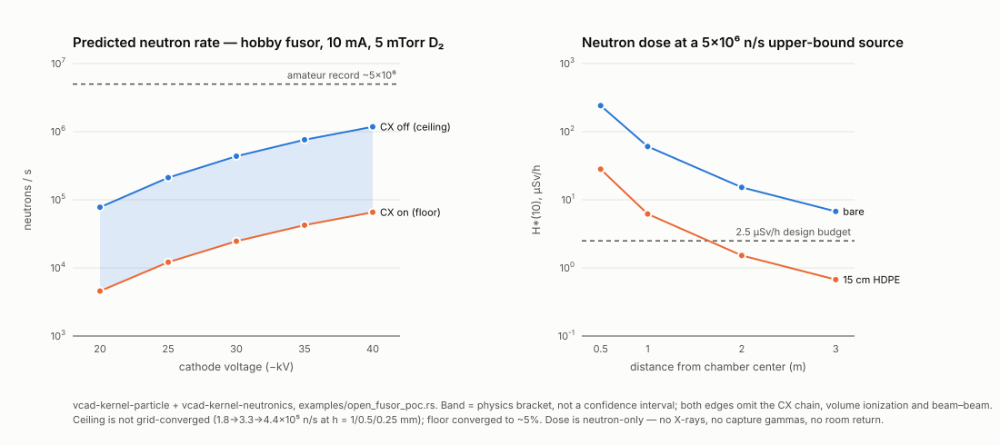
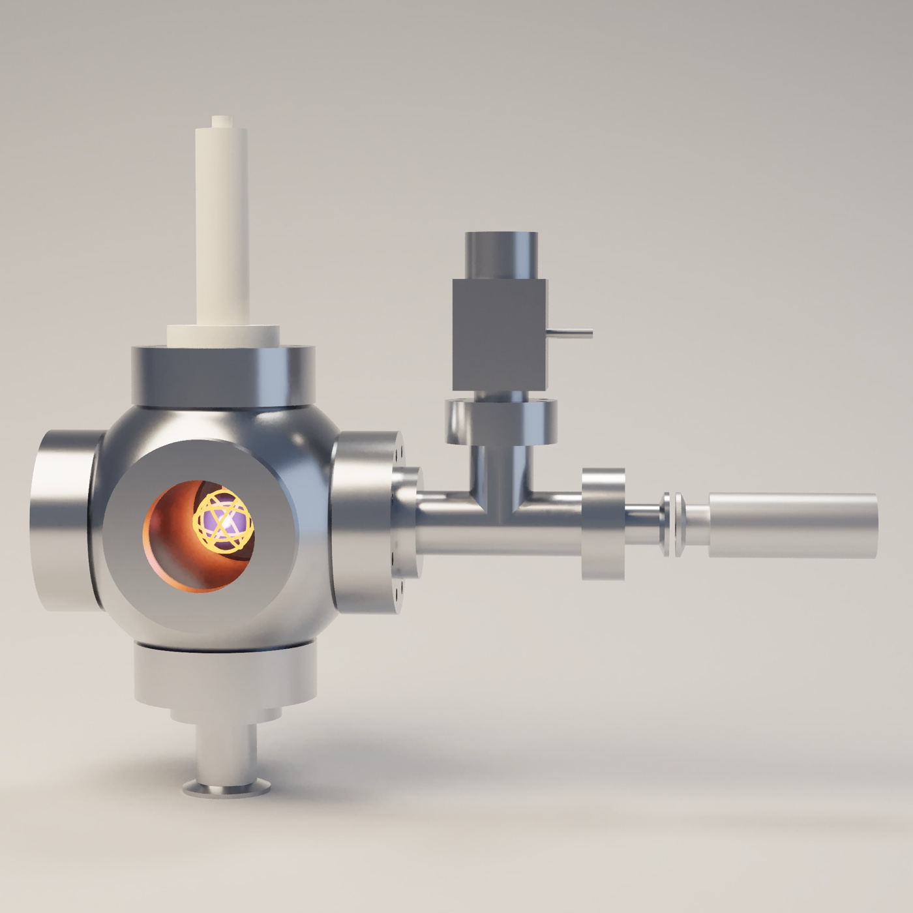
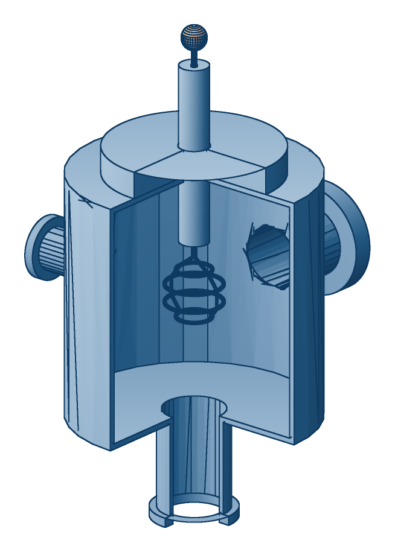
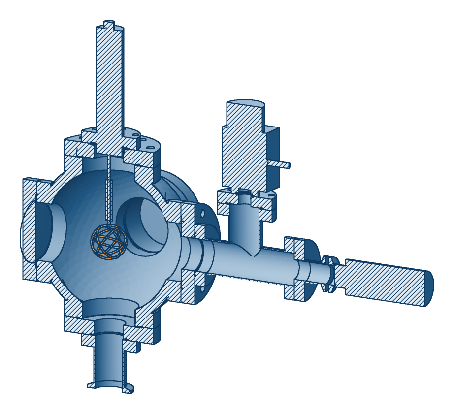
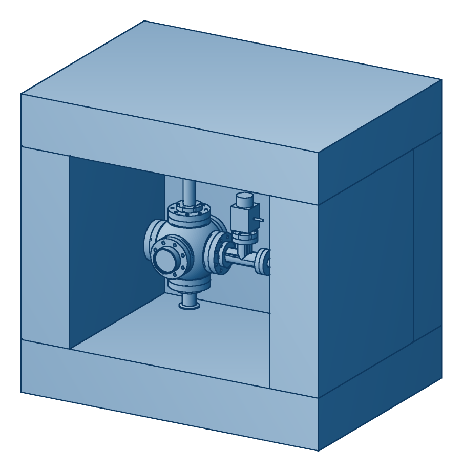

# the open fusor: production plan

showcase video #4. design an IEC fusor end to end in vcad, build it, count
neutrons, and put the measurement on the same plot as vcad's prediction.
the climax is that plot.

this is a plan plus a proof of concept. nothing has been ordered, built,
filmed or published. the numbers in §1–§6 came from code on `origin/main`
at `4ac21aab`, run on `mew`; the block below is from main at `93b5124d`. the doc says where code and docs disagree.

**where it stands (2026-11-17).** the first version of this doc ranked twelve
gaps. ten of them have since landed on main (§6 has the list), and the
machine was redesigned on top of them. the sections below §1 are the original audit and
proof of concept, kept as written; where a number there has been replaced,
this block has the current one and names its source.

- **predicted yield** (−30 kV, 10 mA *supply* current, 5 mTorr D₂):
  **1.9×10³ n/s, band 87 to 1.8×10⁴**. at −40 kV: 6.3×10³ (2.1×10² to
  4.8×10⁴). this is one number with a two-sided band a neutron count can
  violate, from the CX chain with volume ionization and the supply→ion
  current partition (`docs/particle-optics-m0.md` M7,
  `examples/open_fusor_band.rs`). it replaces the §2 floor/ceiling bracket
  (2.5×10⁴ to ≥4.4×10⁵), which assumed 10 mA of *ion* current and could not
  lose. the new central value is 13× below the old floor.
- **that band is for a ring stack, not the grid in the CAD.** the yield chain
  is axisymmetric: 4 latitude rings in a 76 mm cylinder
  ([`open-fusor/fusor-sim.loon`](open-fusor/fusor-sim.loon)). the machine
  now carries a real 6-great-circle globe. the 3D thin-wire solver
  (`docs/particle-optics-3d.md`, `examples/globe_vs_rings.rs`) says a ring
  stack overstates recirculation about 3× (20.7 vs 7.1 mean passes) and the
  CX-off ceiling 2.4×, while the CX-on floor barely moves (2.7 vs 2.8×10⁴
  at 10 mA ion current). the two-sided chain has not been run on the globe.
  until it is, the band is the ring-stack device's.
- **x-rays now have numbers** (`docs/photon-dose-m0.md`, at the bound: every
  milliamp reaching the wall as full-energy electrons). a bare 2.75″
  borosilicate viewport at −30 kV is 1.1 mSv/h at 1 m on axis (upper edge
  2.5); at −40 kV, 4.8 mSv/h (upper edge 10.8). 8 mm of lead glass or a
  3 mm steel shutter takes the window path to nothing, leaving the wall
  term: 0.003 µSv/h at −30 kV, but 9.4 µSv/h at −40 kV through a 1.65 mm
  wall. so the redesign uses leaded-glass viewports. that case is not this
  machine, though: the cube's wall is 11 mm or more (the wall term falls
  ~200× by 3 mm), its DN63 windows have 2.9× the aperture area, and the
  catalog models 5.2 mm of glass, not 8. it has not been re-priced. the ICRP-74 conversion coefficients for
  10–40 keV in that model were transcribed, not independently checked.
- **neutron dose, with the room** (`docs/neutronics-m0.md`,
  `examples/fusor_room.rs`; 5×10⁶ n/s safety bound, 15 cm HDPE castle):
  31 µSv/h at 0.5 m, 4.3 at the 1.5 m operator position, 1.8 at the
  doorway. room return doubles the free-field figure at 1.5 m. capture
  gammas add about a fifth behind the HDPE (1.79 µSv/h total at 2 m free
  field, upper edge 2.32, against a 2.5 budget). at the predicted 1.9×10³
  n/s all of these scale down by 2 600×.
- **CAD → sim extraction exists, for a clean ring-stack document.**
  `vcad_eval::sim_extract` turns a can-plus-rings document into the solver's
  `DeviceSpec` (tested in `crates/vcad-eval/tests/sim_extract_fusor.rs`),
  and vcad.app has the particle and neutron screens. neither file here goes
  through it as written: the globe machine has a spherical cavity and
  crossing wires, and `fusor-sim.loon` has a section cut and a stalk.

still open: the two-sided chain on the 3D globe; the secondary-emission
coefficient in the current partition is uncited; the MCP
`simulate_charged_particles` tool still returns the old floor; and nothing
has been measured.



*the original proof-of-concept plot, superseded by the block above. left:
D-D rate vs voltage (band = CX-on floor … CX-off ceiling, 10 mA ion
current). right: neutron dose vs distance at a 5×10⁶ n/s upper-bound source.
generated by `examples/open_fusor_poc.rs` → `open-fusor/poc.csv` →
`open-fusor/plot.py`.*



*path-traced hero shot of the redesigned machine (`vcad-render --photoreal`,
160 spp, CPU). materials come from [`open-fusor/look.json`](open-fusor/look.json).
the glow is render dressing from
[`open-fusor/star-mode.loon`](open-fusor/star-mode.loon) (glowing media, not
simulated). the camera-side viewport is removed for the shot because the path
tracer does not transmit through glass.*





*second-pass machine CAD and its section at y = 0:
[`open-fusor/fusor.loon`](open-fusor/fusor.loon). every part is stock
`std:vacuum.*` hardware joined by port mates: a DN63 (4.5″ CF) spherical
cube, DN63→DN40 reducers, a 40 kV feedthrough whose conductor is the grid
stalk (tip at z = 19.7 mm, on the grid pole), leaded-glass viewports, a KF40
pump line, and a tee carrying the gauge and the D₂ leak valve. the cathode is
six great circles of 2 mm wire on a 19 mm sphere, the layout the 3D solver
uses. the catalog cavity radius is 79.9 mm against the 76 mm every simulation
assumes (+5%). on mew at main `93b5124d` the 21-root document evaluated in
24 s with 8 roots served from the geometry cache; no cold timing was taken. the first-pass cylinder-and-ring-stack geometry is kept as
[`open-fusor/fusor-sim.loon`](open-fusor/fusor-sim.loon).*



*the same machine inside the 15 cm HDPE castle
([`open-fusor/castle.loon`](open-fusor/castle.loon)), front panel off. the
wall thickness is the one the room dose map prices. the cavity is larger than
that model's 150 mm half-cube, because the real plumbing does not fit in it;
the transport has not been rerun on this cavity.*

---

## 1. feasibility audit (from code)

legend: ✅ works end to end · 🟡 partial · ❌ missing

evidence run: `cargo test --release -p vcad-kernel-particle -p
vcad-kernel-neutronics` on mew at `4ac21aab` → **124 passed, 0 failed**
(unit + `tests/analytic.rs`, `codesign.rs`, `shielding.rs`,
`benchmarks.rs`, `claims.rs`, `gradients.rs`, `kinematics.rs`,
`validation.rs`).

### particle optics (`crates/vcad-kernel-particle`)

| step | status | evidence / caveat |
|---|---|---|
| axisym Laplace (SOR) | ✅ | `src/poisson.rs`. vacuum only: `poisson::solve` has no ρ term. space charge is a separate gauge (`space_charge.rs`) |
| ring-coil B (elliptic) | ✅ | `src/elliptic.rs`, `src/field.rs::b_ring`. only matters for the shielded-grid stretch variant |
| Boris tracing | 🟡 | `src/trace.rs`. works, but in the POC the **max** per-trace energy drift is 19% even at h = 0.25 mm (mean 3.4%), 27% at h = 0.5 mm. wire-grazers dominate it. tighten before quoting the ceiling |
| Bosch-Hale D-D yield | ✅ | `src/xsection.rs` (both branches), `fom::neutron_rate_per_s`. beam-on-background only |
| charge exchange | 🟡 | `trace::CxModel`: constant σ, **single generation**. the CX chain (every CX births a cold ion that re-accelerates) and volume ionization are not modeled. the m0 doc itself attributes the ~30× gap to real fusors to this |
| discrete adjoint | ✅ (kernel) / ❌ (MCP) | `src/adjoint.rs::yield_gradient`, FD-validated per the tests. **but the MCP `optimize_electrodes` calls `optimize::maximize` with FD gradients** (`vcad-kernel-wasm/src/lib.rs:9008`), not the adjoint |
| `DeviceSpec` param seam | ✅ | `src/spec.rs`, serde, fail-closed named params |
| **geometry expressiveness** | ❌ | `Device` = grounded **cylinder** + coaxial **latitude rings** (`src/device.rs`). a real fusor grid is a globe (latitude + meridian wires, or great circles), which can't be represented. the built grid would have to be a ring stack to match the sim, or the sim stays a stand-in |
| BRep → `DeviceSpec` | ❌ | `spec.rs:15` says extraction "is deliberately not" here. nothing elsewhere implements it (grep). CAD and sim share no geometry |
| space-charge gauge | ✅ | `space_charge::estimate`. POC: **0.118 at 10 mA**, already past the 10% linearity band. `self_consistent` (PIC-lite) exists, not run here |
| receipts | 🟡 | `receipt::predicted_claims` / `receipt::compare` (Holds/Violated/Unmeasured) exist kernel-side. no MCP tool binds bench measurements to them |

### neutronics (`crates/vcad-kernel-neutronics`)

| step | status | evidence / caveat |
|---|---|---|
| MC transport | ✅ | `src/transport.rs`, exact two-body elastic kinematics default, deterministic seeds, batch error bars |
| H*(10) dose | ✅ (1D) | `src/dose.rs`. **but geometry is 1D slab or 1D spherical shells only** (`src/geometry.rs`). there's no dose *map*, no room, floor, walls or door, just doses on concentric shells. the "dose map" shot is really a dose-vs-radius curve |
| shielding-thickness gradient | ✅ | `src/diffusion.rs`, diffusion adjoint, FD-validated vs MC within the doc's band |
| photons | ❌ | no photon transport at all: no capture gammas (2.22 MeV H(n,γ) from the HDPE itself) and **no bremsstrahlung x-rays** |
| detector response | ❌ | no He-3 / bubble / CR-39 response model. counts have to be hand-derived from fluence or dose |
| library | 🟡 | bundled 5-group design-estimate library, ±20–30% stated |

### MCP (`packages/mcp/src/tools/particle.ts`, `neutronics.ts`)

| tool | status | notes |
|---|---|---|
| `simulate_charged_particles` | 🟡 wired, not exercised live | node server → `engine.particleSimulate` → wasm `particleSimulate`. exported in the checked-in `vcad_kernel_wasm.d.ts`. covered by `__tests__/particle-tools.test.ts`. **not in native `vcad-mcp`**: `crates/vcad-mcp/src/tools/mod.rs:212` only lists the name as long-running. all vcad MCP servers were down this session, so no live call was made |
| `optimize_electrodes` | 🟡 | same path. FD multi-start, not adjoint (see above) |
| `simulate_neutron_shield` | 🟡 wired, not exercised live | wasm `neutronicsSimulate`, 1D spherical spec |

### CAD / CAM / structure / thermal

| need | status | evidence |
|---|---|---|
| chamber + grid + stalk CAD | 🟡 | the normal modeling stack (revolve, sweep, booleans) can draw it. **no vacuum part library**: no CF/KF flanges, gaskets, feedthroughs (grep finds nothing). model them by hand or import vendor STEP |
| vcad.app screens for this | ❌ | `AnalysisStore.swift` modes are DFM / Stress / Clearance. nothing for particle, neutronics, thermal or EM. `FieldOverlay.swift` exists but no fusor producer feeds it |
| CAM | 🟡 | `vcad-kernel-cam`: 2.5D contour/pocket/face + 3D roughing, Grbl + LinuxCNC posts. **no lathe** (no turning ops). the Carvera Air controller lives in the Swift app, not as a kernel post. fine for plates, brackets and HDPE blocks; not for turning a feedthrough insulator |
| chamber pressure FEA | 🟡 | `vcad-kernel-fea` linear static works on real geometry. no external-pressure **buckling** check for thin shells (`section.rs` explicitly doesn't check local wall buckling). bought CF hardware makes this moot. only a custom welded chamber needs it |
| grid thermal | 🟡 | `vcad-kernel-thermal` is **pure conduction, no radiation** (`lib.rs:40`). a star-mode grid at red-orange heat loses most of its power by radiation, so T_max is a gross overestimate (fusor_codesign already calls it a floor). needs a radiation BC |
| HV / feedthrough EM | 🟡 | `vcad-kernel-em` has 2D electrostatics (planar/axisym φ). you can compute the stalk/feedthrough field for a breakdown margin. there's no breakdown or tracking criterion; you'd compare E against handbook values |
| multi-domain receipt | ✅ | `examples/fusor_codesign.rs` already chains particle → em → thermal → neutronics → tolerance into one `DesignReceipt` (for the shielded-grid variant) |

---

## 2. proof of concept

`cargo run --release -p vcad-kernel-particle --example open_fusor_poc`
(28 s on mew under load ~110). raw output: [`open-fusor/poc.csv`](open-fusor/poc.csv).

**geometry.** 6" chamber (76 mm inner radius, modeled as a cylinder of equal
half-height), 1.5" grid (19 mm radius) as 4 latitude rings of 2 mm wire
(geometric transparency 0.838). operating point: 10 mA *ion* current, 5 mTorr
D₂, 300 K. CX σ = 1×10⁻¹⁹ m². 96 deuterons launched at rest, 40-pass cap.

**yield vs voltage** (h = 0.25 mm grid):

| −kV | floor (CX on) n/s | ceiling (CX off) n/s | interception | mean passes |
|---:|---:|---:|---:|---:|
| 20 | 4.6×10³ | 7.8×10⁴ | 0.78 | 10.3 |
| 25 | 1.2×10⁴ | 2.1×10⁵ | 0.77 | 10.3 |
| **30** | **2.5×10⁴** | **4.4×10⁵** | 0.78 | 10.3 |
| 35 | 4.2×10⁴ | 7.6×10⁵ | 0.78 | 10.3 |
| 40 | 6.6×10⁴ | 1.2×10⁶ | 0.78 | 10.3 |

**convergence at −30 kV** (this is the honesty row):

| grid (h) | particles | floor | ceiling | interception |
|---|---:|---:|---:|---:|
| 305×609 (0.25 mm) | 96 | 2.46×10⁴ | 4.36×10⁵ | 0.78 |
| 305×609 (0.25 mm) | 48 | 2.57×10⁴ | 4.18×10⁵ | 0.79 |
| 153×305 (0.5 mm) | 96 | 2.34×10⁴ | 3.25×10⁵ | 1.00 |
| 77×153 (1.0 mm) | 96 | 2.08×10⁴ | 1.80×10⁵ | 1.00 |

- the **floor is converged** to ~5% across grids and ensembles. it's the
  more physical edge too, since at 5 mTorr the CX mean free path is shorter
  than one pass.
- the **ceiling isn't converged**: it climbs 1.8 → 3.3 → 4.4×10⁵ as h halves,
  and at the finest grid 22% of ions are still alive at the 40-pass cap
  (censored). treat it as "≥". it is also an unphysical bound at 5 mTorr
  (no CX).
- **space charge:** gauge 0.118 at 10 mA. the linear yield claim is
  marginal; the 10% band is crossed at 8.5 mA.
- for scale: community-reported amateur fusors at 30–40 kV are commonly in
  the 10⁴–10⁶ n/s range (fusor.net lore, not a dataset), record ~5×10⁶. the
  bracket overlaps that, which is the point of blocker #2. it can't
  really lose.

**dose vs distance** (5×10⁶ n/s **upper bound**, deliberately not the
predicted rate. a safety case bounds the machine over-performing):

| distance | bare µSv/h | 15 cm HDPE µSv/h |
|---:|---:|---:|
| 0.5 m | 241 | 28.2 |
| 1 m | 60.6 | 6.2 |
| 2 m | 15.2 | 1.52 |
| 3 m | 6.7 | 0.67 |

(MC relative standard error ≤ 0.4%. library uncertainty ±20–30% dominates.
neutron only.)

**what a detector would see at the predicted rate.** scaling the bare row to
the −30 kV bracket: at 0.5 m, 1.2 µSv/h (floor) to 21 µSv/h (ceiling).
uncollided fluence at 0.5 m is 3.2 n/cm²/s per 10⁵ n/s. a bubble dosimeter
set to a few bubbles/µSv at 0.5 m would gather a handful per hour at the
floor, or tens per hour at the ceiling. that's countable on camera, but only
over a long exposure. a moderated He-3 tube is the instrument for a live
count-rate plot.

---

## 3. storyboard

| # | scene | beat | on camera (vcad screen / tool output) | exists today? |
|---|---|---|---|---|
| 1 | cold open | glowing star-mode grid, no explanation, cut to black: "vcad predicted this would make N neutrons per second. let's see." | b-roll of the real machine | after build |
| 2 | blank document | new doc in vcad.app, agent prompt "design a hobby fusor, 6" chamber, 30 kV" | vcad.app + agent pane, loon source streaming in | ✅ app + MCP authoring |
| 3 | the grid | ring-stack cathode modeled, revolved stalk, feedthrough | vcad.app viewport, parameters panel scrubbing grid radius / wire size | 🟡 modeling yes; must be a ring stack (sim limit) |
| 4 | fields + ions | equipotentials and deuteron tracks over the section | **needs a particle overlay in vcad.app.** today only `simulate_charged_particles` JSON. stopgap: a rendered field/trace plot | ❌ gap #4 |
| 5 | grid optimization | `optimize_electrodes` over grid radius × voltage, yield rising per iteration | iteration table → plot; stretch: shielded two-ring variant (6× yield claim) | 🟡 tool exists (FD), no live UI |
| 6 | chamber CAD | CF hardware, viewport, pump port, gauge, HV feedthrough, stand | vcad.app assembly; clearance check; exploded view | 🟡 no flange library: hand-model or vendor STEP |
| 7 | shielding + dose | HDPE castle sized by MC; dose falls with thickness; the adjoint gradient answers "how much more" | `simulate_neutron_shield` → dose-vs-radius chart (right panel above) | 🟡 1D only, neutron only. x-ray survey replaces it on camera |
| 8 | machining | Carvera cuts the base plate, stalk clamp and HDPE blocks; Anolex cuts the HDPE castle panels | vcad CAM toolpath preview → machine b-roll | 🟡 2.5D CAM yes; Carvera via the Swift controller |
| 9 | assembly + leak check | bolting CF, roughing, turbo spin-up, gauge to 10⁻⁵ Torr | gauge readout b-roll; vcad clearance/BOM | after build |
| 10 | first plasma | glow → star mode, low voltage first, survey meter in frame | b-roll + survey meter + HV/current readouts; dose log | after build + safety gates |
| 11 | neutrons | bubble detector bubbles / He-3 count rate climbing with voltage | live count-rate plot | after build |
| 12 | the plot | measurement points drop onto the predicted band, receipt verdict Holds/Violated | prediction.svg with measured overlay + `receipt::compare` output | 🟡 plot yes; compare needs an MCP tool; prediction too wide to impress (blocker #2) |
| 13 | close | the receipt, everything open source; "Violated" is a publishable result too | receipt JSON / page | 🟡 |

**shot discipline:** every on-screen number traces to a commit + command
(the `poc.csv` pattern). no hand-typed figures in edit.

---

## 4. physical build

### BOM (order-of-magnitude, used-market heavy; same convention as `docs/shielded-grid-experiment.md`)

| subsystem | item | est. | make / buy |
|---|---|---:|---|
| chamber | 6" CF spherical cube / 6-way cross, SS | $400–1,500 | buy (used) |
| | CF blanks, gaskets, bolts | $150–400 | buy |
| | viewport (glass) + **steel or leaded shutter** | $150–600 | buy viewport; **cut shutter plate on Carvera** (steel/brass, not lead) |
| vacuum | dual-stage rotary vane or scroll roughing pump | $300–1,500 | buy (used) |
| | turbo + controller, ~70 L/s (optional for D₂ purity; many fusors run diffusion pumps) | $1,000–4,000 | buy (used) |
| | Pirani + cold-cathode or capacitance manometer for 1–20 mTorr | $400–1,500 | buy |
| | fine needle/leak valve | $150–500 | buy |
| HV | −40 kV / 10–20 mA current-limited supply (Glassman/Spellman used, or NST/X-ray transformer + multiplier) | $500–3,000 | buy |
| | ≥40 kV feedthrough (CF) | $300–800 | buy |
| | ballast resistor stack + HV divider + panel meters | $200–600 | buy parts; **mount plate on Carvera** |
| | interlocks (door, vacuum, key switch, e-stop, shorting bar) | $150–400 | buy parts; **enclosure panels on Anolex** |
| grid | 304 SS or tungsten wire, spot-welded ring stack; alumina/Macor stalk insulator | $50–200 | **jig on Carvera**; insulator buy (no lathe in vcad CAM) |
| gas | D₂ lecture bottle + regulator | $300–800 | buy (gas supplier account) |
| diagnostics | bubble dosimeters (BD-PND-type), 2–4 | $600–1,200 | buy |
| | moderated He-3 (or BF₃/B-10) tube + preamp/counter | $800–3,000 | buy (used) |
| | **x-ray survey meter (energy-compensated, low-keV capable)** | $300–1,000 | buy, required |
| | neutron survey meter (rem ball) for dose, if budget allows | $1,000–3,000 | buy / borrow |
| shield | HDPE sheet/blocks for a 15 cm castle (~0.3–0.5 m³) | $800–2,000 | buy stock; **cut on Anolex** |
| misc | stand, plumbing, camera mount, lead-free cable trays | $200–500 | **Carvera/Anolex** |
| **total** | | **~$7k–25k** | |

### what the shop can cut
- **Carvera Air** (small 4-axis desktop mill): grid winding jig, stalk clamp,
  feedthrough mounting bracket, viewport shutter, gauge/valve brackets,
  divider/ballast standoffs (PEEK/Delrin), camera mount.
- **Anolex Ultra 2** (router): HDPE castle panels, interlocked enclosure
  panels (ply/polycarbonate), base platform.
- **don't machine**: CF sealing surfaces, the chamber, the HV feedthrough,
  ceramic insulators, anything lead.

### long-lead items
1. **HV supply**: used-market hunt, plus a full refurb/test. weeks to months.
2. **neutron detector**: He-3 is supply-constrained. used tubes are hit or
   miss. bubble detectors come from one main vendor with weeks of lead time,
   and their shelf life is limited (order close to the run).
3. **D₂**: needs a gas-supplier account. some won't ship to residences.
4. **turbo** (if used): used units need a bearing check.
5. **regulatory answer from the Ohio Department of Health** (see §5). could
   be the longest lead of all.

---

## 5. safety + regulatory (load-bearing)

this section doesn't authorize anything. it lists what has to be true
before power goes on and before a camera rolls. get review from someone
with radiation-safety credentials.

### hazards, ranked
1. **high voltage: the thing most likely to kill you.** −40 kV at 10+ mA,
   with stored energy in the supply, cable and multiplier. single-point
   ground, current-limited supply set to need, **shorting stick + bleeder**
   discipline, interlocked enclosure, key switch, e-stop, **never alone**.
   the camera operator is a second person in the room, so they need the
   same briefing and fixed positions.
2. **x-rays: the dominant radiation hazard.** (written before
   `docs/photon-dose-m0.md` existed; the top of this doc has its numbers.)
   above ~20 kV, electrons striking the chamber wall produce
   bremsstrahlung. steel walls attenuate well; **glass viewports are the
   leak path.** that's exactly where a "look inside" camera wants to be. no
   vcad number exists, so the gate is a measured survey with an
   energy-compensated meter at every voltage step, at the viewport and at
   every occupied position. view through a lead-glass port or a camera
   behind the shutter, or film the glow from a remote camera with a mirror
   periscope.
3. **neutrons**: the vcad case is the table in §2 at a 5×10⁶ n/s upper
   bound. bare at 1 m is 60 µSv/h. behind 15 cm HDPE at 2 m it's 1.5 µSv/h,
   under the 2.5 µSv/h design budget the shielded-grid plan already uses.
   at the predicted rate the real dose should be 10–200× lower than that,
   but the safety case uses the bound, not the prediction. budget
   **capture gammas** separately (poly makes 2.22 MeV γ; not modeled). no
   room return is modeled, so measure.
4. **deuterium**: flammable. lecture-bottle quantities, ventilated room,
   no accumulation paths, leak-check fittings, cylinder restrained.
5. **vacuum/implosion**: viewport under vacuum. shutter doubles as a guard.
6. **activation**: negligible at D-D hobby rates. survey anyway at the end.

### US rules (verified where cited; confirm with the authority)
- **dose limits.** 10 CFR 20.1301: members of the public ≤ **1 mSv/yr**,
  and ≤ **0.02 mSv in any one hour** (20 µSv/h) in unrestricted areas.
  agreement states adopt equivalent rules. the bare 1 m neutron dose at the
  upper bound (60 µSv/h) exceeds the hourly figure, so the shielded
  configuration + distance is mandatory, and the area around the machine
  has to be controlled during runs.
- **who regulates a fusor: Ohio.** Cam is in Ohio, which is an NRC
  Agreement State, so the authority is the **Ohio Department of Health,
  Bureau of Radiation Protection**, not the NRC and not fusor.net. Ohio
  registers handlers of *radiation-generating equipment* under
  [OAC 3701:1-38-03](https://codes.ohio.gov/ohio-administrative-code/rule-3701:1-38-03),
  with operating rules in chapter
  [3701:1-66](https://codes.ohio.gov/ohio-administrative-code/chapter-3701:1-66)
  (amended 2024). a fusor accelerates ions through ~40 kV in vacuum and
  emits x-rays, so it plausibly counts as radiation-generating equipment.
  **whether ODH requires registration for a hobby fusor is unverified, and
  is the single most important call to make.** ask ODH in writing before
  first HV and keep the answer with the build log.
- **NRC.** the NRC chose (2023) to regulate fusion machines under the
  byproduct-material framework, and published a proposed rule (10 CFR Part
  30, Federal Register 2026-02-26) aimed at **commercial** fusion and the
  radioactive material it produces (tritium, activation). a D-D hobby fusor
  makes negligible byproduct material. whether the final rule's "fusion
  machine" definition reaches hobby devices is **unverified**. check the
  final rule text before filming. D-D needs no special nuclear material.
- **publishing.** fusor construction details are widely published (fusor.net,
  magazines, papers), and vcad's neutronics crate refuses fission physics by
  design. an export-control review of publishing a *design tool +
  build* hasn't been done. **unverified, low risk, check before release.**
- also: local building/electrical code, homeowner/renter insurance,
  landlord, neighbors. a filmed neutron source in a residence can be a
  zoning question.

### filming blockers (each one stops filming)
- [ ] Ohio Department of Health (Bureau of Radiation Protection) answer
      in hand: registration under OAC 3701:1-38 done, or written "not
      required"
- [ ] x-ray survey at every voltage step, logged, with the camera position
      included. **no camera at a bare glass viewport above ~15 kV**
- [ ] second trained person present for every HV-on minute (camera op ≠
      safety officer)
- [ ] interlocks tested (door, vacuum, key, e-stop) and shorting stick on
      the HV terminal before any hands-in
- [ ] neutron + gamma survey matches the §2 shielded case (`receipt::compare`
      Holds) before anyone stands within 2 m. a Violated dose claim means
      stop work
- [ ] personal dosimetry (badge or electronic dosimeter) on everyone in
      the room
- [ ] D₂ leak check, ventilation confirmed

---

## 6. gap list (ranked by importance to the video being honest)

| # | gap | why it matters | size |
|---|---|---|---|
| 1 | **photon dose: bremsstrahlung x-ray source + attenuation (steel, glass, lead), plus capture-γ** | the main radiation hazard is the one with no vcad number. the safety scene rests on a neutron-only case | L |
| 2 | **two-sided yield prediction**: CX chain + volume ionization in `trace`, a supply-current → ion-current partition (secondary electron emission at the grid), and pressure in the model. then quote one number with a band a measurement can violate | without it the climax plot can't fail, so it proves nothing | L |
| 3 | **real grid geometry**: meridional/great-circle wires (3D field solve, or a validated transparency/lensing correction on the axisym model) | the hardware either has to be a ring stack (odd-looking, unlike any fusor) or the sim is a stand-in | L |
| 4 | **BRep → `DeviceSpec` / `ShieldSpec` extraction** | CAD and sim share provenance (the experiment doc demands it). the video's "design in vcad → simulate" claim needs it | M |
| 5 | **vcad.app screens**: field/trace overlay, yield sweep chart, dose-vs-radius chart; serve the particle + neutronics tools from native `vcad-mcp` | scenes 4, 5, 7 have nothing to film but JSON. the app is the 1.0 product | M |
| 6 | **ceiling convergence + integrator**: CX-off rate moves 2.4× over 4× grid refinement with censoring at the pass cap; max energy drift 19% | can't print a ceiling until it's converged | S–M |
| 7 | **neutronics geometry**: at least 2D (cylinder + floor + walls) for a real dose map; detector response functions (He-3, bubble) | "dose map" and "counts vs prediction" are hand-derived today | M |
| 8 | **MCP measurement binding**: expose `receipt::compare` for particle + neutronics claims | the climax receipt verdict should come from a tool, on screen | S |
| 9 | **space charge at the operating point**: run `self_consistent` and carry its correction (gauge already 0.118 at 10 mA) | the linear claim is marginal at the chosen current | S |
| 10 | **thermal radiation BC** in `vcad-kernel-thermal` | grid temperature is meaningless without it (star-mode grids radiate) | M |
| 11 | **vacuum part library** (CF/KF flanges, gaskets, feedthroughs, viewports) | scene 6 hand-models stock hardware | S–M |
| 12 | adjoint in `optimize_electrodes` (currently FD), external-pressure buckling in FEA, lathe ops in CAM | polish. bought hardware and FD are adequate for the video | S each |

**status, 2026-11-17:** 1 (photon dose), 2 (two-sided yield, ring stack
only), 3 (3D globe field solve), 4 (extraction, ring-stack twin), 5 (app
screens), 6 (integrator drift 19.4% → 0.17%), 7 (room dose map + detector
response), 10 (thermal radiation), 11 (vacuum library) and 12 (adjoint,
buckling, turning) are on main. 8 and 9 were not checked for this update.
the remaining honest gap is 2 × 3: the two-sided chain on the globe.

---

## reproduce

```bash
# on mew (never the mac)
# hero shot (glass does not transmit: drop the camera-side viewport)
D=docs/videos/open-fusor
grep -v "viewport-front" $D/fusor.loon > open.loon
cat open.loon $D/star-mode.loon > shot.loon
cargo run --release -p vcad-loon --example loon2vcad -- shot.loon > shot.vcad
cargo run --release -p vcad-render -- shot.vcad --photoreal --azimuth 274 --elevation 4 --size 2000x2000 --fill 0.9 --fov 22 --exposure 0.75 --spp 160 --look $D/look.json --lighting warm-studio --backdrop cyclorama -o hero.jpg
# machine, section and shielded renders (loon -> IR -> PNG)
cargo run --release -p vcad-loon --example loon2vcad -- $D/fusor.loon > fusor.vcad
cargo run --release -p vcad-render -- fusor.vcad --azimuth 310 --elevation 22 --format png --out-dir out --size 1400x1400 --trim --trim-margin 40
cargo run --release -p vcad-render -- fusor.vcad --section y=0 --azimuth 300 --elevation 15 --format png --out-dir section --size 1400x1400 --trim --trim-margin 40
cat $D/fusor.loon $D/castle.loon > shielded.loon
cargo run --release -p vcad-loon --example loon2vcad -- shielded.loon > shielded.vcad
cargo run --release -p vcad-render -- shielded.vcad --azimuth 300 --elevation 20 --format png --out-dir shielded --size 1400x1400 --trim --trim-margin 40
cargo test --release -p vcad-kernel-particle -p vcad-kernel-neutronics
cargo run --release -q -p vcad-kernel-particle --example open_fusor_poc > docs/videos/open-fusor/poc.csv
python3 docs/videos/open-fusor/plot.py   # stdlib only → prediction.svg
```

sources for §5:
[10 CFR 20.1301 (GPO)](https://www.gpo.gov/fdsys/pkg/CFR-2012-title10-vol1/pdf/CFR-2012-title10-vol1-sec20-1301.pdf) ·
[eCFR 20.1302](https://www.ecfr.gov/current/title-10/chapter-I/part-20/subpart-D/section-20.1302) ·
[NRC fusion machines](https://www.nrc.gov/materials/fusion-machine) ·
[proposed rule 2026-03865 (Federal Register)](https://public-inspection.federalregister.gov/2026-03865.pdf) ·
[Pillsbury summary](https://www.pillsburylaw.com/en/news-and-insights/nrc-licensing-framework-fusion-machines.html) ·
[fusor.net thread on state radiation-control acts](https://www.fusor.net/old-boards/songs.com/msgs/msg-739.html) (informal, anecdotal)
