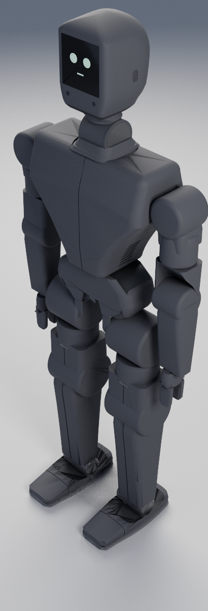
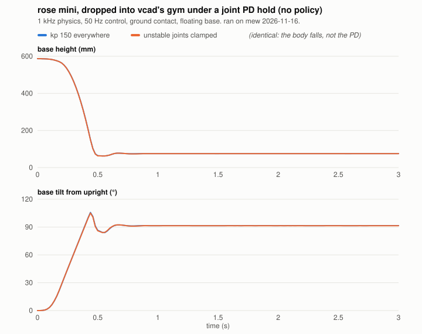

# build a robot from nothing — production plan

*video series #1 of the showcase trio (robot · open fusor · every physics in one object).
planning + proof of concept, 2026-11-16. nothing ordered, nothing published.*

the pitch: a blank vcad document becomes a walking robot, and every step happens in
vcad. actuators, structure, the board, the cut and printed parts, the gait. the
series ends with the robot walking out the door.

this doc is the honest version of that pitch. it says what vcad can do today, where
the chain breaks, which robot to build, and how long the critical path is.

**tl;dr**

- **robot: rose-mini legs (`rml-12`).** that's the lower half of rose-mini: 12 DOF, K1
  kinematics, RobStride QDDs, bent-aluminium plate frame, printed covers. arms and head
  are season 2. it's chosen because it reuses the Booster K1's joint layout and limits,
  and the K1 is the body our phyz stack knows best: vcad imports it and trains it to stand
  (`k1_stand`), and private sibling work goes further (see the redaction note at the end).
- **critical path to first walk: ~20 engineer-weeks, one person,** with hardware lead
  times run in parallel. realistic calendar: 5–6 months. assumptions are in §5.
- **top 3 blockers:**
  1. vcad can't train a gait. it has ARS only, a standing-only reward, and a policy that
     reads base velocity and height, which no real IMU measures.
  2. vcad has no path to hardware: no policy runtime, no motor-bus driver, no IMU or state
     estimator. "the same file drives the hardware" is 0% true today.
  3. the robot isn't sim-ready. rose-mini lives on a local-only branch. loon export drops
     the floating base, densities, effort limits and joint names. the PoC hand-patched
     the first three and worked around the names, and getting the spawn height right
     took two tries.

evidence tags used below: **[ran]** = executed on mew today (logs in
`robot-from-nothing/poc/logs/`), **[main]** = read on main @ `4ac21aab8`,
**[branch]** = unmerged or local-only branch, **[outside]** = sibling repos, not vcad
(rose is public; anything from private repos is redacted here, see the end of the doc).

---

## 1. feasibility audit

verdicts: ✅ works · 🟡 partial · ❌ missing.

### actuator / motor

| link | verdict | evidence |
|---|---|---|
| EM solver: BLDC Kt | 🟡 | [main] `crates/vcad-kernel-em` covers planar A_z with periodic slices, saturable B–H and torque two ways (`planar.rs` `torque_on_magnet`, `torque_stress_circle`), plus an adjoint. Kt for a real motor exists only as the hand-built `examples/motor_torque.rs`: 3.13 vs 3.70 mN·m/A shipped (`docs/em-m0.md`). Geometry is limited to rects and linear rings, and curved interfaces become staircases. |
| EM: cogging | ❌ | [main] no rotor-angle sweep. `vcad-kernel-magnetostatic` is air-core only, so its cogging is zero by construction. |
| EM ↔ CAD | ❌ | [main] MCP `simulate_em` takes a hand-written spec with no `document_id`. A `.vcad` stator can't be solved directly. |
| motor formula tools | ✅ | [main] `calc_motor`, `winding_layout`, `check_self_start` (`vcad-ecad-sim/src/motor.rs`), first-order: no slotting or saturation. [outside] the rana actuators (whose stator vcad's booleans already mill: `rana-60` in `crates/vcad-eval/src/evaluate.rs` notes) were designed against these, and are predicted, not yet dyno'd. |
| gearbox generator | ❌ | [main] involute `gear`, `spur-gear` and `ring-gear` exist in `lib/src/lib.loon`. there is no planetary, cycloidal or actuator assembly. |
| stator CAM | 🟡 | the whole end-to-end stator job (union seam, stocksim grading, heal gate) is on [branch] `claude/cam-roadmap` (579067fd8, 43a38c6eb, 9532d538f), not main. On [main], `vcad_cam_job` (`crates/vcad-ffi/src/cam_job.rs`) has face, pocket, profile and contour-with-tabs ops. it has no drilling op, and `roughing3d` isn't exposed. the stator test (`CNCOutlineTests.swift`) skips without `VCAD_STATOR_DXF`. |
| verify before cut | 🟡 | [main] `vcad_kernel_stocksim::verify_stock_against_mesh` grades vcad-generated toolpaths. it cannot verify an arbitrary `.nc` file. the copper stator's actual G-code check was `verify_nc.py`, which lives outside the repo. that's the check that caught inside contours offset into the part. |

### structural

| link | verdict | evidence |
|---|---|---|
| FEA on a part | 🟡 | [main] tets via voxel fill, PCG, a fail-closed 2-level convergence gate (`crates/vcad-kernel-fea`), MCP `analyze_structure`, and the app's `vcad_fea_solve`. thin walls fail closed toward `beam_check`. **[ran] on rose-mini's 3.2 mm shin plate: see §6.** |
| topology optimization | 🟡 | [main] SIMP + surface nets, MCP `topology_optimize`. the output is a frozen mesh part, so it can't feed sheet metal, CAM or STEP without re-modelling. |
| assembly / dynamic FEA | ❌ | [main] single part, linear static only. `docs/assembly-stress.md` is a perf test, not stress analysis. |

### electronics

| link | verdict | evidence |
|---|---|---|
| PCB ↔ enclosure co-design | ✅ | [main] `vcad-kernel-enclosure`, `check_enclosure_fit`, `board_from_solid` / `solid_from_board`. |
| autorouter + DRC + fab_prep | 🟡 | [main] router, DRC, `vcad fab-prep`, `export_gerber`. **but** [ran 2026-11-08 on mew, `~/Developer/foc-runs`] a 60×45 mm 4-layer FOC driver authored in loon (STM32G431 + FAN7388 + 6 MOSFETs) failed closed: 37 nets open, 11 proved infeasible, 31 unknown, no fab files. the gate behaved correctly. the router can't finish a dense power board yet. |
| motor driver design | ❌ | [main] parts only: STM32G4/H7, CAN-FD transceivers, TOLL FETs in `lib/parts/orderable.json`. there's no 3-phase driver reference. [outside] the FOC board above. |
| limb controller | 🟡 | [outside] `rose/electronics/limb-controller`: a CAN-FD board with an H723, hot-swap, brake chopper and watchdog. "robot mode" takes pos/vel/kp/kd/τff per joint per tick. its schematic is written in loon and exported by vcad; KiCad routes it. it was power-path simulated on `vcad_ecad_sim`. nothing has been fabbed. |

### manufacturing

| link | verdict | evidence |
|---|---|---|
| CAM + stocksim in the app | 🟡 | [main] `CamJobPanel.swift` does generate → verify → post (grbl, linuxcnc). agent-side `fab_mill` streams to a dry-run machine only. |
| Carvera Air control | ❌ | [main] `CNC.swift` is a Grbl-over-telnet streamer for the Anolex (Grbl_ESP32), and Carvera firmware isn't Grbl. project notes record a complete Carvera controller (port 2222, QuickLZ, Makera XMODEM), but it is **not in any branch, stash or worktree I could find**. treat it as lost or uncommitted. |
| Bambu P1S print | 🟡 | [main] `vcad slice` and `vcad print` (dry run unless `--confirm-print`), `vcad printer discover/status`, and the Swift PrintWorkbench. the MQTT CONNACK-hang fix is on unmerged [branch] `codex/p1s-connect` / `claude/p1s-print-e2e`. none of it was verified against hardware here. |
| sheet metal → SendCutSend | ✅ | [main] `flat_pattern_from_solid` returns DXF + bend table and fails closed on non-sheet parts. the SCS catalog is `sheet_json.rs`. upload is manual. |

### assembly

| link | verdict | evidence |
|---|---|---|
| joints in IR | ✅ | [main] Fixed / Revolute{limits, effort, velocity} / Slider / Cylindrical / Ball / Free (`crates/vcad-ir/src/lib.rs`). |
| joints from loon | 🟡 | [main] `crates/vcad-loon/src/convert.rs`: no Free joint; revolute `effort_limit` / `velocity_limit` are `None` (:512-513); ids come out as `joint_{idx}` (:503), so gains can't be keyed by name; material `density: None` (:70), which physics turns into 1000 kg/m³ for everything. |
| URDF in / out | 🟡 | [main] import works (the K1). export drops inertials and collisions and refuses extrude, loft and sweep (`vcad-kernel-urdf/src/writer.rs`), so it's unusable for rose. there is no MJCF export. |
| the robot itself | 🟡 | [branch, local-only] `rose-streamlined`: `hardware/rose-mini` (142 parts, 23 links, 22 revolutes) and `rose-full`. **not on main or any remote.** main has only `rose-pro` (joint-free plates). |

### sim

| link | verdict | evidence |
|---|---|---|
| `create_robot_env` / gym | ✅ | [main] MCP `create_robot_env`, `gym_step/reset/observe/close`, `record_simulation`. [ran] rose-mini with the float patch builds an env: floating base, 22 actions, 318-dim obs (§6). |
| contact | 🟡 | [main] ground plane only, PGS with a Coulomb cone (`world.rs:968`). "Body-body (robot self-) collision is not handled here yet" (`world.rs:84`). |
| actuator limits + PD gains | ✅ | [main] the effort clamp applies in every mode, including gravity feed-forward. per-joint `joint_gains`. `check_gain_stability` warns on ω·dt [ran: at kp 150 it flagged both ankle-roll and both upper-arm-rotation joints]. |
| motor model | ❌ | [main] ideal clamped PD: no torque-speed curve, no back-EMF, no armature (phyz has `armature`, vcad never sets it). |
| domain randomization | ✅ | [main] mass, friction, gain scale, latency, init pose/vel, observation noise (`vcad-kernel-physics/src/gym.rs`). |
| training | 🟡 | [main] ARS with linear or MLP policies (`vcad-sim/src/rl.rs`). the FFI `RewardSpec` (`vcad-ffi/src/train.rs:72`) is standing-only: alive, height, tilt, drift. **no locomotion task, no PPO, no gait clock anywhere in vcad.** the K1 *stands* (`k1_stand`, 394.87/400). |
| GPU batch | 🟡 | [main] `BatchSimPipeline` (AABB colliders, PD). `gpu_cpu_parity.rs` compares raw state on a contact-free floating arm only. nothing trains on it, there's no `vcad_batch_*` FFI, and MCP `batch_step` is a sequential CPU map. `docs/native-sim-m0.md` still says M3 "not started". |
| observation realism | ❌ | [main] `rl.rs:538` features include base linear velocity and base height. a real robot has neither without an estimator. |

### sim → real

| link | verdict | evidence |
|---|---|---|
| inside vcad | ❌ | [main] `.vcadpolicy` JSON weights load via `vcad_policy_load`. there's no ONNX or embedded exporter, no CAN/RobStride/Dynamixel code, no IMU, no serial/IOKit in the app, no calibration, no HIL. |
| outside vcad | 🔒 | [outside, private] redacted from this public doc. there is relevant private sibling work on phyz-trained K1 policies and real hardware; see the redaction note at the end. |

**where the chain breaks, bluntly:** design → sim works for a hand-patched
document. sim → walk doesn't exist in vcad (it stands, it doesn't walk). walk → hardware
doesn't exist in vcad at all. fab is real for printing and sheet metal, dry-run-only for the mill, and the
router can't finish a power board. the EM story is formula-grade plus a 2D slice, not
"solve the stator I just drew".

---

## 2. pick the robot

scored 1–5 (5 = best). "walk odds" means the chance that one person gets a real,
untethered walk out of it.

| option | DOF | walk odds | cost (actuators) | vcad on camera | notes |
|---|---:|---:|---:|---:|---|
| rose-mini, full humanoid | 22 | 2 | ~$4.0k | 5 | 18 kg, 22 joints, expensive falls. arms add nothing to a walk. |
| **rose-mini legs (rml-12)** | **12** | **4** | **~$2.6k** | **5** | **K1 kinematics and limits, so K1 gait recipes, gains and limits transfer. already authored in vcad. lighter than a K1 once the arms and head are gone.** |
| rose-full | 31 | 1 | >$8k | 5 | packing check BLOCKED (`rose/README`). no. |
| quad00 quadruped (rose repo, Go2 layout, RS00×12) | 12 | 5 | ~$2.1k | 3 | quadruped RL sim2real is the most forgiving. but the geometry is python/manifold in rose, not vcad, there's no proven recipe in our stack, and "walking out the door" on four legs reads smaller. |
| servo-scale biped/quad (Feetech STS3215) | 12 | 3 | ~$0.2k | 2 | position-only servos, no torque control. sim2real by brute force, and nothing for EM, FEA or PCB to do. |
| Unitree Go2 (URDF on main) | 12 | — | n/a | 1 | importing a robot defeats "from nothing". |

**pick: rml-12.** a quadruped is the safer walk. rml-12 wins because it reuses the K1's
joint layout and limits, the K1 is the body our phyz stack knows best, and K1-class
humanoid walking is a well-trodden RL recipe (velocity-command reward, gait clock,
proprioception + IMU). that turns "RL from scratch on a new body" into "re-fit a known
recipe to a lighter body". a biped walking out the door is also the shot that makes
the series.
**fallback if ep 6 sim can't produce a walk:** keep the RobStride order, and rebuild
the same 12 actuators as quad00 legs (§5).

**the home-made actuator:** the walk uses bought RobStride QDDs. the "actuator from
nothing" episode builds *one* home-made actuator (from the rana stator already cut in
copper) and dynos it against vcad's predicted Kt and torque-speed. it then goes into
one joint for a single on-camera test. that keeps the custom motor off the critical
path and keeps the EM episode honest.

### rough BOM (rml-12)

| item | qty | unit | total | source |
|---|---:|---:|---:|---|
| RobStride RS06 (hip pitch, hip roll, knee; 36 N·m peak) | 6 | ~$240 | ~$1,440 | reseller listings, unverified, 2026-11-16: [roboticscenter.ai](https://www.roboticscenter.ai/store/brand/robstride/), [rcdrone.top](https://rcdrone.top/collections/robstride) |
| RobStride RS02 (hip yaw; 17 N·m) | 2 | ~$160–190 | ~$380 | same |
| RobStride RS00 (ankle pitch, ankle roll; 14 N·m) | 4 | ~$160–185 | ~$740 | same |
| 3 mm 5052 plate frame, bent (SendCutSend) | ~30 parts | | ~$300–500 | estimate; get a DXF quote first |
| printed covers / soles (ASA, TPU) | | | ~$80 | filament |
| CAN controller: NUCLEO-H723ZG + 3× CAN-FD breakouts (limb-controller "now" plan) | 1 | | ~$80 | `rose/electronics/limb-controller/DESIGN.md` |
| RobStride discharge module or brake chopper | 1 | | ~$40 | same |
| IMU (BMI088 or similar) | 1 | | ~$20 | estimate |
| host compute: tethered laptop first, then a Pi 5 / Orin Nano onboard | 1 | | $0–$500 | |
| 13S Li-ion pack + BMS + e-stop | 1 | | ~$250 | estimate |
| gantry / harness for falls (2020 extrusion + rope) | 1 | | ~$150 | estimate |
| **total** | | | **~$3.5k–4.2k** | |

per-joint torque check: rose's sizing says the full 18 kg mini needs 33 N·m for a
single-leg 90° squat (`rose/README`). RS06 is 36 N·m peak / 8 continuous. that's tight
for the full humanoid, and should be comfortable for a legs-only body (a guess of
~10–12 kg; not yet measured). **re-run that
check in vcad (ep 3) before ordering.**

---

## 3. episode plan

| # | title | goal | vcad shown | physical milestone | risk |
|---|---|---|---|---|---|
| 1 | **the blank document** | set the rules: one file, one person. show the target and the plan | loon authoring, live viewer, render, gym drop-test of rose-mini (it falls) | none: a pile of nothing on a bench | low |
| 2 | **a motor from a stator** | design and cut one actuator; predict Kt, then measure it | `calc_motor`, `winding_layout`, EM slice solve, stator CAM, stocksim verify, Carvera cut | one wound actuator on a dyno: predicted vs measured Kt and torque-speed | **high**: no EM-from-CAD, no Carvera control on main, cogging unmodelled. hedge: rana/RS00 teardown comparison |
| 3 | **legs that don't break** | size the frame | plate frame in loon, FEA on shin and thigh (or `beam_check` when it fails closed), topology study on the hip bracket, torque/packing check, mass properties | none; the parts list gets locked | medium: the 3 mm plates fail FEA's thin-wall gate (§6), so this is a `beam_check` episode, plus a fix to the FEA gate if it's in scope |
| 4 | **cut, bend, print** | make the frame | `flat_pattern_from_solid` → SendCutSend DXF, P1S slicing and print of covers and soles, Carvera for the hip blocks | a standing (unpowered) skeleton on a bench | medium: P1S connect fix unmerged; Carvera dispatch missing |
| 5 | **the nervous system** | power + CAN + IMU into a body | limb-controller schematic in loon → vcad export, enclosure co-design (`check_enclosure_fit`), power-path sim, autorouter + `fab_prep` receipt | joints spinning on command from a laptop over CAN | **high** if the board must be vcad-routed (the router fails closed on dense power, §1). hedge: NUCLEO + breakouts for the walk; the vcad-routed board is its own beat |
| 6 | **learning to walk (in sim)** | a gait policy for rml-12 in vcad's gym | gym, domain randomization, PPO trainer (to be ported), gait clock, motor model, rollout replay in the app | none, all sim: rml-12 walking in the viewer | **high**: the trainer doesn't exist in vcad yet (§5 critical path) |
| 7 | **hanging tests** | sysid + first powered motion | gym sysid fit (inertial and actuator parameters by gradients through phyz), PD-gain match, latency measurement | robot on the gantry: stand, squat, march in place | medium |
| 8 | **first steps** | untethered walking on flat floor | same `.vcad` drives sim and hardware; telemetry overlay of sim vs real | 10 steps without the gantry | **high**: the classic sim2real gap; budget 2–3 weeks of iteration |
| 9 | **out the door** | the shot | the whole file in one frame: CAD, FEA, board, policy | rml-12 walks out the front door | medium (if ep 8 landed) |

### episode 1 shot list (detailed)

the episode is about 12 min. tone: calm, a one-person workshop, no hype. every number
on screen comes from a log.

1. **cold open (0:00–0:30).** black. a cursor in an empty vcad window. VO: "this
   document is empty. at the end of this series, it walks out that door." hard cut to
   the door, static, 3 s.
2. **the rules (0:30–1:30).** desk shot. three cards on the table, each drawn in vcad
   and printed on the P1S: *one file. one person. no vendor CAD.* VO lists what "from
   nothing" means: motors, frame, board, gait. what's bought (bearings, magnets, the
   RobStride QDDs for the walk) gets said out loud.
3. **the target (1:30–3:00).** the Booster K1 in vcad: imported, standing in the gym
   under the shipped `k1-stand` policy, shoved and recovering. VO: "vcad can make a
   robot stand. somebody else built this one's body, and it doesn't walk yet. this time
   we build the body, and we teach it to walk." (if the private K1 work is cleared to
   show, real-hardware footage goes here instead; see the redaction note.)
4. **the body, on paper (3:00–5:00).** screen. rose-mini in vcad, built up link by link
   (time-lapse of `rose-mini.loon` evaluating). then the cut: arms and head fade out,
   leaving rml-12. the joint table rolls in from `rose-mini.joints.json`: 12 joints,
   limits, actuator per joint. **teaser asset: `robot-from-nothing/rose-mini-iso.png`.**
5. **the drop test (5:00–7:00).** the money shot of the episode. rose-mini dropped into
   vcad's gym, holding its zero pose with a plain joint PD, no policy. it tips straight
   backward and lands on its back in 0.6 s. overlay: the trace from §6 (base height and tilt vs time,
   `robot-from-nothing/rose-mini-hold.svg`). VO: "this is what 'designed' gets you.
   everything after this episode is about closing that gap."
6. **the honest map (7:00–9:30).** whiteboard, or the §1 audit table animated: green,
   yellow, red per link. call out the three reds that matter: the gait trainer, the
   hardware bridge, the sim-ready model. show the critical path as a timeline.
7. **the bill (9:30–10:30).** BOM on screen, with the actuator price flagged as a
   reseller quote. a price tag for the whole robot.
8. **what's next (10:30–11:30).** the copper stator already cut, in hand. "next
   episode: we turn this into a motor and find out if the math was right."
9. **end card (11:30–12:00).** the door again, robot-shaped outline.

b-roll needed: the empty desk, the door, the copper stator in hand, a RobStride box,
mew's terminal running the gym (real logs), the P1S printing the rule cards.

---

## 4. sim-to-real plan

**architecture (the standard impedance-mode humanoid stack):**

```
          vcad document (rml-12.vcad)  ──►  gym (phyz)  ──►  PPO  ──►  policy.vcadpolicy
                     │                                                    │
                     │ joint table, limits, gains, motor model            │
                     ▼                                                    ▼
host (laptop → Pi 5/Orin) : vcad-runtime ── 50 Hz ──► policy inference ── joint targets
                     │         ▲  IMU (gyro, gravity) + joint pos/vel + contact-based velocity estimate
                     ▼         │
       CAN-FD ×2 ── NUCLEO-H723 (limb-controller fw, "robot mode": pos/vel/kp/kd/τff per joint per tick)
                     │
              RobStride RS06/RS02/RS00 (own FOC, MIT-style impedance mode)
```

- **controller board:** the limb-controller's "robot mode" contract (pos, vel, kp, kd,
  τff per joint per tick; the board adds safety, does no kinematics). for the walk, use
  the doc's own "now" plan: a NUCLEO-H723ZG with three CAN-FD breakouts and the
  RobStride discharge module. the vcad-routed limb board becomes ep 5's beat and an
  upgrade, not a dependency.
- **firmware:** a small Rust (embassy) or C (STM32Cube) image: two FDCAN buses, the
  RobStride private protocol (MIT mode), a hardware watchdog, e-stop, USB-CDC or
  Ethernet to the host. this lives outside vcad. it only has to honor the joint
  table vcad emits.
- **motor drivers:** inside the RobStride units. that's the biggest reason to buy them.
- **policy runtime:** the host runs inference at 50 Hz, with the gait clock appended to
  every observation frame, reading `.vcadpolicy`.

**what vcad must build for "the same file drives the hardware" to be true:**

1. **a hardware manifest in the document**: per-joint motor model, CAN bus/id, sign,
   zero offset, gear ratio, kp/kd, and the IMU's mount frame. that means joint metadata
   in the IR, authored in loon. sim reads it for the motor model; the runtime reads it
   for the bus map. one file.
2. **`vcad run <doc> --policy p.vcadpolicy --hw can0`**: a runtime that loads the doc,
   builds the same observation vector as `rl.rs` (minus non-measurable terms), runs
   inference and writes joint targets. with `--hw sim` it runs the gym instead, so the
   same binary covers both.
3. **observation contract**: drop base linear velocity and height from policy inputs,
   or estimate them (e.g. a contact-based velocity estimate). the gym trains on exactly
   what the runtime can produce.
4. **sysid loop**: log real joint and IMU traces in the gym's units, replay them in sim,
   and fit masses, armature, friction and latency by phyz gradients. write the fitted
   values back into the doc.
5. **calibration**: a zero-pose procedure that writes offsets into the manifest.

---

## 5. gap list (ranked) + critical path

sizes: S ≤ 1 wk · M 1–3 wk · L 3–6 wk. one engineer; "wk" = engineer-week.

| rank | gap | size | on critical path? |
|---:|---|---|---|
| 0 | land `rose-streamlined` (rose-mini/full) on main; derive rml-12 | S | yes |
| 1 | **locomotion training in vcad**: a PPO walk env (gait clock, velocity-command reward, measurable-only obs, estimator), generic over any `.vcad`. port from private sibling work where possible | L (4 wk) | **yes** |
| 2 | **runtime + hardware manifest**: `vcad run`, joint→CAN map in IR/loon, observation contract | M (3 wk) | **yes** |
| 3 | **loon physics metadata**: Free base, densities, effort/velocity limits, joint ids = names (`convert.rs:70,503,512`) | S (1 wk) | **yes** |
| 4 | motor model in the gym: torque-speed, armature, from the RobStride datasheets | S (1 wk) | yes |
| 5 | firmware: NUCLEO-H723, 2× CAN-FD, RobStride MIT mode, watchdog, e-stop | M (2 wk) | **yes** |
| 6 | sysid + sim2real iteration (gantry, gain match, latency) | L (4 wk) | **yes** |
| 7 | FEA thin-wall path for 3 mm plates (shell elements, or accept `beam_check`) | M | no (ep 3) |
| 8 | self-collision in contact (feet/shins) | M | no (only if the gait crosses its legs) |
| 9 | router finishing a dense power board (FOC / limb controller) | L | no (ep 5 beat) |
| 10 | Carvera Air control: recover or rewrite and commit | M | no (ep 2/4; SendCutSend covers the frame) |
| 11 | EM from a `.vcad` stator + cogging sweep | M | no (ep 2) |
| 12 | P1S connect fix merge + real-printer verify | S | no |
| 13 | topopt → B-rep / sheet path | L | no |
| 14 | GPU batch training (`vcad_batch_*`, CPU/GPU contact parity) | L | no; CPU training should be enough for 12 DOF |

**critical path to first walk** (one person, so engineering steps are serial; only
vendor lead times overlap):

| wk | engineering (serial) | waiting on vendors (parallel) |
|---|---|---|
| 0–1 | land rose-mini + loon physics metadata (gaps 0, 3) | order actuators (lead ~2–4 wk) |
| 1–3 | derive rml-12; balanced zero pose; motor model (gap 4); torque + `beam_check` | order plates once frozen (SCS ~1–2 wk) |
| 3–7 | PPO walk trainer in vcad-sim; rml-12 walks in sim (gap 1) | parts arrive |
| 7–9 | frame assembly, cover/sole printing, wiring harness | |
| 9–11 | firmware bring-up (gap 5) | |
| 11–14 | runtime + manifest (gap 2) | |
| 14–15 | integration: joints move from the policy on the gantry | |
| 15–19 | sysid + sim2real iteration (gap 6) | |
| 19–20 | untethered walk, door shot | |

**≈ 20 engineer-weeks** (1 + 2 + 4 + 2 + 2 + 3 + 1 + 4 + 1). vendor lead times
(actuators, plates) fit inside wk 0–7. assumptions: RobStride stock is available; a K1
walk recipe ports to rml-12 without a research detour; one fab iteration of the frame;
no custom actuator in the walking robot; non-critical episodes (EM, router board,
Carvera) are filmed alongside, not on this path. the risk-adjusted calendar is 5–6
months. the biggest swing items are gap 1 (if the recipe doesn't transfer to a lighter
body, add 2–4 wk) and gap 6.

---

## 6. proof of concept (ran on mew, 2026-11-16)

everything below was executed on `mew` against `origin/main` @ `4ac21aab8`, with
rose-mini copied from the local `rose-streamlined` branch. commands and raw output are
in `robot-from-nothing/poc/logs/`. mew was at load ~118 the whole time, so **no
timings are quoted.**



*teaser asset: rose mini, `vcad-render --photoreal`. the render is committed on
`rose-streamlined` (867686b66) and copied here. a fresh 1600 px iso render on mew was
still running after 40 min at load ~118, so it was abandoned; see the note in step 1.*

**step 1: load. [ran] ✅ (with a CLI quirk)**

`vcad export hardware/rose-mini/rose-mini.loon` → `rose-mini.vcad`: 1639 nodes, 15
materials, 142 instances, 141 joints (119 fixed welds + 22 revolute), ground
`cover-chest_i` (`poc/logs/01-export-info.log`). `vcad info` then reports
**"Total triangles: 0"** for a 142-instance assembly (the document has no `roots`, only
instances; probably `info` counts roots only — not traced to source). a small CLI bug
worth fixing before it ends up on camera. evaluating the assembly
spends most of its time in two `SweepRotate`+`Difference` relief cuts. that's
cache-warm on a second run, and a cold-render cost to know about.

**step 2: make it simulable. [ran] 🟡, needed a hand patch**

`poc/float_rose_mini.py` adds what loon can't express (gap 3):
- a world instance and a Free joint on the chest, anchored at the torso origin
  (587.153 mm in `rose-mini.joints.json`'s soles-on-z=0 frame) + 2 mm, so it drops
  onto its soles;
- handbook densities per material;
- RobStride peak torques as effort limits (RS06 36 / RS02 17 / RS00 14 N·m).

this took three tries. anchored at z=0, the robot spawned 546 mm *under* the floor and
sat frozen. anchored at 548 mm (read off a foot instance whose origin is the ankle
pivot, not the sole), the soles started 39 mm inside the floor. a good example of why
the base pose belongs in the authored file, not a patch.

**step 3: drop it into the gym. [ran] ✅ env, ❌ stands**

`crates/vcad-sim/examples/rose_mini_hold.rs` builds the env with a floating base, 22
actions, 318-dim observations and ground contact, then holds the zero pose with a joint
PD for 3 s (1 kHz physics, 50 Hz control). at kp 150 `check_gain_stability` flagged
both ankle-roll and both upper-arm-rotation joints (ω·dt 0.46–0.56, limit ~0.3), so it
ran twice: blanket kp 150, and the flagged joints clamped to 80% of their stable kp
(34.7–50.8).



| t (s) | base z (mm) | tilt (°) | base x (mm) | ankle-pivot z (mm) |
|---:|---:|---:|---:|---:|
| 0.02 | 587 | 0.0 | 0 | 40.7 |
| 0.10 | 584 | 3.4 | −8 | 39.7 / 40.4 |
| 0.22 | 552 | 35.0 | −79 | 108 |
| 0.42 | 206 | 99.4 | −239 | 297 |
| 0.62 | 73 | 90.6 | −307 | 125 |
| 3.00 | 75 | 91.5 | −306 | 127 |

(stable-gain run, `poc/data/trace-hold-stable-gains.csv`; the kp-150 run tracks it
within ~2 mm and 0.6° up to the fall and settles 13 mm apart on its back.)

the soles settle about 1 mm onto the floor (ankle pivot 40.7 → 39.7 mm), so the spawn is
clean. then the robot rotates straight backward (−x) from the first control steps,
lifts its toes by 0.12 s, and lands on its back by ~0.6 s. it does this identically
with or without the gain clamp, so it's the body, not the integrator. the rotation is
already accelerating at t = 0. that points at gravity having a lever arm from the
start: either **the zero-pose COM sits behind the soles** (the pack is on the back,
and densities are handbook guesses), or the joint PD can't hold the ankle against it.
**this run doesn't separate the two.** that's the first job of ep 3: compute the
COM from the physics model, check it against the support polygon, then find a
statically balanced pose before any policy. it's also ep 1's money shot.

**step 4: FEA on a leg link. [ran] ❌, fails closed (correctly)**

`crates/vcad-ffi/examples/fea_request.rs` drives the app's `vcad_fea_solve` path on
two plates pulled out with `poc/extract_part.py`. load case: 18 kg robot, single
stance, 3 g, split over two plates, so 265 N axial + 80 N fore-aft at the foot end,
fixed at the knee end, 5052-H32 (E 70.3 GPa, yield 193 MPa).

| part | size | result |
|---|---|---|
| `shin-outer_ll` | 92 × 3.2 × 323 mm | **refused.** 3.20 mm wall, 0.9 cells through it at the finest level; needs resolution 607 vs the 192 cap. routes to `beam_check`. |
| `thigh-outer_ll` | 87 × 3.2 × 115 mm | **solved but not converged** (2.7 cells through the wall). σ_vm 77 MPa and δ 0.11 mm are reported, with no safety factor claimed. |

(`poc/data/fea-*-result.json`.) this is the right behavior: vcad won't hand you a
number off a staircased 3 mm plate. it does mean ep 3 is a `beam_check` / shell-element
episode, not a voxel-FEA one. a **hand check (not a vcad run)** for scale: the shin
plate's Euler buckling about its weak axis is P_cr ≈ 1.67 kN pinned–pinned (SF ≈ 6.3
against 265 N), or ≈ 0.42 kN fixed–free (SF ≈ 1.6). the stiffening web between the
inner and outer plates is what keeps it near the first number. verify it on camera with
`beam_check`.

**not run:** the K1 shipped-policy test (`crates/vcad-ffi/tests/k1_sample.rs`). the gym
already built and stepped a floating 22-DOF body above, and the K1 test would only
re-prove the standing case. the GPU batch path wasn't touched either (mew's GPU was in
use by other jobs).

### what the PoC proves and doesn't

- proves: a vcad-authored humanoid goes from loon → `.vcad` → a gym env with a
  floating base, 22 actuated joints and ground contact, and vcad's FEA either answers or
  refuses with a reason on the real plate parts.
- doesn't prove: anything about walking. no policy was trained. the gains are one
  blanket value. densities are handbook guesses. RobStride velocity limits are
  placeholders. **rml-12 does not exist as a file yet.** it's rose-mini minus arms and
  head, and its derivation is gap 0.

reproduce:

```bash
# on mew, in a checkout with rose-mini (rose-streamlined branch)
cargo build --release -p vcad -p vcad-render --features vcad-render/cli --bins
cargo build --release -p vcad-sim --example rose_mini_hold
cargo build --release -p vcad-ffi --example fea_request
vcad export hardware/rose-mini/rose-mini.loon out/rose-mini.vcad
python3 docs/videos/robot-from-nothing/poc/float_rose_mini.py out/rose-mini.vcad out/rose-float.vcad
target/release/examples/rose_mini_hold out/rose-float.vcad hold > trace-hold.csv
python3 docs/videos/robot-from-nothing/poc/extract_part.py out/rose-mini.vcad shin-outer_ll out/shin.vcad
target/release/examples/fea_request out/shin.vcad docs/videos/robot-from-nothing/poc/fea-shin.json
```

---

## redaction note

this doc lives in a public repo. two sibling repos it draws on are private, so their
specifics are left out here: phyz-trained K1 policy results on real hardware and the
deploy stack behind them, and the rana actuator's design numbers and BOM. the full
findings sit in the planning session's shared notes (outside the repo). they materially
strengthen §1 (sim → real), §2 (why rml-12) and the ep 1 cold open, so un-redact them
only on Cam's say-so.
