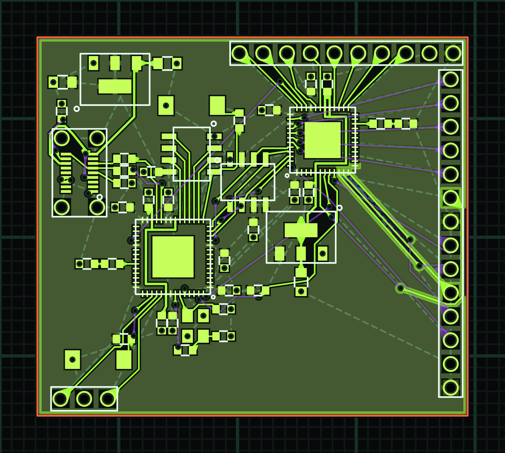

# ice-viz — iCE40UP5K + RP2040 FPGA dev board

A pico-ice-style starter FPGA board designed entirely through the vcad MCP
tools: Lattice iCE40UP5K-SG48 with an RP2040 as on-board USB-C programmer
(shared SPI bus to the W25Q32 bitstream flash, CRESET/CDONE under RP2040
control — drag-and-drop UF2 programming, no external programmer), a 14-pin
header matching the common 2.8" ILI9341 SPI display breakout (+ XPT2046
touch), SWD header, and 8 spare FPGA IOs. 46×40.5 mm 2-layer (GND pour on the
back, 3V3 pour on the front), JLCPCB-compatible rules, DRC-clean.

- `ice-viz.vcad` — the parametric source; reopen with the MCP `load_document`
  tool or vcad.io to edit and re-export.
- `fab/` — gerber/drill/BOM/pick-and-place bundle plus editable KiCad 9
  exports (`ice-viz.kicad_sch`, `ice-viz.kicad_pcb`).
- `layout/` — the floorplan (`layout.mjs`: placements plus the hand pre-routes
  for the two core supplies) and `relayout.mjs`, which replays it through the
  MCP server (`set_placement` → `route_nets` → DRC → export) and regenerates
  `ice-viz.vcad` and `fab/` byte-for-byte: `node layout/relayout.mjs`.

Before ordering: verify the iCE40 SG48 and RP2040 pin maps against the
datasheets, and eyeball the parametric USB-C/QFN land patterns in KiCad.
